# Arquitectura de iworkflow

> 🇬🇧 English version: [ARCHITECTURE.md](ARCHITECTURE.md)

Guía para leer el código de iworkflow, pensada para alguien con experiencia sólida en Java que está aprendiendo Rust. Si llegas nuevo, empieza por el [Glosario rápido](#glosario-rápido) y la [ruta de lectura](#12-ruta-de-lectura-recomendada). Sigue el orden en que conviene leer el código: primero el mapa general, después el arranque, un *slice* completo (`tasks`) y, por último, el resto de módulos.

> Los diagramas usan [Mermaid](https://mermaid.js.org/) (GitHub y la mayoría de editores lo renderizan). Las rutas de fichero son relativas a la raíz del repositorio. Las reglas de estilo y de proceso del proyecto están en [AGENTS.md](AGENTS.md); este documento explica **cómo está construido**, no cómo contribuir.

## Índice

1. [Qué hace la aplicación](#1-qué-hace-la-aplicación)
2. [Rust para un desarrollador Java](#2-rust-para-un-desarrollador-java)
3. [Stack y compilación dual `ssr` / `hydrate`](#3-stack-y-compilación-dual-ssr--hydrate)
4. [Estructura del código](#4-estructura-del-código)
5. [Arranque y raíz de composición](#5-arranque-y-raíz-de-composición)
6. [Anatomía de un slice: `tasks`](#6-anatomía-de-un-slice-tasks)
7. [Flujos de extremo a extremo](#7-flujos-de-extremo-a-extremo)
8. [Persistencia](#8-persistencia)
9. [Frontend: Leptos y Signals](#9-frontend-leptos-y-signals)
10. [Resto de módulos](#10-resto-de-módulos)
11. [Estrategia de tests](#11-estrategia-de-tests)
12. [Ruta de lectura recomendada](#12-ruta-de-lectura-recomendada)

También: [Glosario rápido](#glosario-rápido) · [Rust para desarrolladores Java](docs/rust-for-java.es.md)

---

## Glosario rápido

| Término | Significado en este repo |
|---|---|
| **Slice / feature** | Directorio bajo `modules/` con sus propias capas |
| **Puerto** | Trait que define lo que el dominio necesita (outbound) u ofrece (inbound) |
| **Adaptador** | Implementación concreta de un puerto (Diesel, `git`, proceso, FS) o punto de entrada (server fn, SSE, WS) |
| **Caso de uso** | `struct` con `execute()`; una acción de usuario o de sistema |
| **Contexto (`XxxContext`)** | Struct con los casos de uso de un feature, inyectado con `provide_context` |
| **Bridge** | Adaptador en `app_state.rs` que conecta dos features sin que se importen entre sí |
| **Worktree** | Copia de trabajo git aislada por tarea, en `~/.iworkflow/worktrees` |
| **Sink** | Receptor de eventos del agente (`AgentEventSink`) |
| **SSR / hidratación** | El servidor renderiza HTML; el WASM lo "activa" en el navegador sin volver a pintarlo |
| **DTO** | Tipo serializable que cruza cliente ↔ servidor; el dominio nunca viaja |

---

## 1. Qué hace la aplicación

iworkflow es un ADE (Agentic Development Environment) para lanzar, orquestar y revisar agentes de código (`gentle-shell`, `pi`, `claude` o `cursor`) mediante un protocolo RPC. El agente concreto queda detrás de un puerto (`AgentRuntimePort`), de modo que el dominio no sabe qué agente ni qué transporte hay debajo ([§6.7](#67-abstracción-del-runtime-de-agentes)). Cada **tarea** se ejecuta en su propio **git worktree**; al terminar, el usuario revisa el diff y decide si integrar (`merge --no-ff`) o descartar.

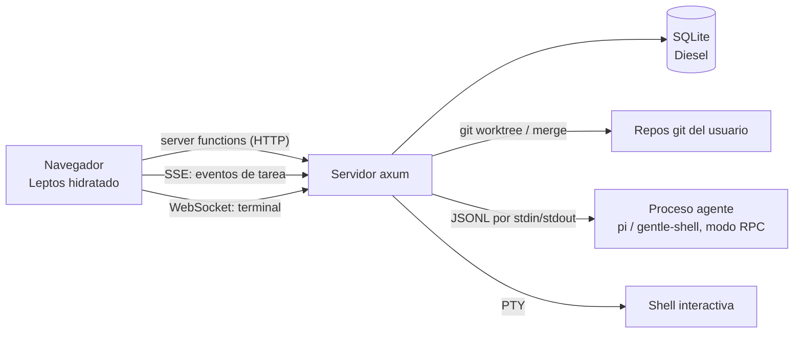

Es un único binario Rust que sirve el HTML (SSR), el bundle WASM, las *server functions*, un endpoint SSE y un WebSocket.

Ciclo de vida de una tarea (la máquina de estados vive en `src/modules/tasks/domain/models/task.rs`):

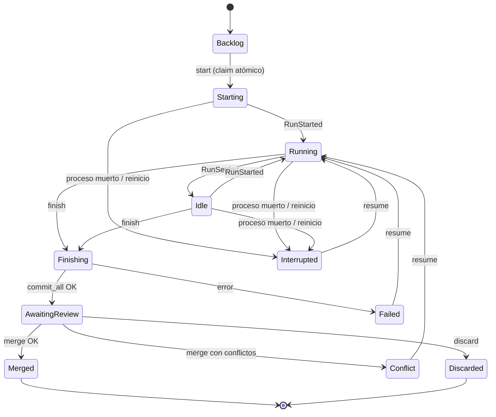

Las transiciones se validan con métodos del propio enum (`can_start`, `can_finish`, `can_merge`, …), no con `if` dispersos por los casos de uso.

---

## 2. Rust para un desarrollador Java

La tabla de equivalencias Java ↔ Rust y los conceptos sin equivalente directo (ownership, `Arc`, `Send + Sync`, macros…) están en [docs/rust-for-java.es.md](docs/rust-for-java.es.md). Échale un vistazo primero si vienes de Java.

---

## 3. Stack y compilación dual `ssr` / `hydrate`

| Pieza | Tecnología |
|---|---|
| Lenguaje | Rust (edición 2024) |
| UI + servidor | [Leptos](https://leptos.dev) 0.8 (SSR + hidratación, reactividad con *signals*) sobre `axum`, orquestado por `cargo-leptos` |
| Persistencia | Diesel + `diesel-async` (`SyncConnectionWrapper<SqliteConnection>`) + pool `deadpool`, SQLite embebido (`libsqlite3-sys` bundled) |
| Migraciones | `migrations/` (Diesel), embebidas con `embed_migrations!` y aplicadas al arrancar |
| Estilos | Tailwind CSS (`style/tailwind.css`) |
| Procesos / PTY | `tokio::process`, `portable-pty` |
| Tests | `cargo test`, `mockall`, `tempfile`, Playwright para e2e |

### Un crate, dos binarios

Leptos compila el mismo crate **dos veces**:

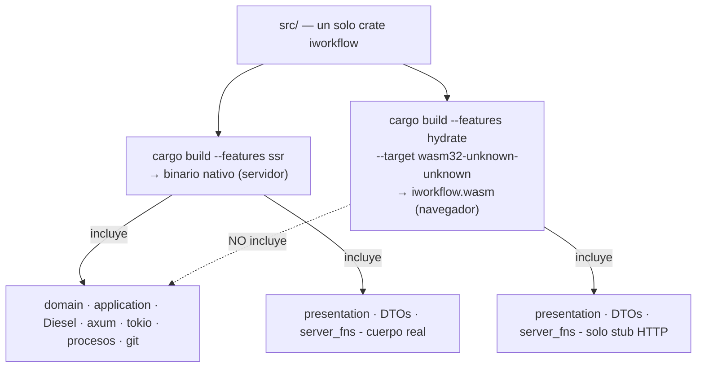

Configuración en `Cargo.toml`:

```toml
[features]
hydrate = ["leptos/hydrate", "dep:console_error_panic_hook", "dep:wasm-bindgen", "dep:web-sys", "dep:js-sys"]
ssr = ["dep:axum", "dep:tokio", "dep:diesel", "dep:diesel-async", "leptos/ssr", /* ... */]

[package.metadata.leptos]
bin-features = ["ssr"]      # el binario del servidor se compila con ssr
lib-features = ["hydrate"]  # la librería WASM se compila con hydrate
```

Las dependencias del servidor son `optional = true` y solo las activa `ssr`: **Diesel y tokio nunca llegan al bundle WASM**. La regla se aplica en el código con `#[cfg(feature = "ssr")]`. Mira `src/modules/tasks/mod.rs`:

```rust
#[cfg(feature = "ssr")]
pub mod application;     // casos de uso: solo servidor
#[cfg(feature = "ssr")]
pub mod domain;          // dominio: solo servidor
pub mod infrastructure;  // existe en ambos (DTOs y server fns), pero por dentro filtra
#[cfg(all(test, feature = "ssr"))]
pub mod mocks;
pub mod presentation;    // UI: en ambos
```

Consecuencia importante: **el cliente WASM no conoce el dominio**. Por eso los tipos que cruzan la red son DTOs en `infrastructure/adapters/inbound/dto/`, compilados en ambas features. El `TaskStatusDto` duplica a propósito el enum `TaskStatus` del dominio (y hasta replica `has_live_agent`), y la conversión `From<Task> for TaskDto` está dentro de un bloque `#[cfg(feature = "ssr")]`.

### Qué es una *server function*

```rust
#[server]
pub async fn get_task(id: String) -> Result<TaskDto, ServerFnError> { /* cuerpo solo servidor */ }
```

La macro `#[server]` genera **dos** cosas: en el servidor, el endpoint HTTP con el cuerpo real; en el cliente, un *stub* con la misma firma que hace un `fetch` al endpoint. Desde un componente se llama como una función async normal. Es el equivalente a un controlador REST + un cliente generado, sin escribir ninguno. En términos de arquitectura hexagonal, **es el adaptador inbound**.

---

## 4. Estructura del código

```text
src/
├── main.rs            # arranque axum (solo ssr)
├── lib.rs             # entrada WASM (hydrate) + declaración de módulos
├── app.rs             # <App>, shell HTML, rutas del router
├── app_state.rs       # RAÍZ DE COMPOSICIÓN: agrupa contextos y puentes entre features
├── core/              # transversal; NO puede importar de modules/
│   ├── config.rs      # AppConfig (variables de entorno IWF_*)
│   ├── db/            # pool.rs (DbPool, migraciones), schema.rs (generado por Diesel)
│   ├── http/          # límite de cuerpo de las server functions
│   ├── dock/          # espacio de trabajo con pestañas y grupos divisibles (layout, arrastre, reordenación)
│   ├── line_diff.rs   # diff de líneas puro (marcas del margen del editor)
│   ├── git.rs, env.rs # utilidades sin dominio
│   └── components/    # componentes UI base (modal, toast, select, shell, ...)
└── modules/           # un directorio por feature (vertical slice)
    ├── tasks/         # el núcleo: tareas, worktrees, agentes, eventos
    ├── workspaces/    # repositorios git registrados
    ├── terminal/      # terminales PTY por WebSocket
    ├── agent_settings/# modelo/perfil/runtime/thinking globales
    ├── agent_profiles/# perfiles y enrutado de roles/modelos de los agentes
    ├── project_tree/  # explorador de ficheros y editor (workspace o worktree de tarea), estado git
    ├── agents_files/  # ficheros AGENTS.md reutilizables
    ├── code_hosting/  # MR/PR, CI y merge contra GitLab o GitHub (proveedor detectado por origin)
    └── jira/          # importación desde Jira Server/DC y conversión en tareas
```

### Corte vertical + capas hexagonales

Cada feature contiene **todas** sus capas. Dentro de cada una, las dependencias solo apuntan hacia el centro:

```text
modules/<feature>/
├── domain/            # Rust puro: modelos, errores (thiserror), PUERTOS (traits)
│   ├── models/
│   ├── errors/
│   └── ports/{inbound,outbound}/
├── application/       # casos de uso: un struct por acción con método execute()
│   └── usecases/
├── infrastructure/    # adaptadores técnicos
│   ├── adapters/inbound/{dto/, server_fns.rs [, sse.rs | ws.rs]}
│   ├── adapters/outbound/{persistence/, git/, runtime/, fs/, ...}
│   └── di/<feature>_context.rs     # cablea puertos ↔ adaptadores ↔ casos de uso
├── presentation/      # UI Leptos
│   ├── state/         # signals / Resources / Actions de una pantalla
│   ├── pages/
│   └── components/
└── mocks.rs           # mocks mockall de los puertos (solo #[cfg(test)])
```

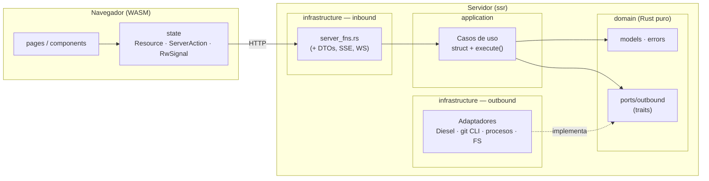

Reglas de dependencia (equivalentes a ArchUnit en Java, pero aquí por convención y revisión):

- `domain` y `application` **no** importan `leptos`, `diesel`, `axum`, ni nada de `infrastructure` / `presentation`.
- Un caso de uso depende de **traits** (`Arc<dyn TaskRepositoryPort>`), nunca de adaptadores concretos.
- Las queries Diesel solo existen en `infrastructure/adapters/outbound/persistence/`.
- `core/` no importa nada de `modules/`. Un feature no importa a otro: se comunican por puertos y puentes en `app_state.rs`.

---

## 5. Arranque y raíz de composición

### `src/main.rs`

Es el equivalente a la clase `@SpringBootApplication` + la configuración de beans. Secuencia, en orden:

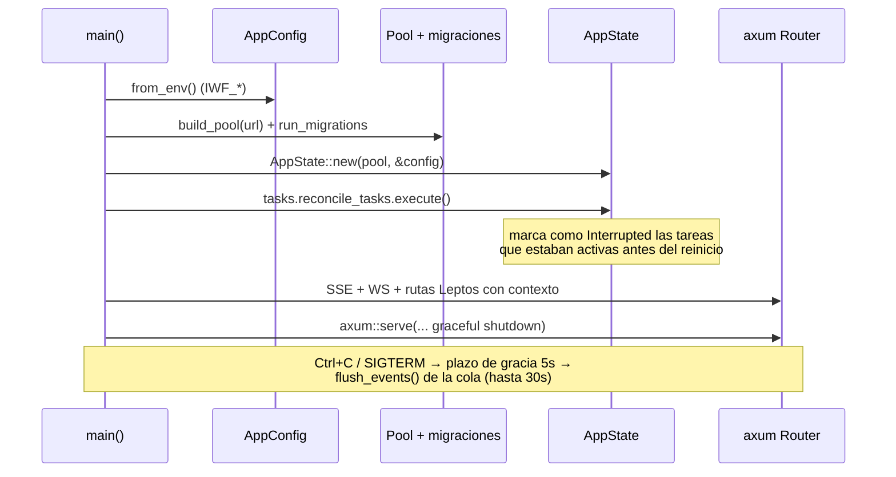

Detalles útiles para leerlo:

- `#[tokio::main] async fn main()` arranca el runtime asíncrono (en Java sería el contenedor/servidor embebido).
- En `main.rs` sí se permite `expect()`/`panic!` (AGENTS.md lo autoriza solo en el arranque): si la configuración o las migraciones fallan, no tiene sentido continuar.
- Los routers SSE (`task_events_router`) y WebSocket (`terminal_ws_router`) se montan con `.merge(...)` junto al router de Leptos.
- `leptos_routes_with_context(..., move || context_state.provide(), ...)` es el punto donde se **inyectan** los contextos: esa closure se ejecuta por cada petición y llama a `provide_context` para cada feature.
- El cierre ordenado importa: los eventos del agente se encolan en memoria (ver [§7.2](#72-eventos-del-agente-el-pipeline-más-importante)) y `flush_events()` espera a que se persistan antes de salir.

### `src/app_state.rs` — la raíz de composición

```rust
#[derive(Clone)]
pub struct AppState {
    pub workspaces: WorkspacesContext,
    pub tasks: TasksContext,
    pub agent_settings: AgentSettingsContext,
    pub agents_files: AgentsFilesContext,
    pub terminal: TerminalContext,
}

impl AppState {
    pub fn provide(&self) {
        provide_context(self.workspaces.clone());
        provide_context(self.tasks.clone());
        // ...
    }
}
```

**Inyección de dependencias sin framework.** No hay contenedor IoC con reflexión. El patrón es:

1. Cada feature expone un `XxxContext` (struct con sus casos de uso ya construidos como `Arc<UseCase>`), en `infrastructure/di/<feature>_context.rs`.
2. `AppState::new` construye los contextos en el orden adecuado.
3. En cada petición, `provide()` los registra en el **contexto de Leptos** (`provide_context`).
4. Las server functions los recuperan con `use_context::<TasksContext>()`.

Piensa en `provide_context` / `use_context` como un `ApplicationContext` ligero y tipado por clase.

### Los *bridges*: cómo se hablan los features sin acoplarse

Un feature **no puede importar otro**. Cuando `tasks` necesita saber qué workspace tiene una tarea, define un **puerto propio** y `app_state.rs` lo implementa con un adaptador ("bridge") que usa los casos de uso de `workspaces`:

```rust
/// Expone los workspaces al feature de tareas a través de su propio puerto.
pub struct WorkspaceLookupBridge {
    pub get_workspace: Arc<GetWorkspace>,
    pub list_workspaces: Arc<ListWorkspaces>,
}

#[async_trait::async_trait]
impl WorkspaceLookupPort for WorkspaceLookupBridge {   // puerto definido en tasks/
    async fn find(&self, workspace_id: &str) -> Result<Option<WorkspaceRef>, TaskError> {
        let Ok(id) = WorkspaceId::parse(workspace_id) else { return Ok(None); };
        match self.get_workspace.execute(id).await {   // caso de uso de workspaces/
            Ok(workspace) => Ok(Some(to_ref(workspace))),
            Err(WorkspaceError::NotFound(_)) => Ok(None),
            Err(error) => Err(TaskError::Repository(error.to_string())),
        }
    }
    // ...
}
```

Es el patrón *anti-corruption layer*: `tasks` ve un `WorkspaceRef` (su propia vista mínima), no el `Workspace` de otro dominio.

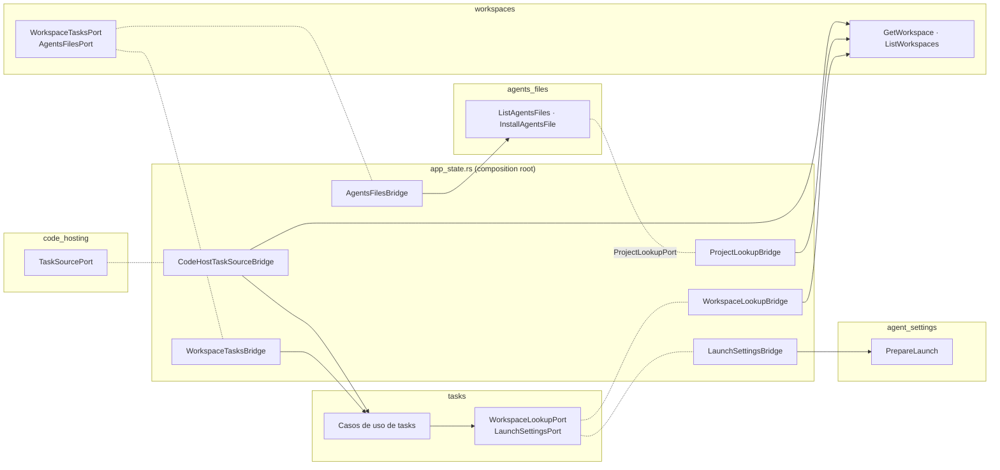

| Bridge | Puerto (lo define…) | Delega en… |
|---|---|---|
| `WorkspaceLookupBridge` | `WorkspaceLookupPort` (tasks) | `workspaces::GetWorkspace`/`ListWorkspaces` |
| `LaunchSettingsBridge` | `LaunchSettingsPort` (tasks) | `agent_settings::PrepareLaunch` |
| `WorkspaceTasksBridge` | `WorkspaceTasksPort` (workspaces) | `tasks::DeleteWorkspaceTasks` |
| `AgentsFilesBridge` | `AgentsFilesPort` (workspaces) | `agents_files::ListAgentsFiles`/`InstallAgentsFile` |
| `ProjectLookupBridge` | `ProjectLookupPort` (agents_files) | `workspaces::GetWorkspace`/`ListWorkspaces` |
| `CodeHostTaskSourceBridge` | `TaskSourcePort` (code_hosting) | `tasks::GetTask` + `workspaces::GetWorkspace` |
| `TaskCreationBridge` | `TaskCreationPort` (jira) | `tasks::CreateTask` |
| `WorkspaceCatalogBridge` | `WorkspaceCatalogPort` (jira) | `tasks::ListWorkspaceOptions`/`ListWorkspaceBranches` |
| `workspace_path_resolver` (closure) | `PathResolver` (terminal) | `workspaces::GetWorkspace` |

El orden en `AppState::new` no es arbitrario: `workspaces` necesita a `tasks` y `agents_files` (para borrado en cascada e instalar AGENTS.md), pero estos necesitan antes los casos de uso de lectura de workspaces. Por eso se crean primero `get_workspace` / `list_workspaces` con su repositorio y los demás contextos se construyen sobre ellos.

---

## 6. Anatomía de un slice: `tasks`

`src/modules/tasks/` es el feature más grande y el mejor ejemplo. Lo recorremos de dentro hacia fuera.

### 6.1 Dominio (`domain/`)

Rust puro. Sin Leptos, Diesel ni axum.

**Modelos** (`domain/models/`):

| Fichero | Contenido |
|---|---|
| `task.rs` | `Task`, `TaskId` (newtype de `Uuid`), `TaskStatus` (11 estados + reglas de transición, `can_view_diff`), `diff_range: Option<DiffRange>`, `TaskStage` (vista agregada para el tablero), `NewTask`, helpers `branch_name(...)` |
| `agent_event.rs` | `AgentEvent`: eventos normalizados que emite el agente (`RunStarted`, `TextDelta`, `ToolFinished`, `DialogRequested`, `ProcessExited`, …) |
| `agent_command.rs` | `AgentCommand`: órdenes hacia el agente (`Prompt`, `Steer`, `FollowUp`, `Abort`, `AnswerDialog`) y `MessageMode` (`Steer`/`FollowUp`) |
| `agent_capabilities.rs` | `AgentCapabilities`: qué soporta cada runtime (`steer`, `follow_up`, `dialogs`, `model_selection`, `thinking_levels`, `resume`, `subagents`); `full()` y `minimal()` |
| `runtime_id.rs` | `RuntimeId`: slug validado del runtime (`pi`, `gentle-shell`) |
| `launch_options.rs` | `LaunchOptions` (`runtime`, `model`, `thinking`) y `restricted_to(&caps)`, que descarta lo que el runtime no soporta |
| `subagent_task.rs` / `subagent_activity.rs` | `SubagentTask`, `SubagentStatus`, `SubagentThreadItem`: actividad de subagentes neutra respecto al runtime |
| `task_event.rs` | `TaskEvent` / `TaskEventKind`: lo que se persiste y se difunde (estado, agente, efímeros) |
| `worktree.rs` | `MergeOutcome` (`Merged` / `Conflict { files }`), `TaskDiff`, `DiffRange` (`base_sha..head_sha`: commits de la tarea, para regenerar su diff tras integrar) |
| `workspace_ref.rs` | Vista mínima de un workspace desde el punto de vista de tareas |

La parte más importante es que `TaskStatus` **encapsula las reglas**:

```rust
pub fn can_finish(&self) -> bool {
    matches!(self, TaskStatus::Running | TaskStatus::Idle | TaskStatus::Interrupted
                 | TaskStatus::Failed  | TaskStatus::Conflict)
}

/// Transición provocada por un evento del agente, si aplica.
pub fn after_agent_event(&self, event: &AgentEvent) -> Option<(TaskStatus, Option<String>)> {
    match event {
        AgentEvent::RunStarted if self.has_live_agent() => Some((TaskStatus::Running, None)),
        AgentEvent::RunSettled if matches!(self, TaskStatus::Starting | TaskStatus::Running)
            => Some((TaskStatus::Idle, None)),
        AgentEvent::ProcessExited { code } if self.has_live_agent() => Some((
            TaskStatus::Interrupted,
            Some(format!("el agente terminó inesperadamente ({})", /* ... */)),
        )),
        _ => None,
    }
    .filter(|(next, _)| next != self)
}
```

Lectura para Java: `matches!(x, A | B)` es un `switch` que devuelve `boolean`; los `if` tras el patrón (`RunStarted if self.has_live_agent()`) son *guards*; devolver `Option<(TaskStatus, Option<String>)>` significa "quizá hay transición, y quizá lleva un mensaje de error". Esta función es **pura** (no toca BD), lo que la hace trivial de testear.

`TaskStage` es una proyección (`Backlog`, `Working`, `Attention`, `Review`, `Done`) calculada a partir del estado, los diálogos pendientes y la actividad de subagentes; el tablero colorea los nodos por ella y `needs_attention()` decide qué resaltar.

**Errores** (`domain/errors/task_error.rs`): un `enum TaskError` con `thiserror`. Es el equivalente a una jerarquía de excepciones, pero cerrada y exhaustiva. Incluye `is_transient()` (solo `Busy`, "SQLite bloqueada"), que usa el decorador de reintentos.

### 6.2 Puertos (`domain/ports/`)

**Outbound** (lo que el dominio *necesita* del mundo exterior) — todos `#[async_trait] pub trait X: Send + Sync`:

| Puerto | Responsabilidad | Adaptador |
|---|---|---|
| `TaskRepositoryPort` | Persistir tareas y eventos; operaciones condicionales atómicas | `TaskRepositoryAdapter` (Diesel) |
| `TaskAttachmentRepositoryPort` | Metadatos de imágenes adjuntas | `TaskAttachmentRepositoryAdapter` (Diesel) |
| `AttachmentStoragePort` | Ficheros de imagen en disco | `FsAttachmentStorageAdapter` |
| `WorktreePort` | `git worktree add`, commit, diff, `pin_range` / `diff_range` (diff de tareas integradas), merge, remove | `GitCliWorktreeAdapter` (ejecuta `git`) |
| `AgentRuntimePort` | Lanzar/parar/hablar con el agente de una tarea sin presuponer el transporte; ver [§6.7](#67-abstracción-del-runtime-de-agentes) | `AgentRuntimeRouter` → `PiRpcRuntimeAdapter` (registrado como `gentle-shell` y `pi`) `ClaudeStreamRuntimeAdapter` (`claude`) o `CursorAcpRuntimeAdapter` (`cursor`) |
| `TaskEventPublisherPort` | Difundir eventos en vivo | `BroadcastTaskEventBus` (tokio broadcast) |
| `WorkspaceLookupPort` | Consultar workspaces | `WorkspaceLookupBridge` (en `app_state.rs`) |
| `LaunchSettingsPort` | Modelo/thinking a usar al lanzar | `LaunchSettingsBridge` |

**Inbound** (`ports/inbound/agent_event_sink.rs`): el único puerto inbound. Existe porque hay **dos** drivers: el runtime del agente empuja eventos hacia el dominio.

```rust
#[async_trait::async_trait]
pub trait AgentEventSink: Send + Sync {
    async fn handle(&self, task_id: TaskId, event: AgentEvent);
}
```

Las server functions *no* tienen puerto inbound: llaman directamente al struct del caso de uso (AGENTS.md lo permite cuando hay un único consumidor).

Ejemplo de puerto con contrato documentado (`agent_runtime_port.rs`):

```rust
#[async_trait::async_trait]
pub trait AgentRuntimePort: Send + Sync {
    async fn start(&self, task_id: TaskId, cwd: &Path, resume: bool,
                   options: &LaunchOptions, sink: Arc<dyn AgentEventSink>) -> Result<(), TaskError>;
    async fn send(&self, task_id: TaskId, command: AgentCommand) -> Result<(), TaskError>;
    async fn stop(&self, task_id: TaskId) -> Result<(), TaskError>;
    async fn is_running(&self, task_id: TaskId) -> bool;
}
```

Fíjate en que `start` recibe un `sink`: el runtime no conoce la BD, solo "alguien que quiere los eventos".

### 6.3 Casos de uso (`application/`)

Un caso de uso = un `struct` con sus puertos como campos `Arc<dyn …>`, un `new(...)` y un `execute(...)`. Es el equivalente a un `@Service` con un único método público.

Hay un fichero por caso de uso en `application/usecases/` (por ejemplo `create_task`, `start_task`, `finish_task`, `merge_task`, `discard_task`; `handle_agent_event` implementa `AgentEventSink`). Consulta el directorio para ver la lista completa.

**`TaskLifecycle`** (`application/services/task_lifecycle.rs`) es el colaborador compartido por casi todos: carga tareas, cambia estado, registra eventos y los difunde.

```rust
pub async fn transition(&self, id: TaskId, status: TaskStatus, error: Option<String>)
    -> Result<(), TaskError>
{
    self.repository.update_status(id, status, error.clone()).await?;
    if !status.has_live_agent() {
        self.repository.clear_pending_dialogs(id).await?;
    }
    self.emit(id, TaskEventKind::status(status, error)).await
}

async fn emit(&self, id: TaskId, kind: TaskEventKind) -> Result<(), TaskError> {
    let event: TaskEvent = if kind.is_persistent() {
        self.repository.append_event(id, kind).await?   // se guarda y recibe su `seq`
    } else {
        TaskEvent::ephemeral(id, kind)                   // solo en vivo
    };
    self.publisher.publish(event);                       // difusión a SSE
    Ok(())
}
```

Otros servicios: `AttachmentCleanup` (borra imágenes al terminar la tarea, mejor esfuerzo) y `QueuedAgentEventSink` (cola, ver §7.2).

**Ejemplo comentado: `FinishTask`** (resumido):

```rust
pub async fn execute(&self, id: TaskId) -> Result<(), TaskError> {
    let task: Task = self.lifecycle.load(id).await?;         // `?` = si falla, retorna el Err
    if !task.status.can_finish() {                            // regla de dominio
        return Err(invalid_state("finalizar", task.status));
    }
    self.lifecycle.transition(id, TaskStatus::Finishing, None).await?;

    if let Err(error) = self.consolidate(&task).await {       // parar agente + commit_all
        self.lifecycle.transition(id, TaskStatus::Failed, Some(error.to_string())).await?;
        return Err(error);
    }
    self.lifecycle.transition(id, TaskStatus::AwaitingReview, None).await?;
    self.cleanup.cleanup_task(id).await;                      // limpieza de imágenes
    Ok(())
}
```

Observa el patrón: **validar con el dominio → transicionar → operar con puertos → compensar si falla**. Casi todos los casos de uso siguen esta forma.

### 6.4 Infraestructura (`infrastructure/`)

**Adaptadores outbound** (`adapters/outbound/`):

| Carpeta | Qué hace |
|---|---|
| `persistence/` | `TaskRepositoryAdapter` (Diesel), `TaskAttachmentRepositoryAdapter`, `RetryingTaskRepository` (decorador), `models/*_row.rs` (structs `Queryable`/`Insertable`) |
| `git/` | `GitCliWorktreeAdapter`: invoca el binario `git` (worktree add, commit, merge `--no-ff`, merge en worktree temporal si la rama base no está checkouteada, …) |
| `runtime/` | `AgentRuntimeRouter` (delegación por `RuntimeId`); `agent_process.rs`: núcleo común de procesos (`ProcessRuntime`, `LineCodec`, `LaunchSpec`); `pi/`: `PiRpcRuntimeAdapter` + `rpc_protocol.rs` (JSONL ↔ `AgentEvent`/`AgentCommand`); `claude/`: `ClaudeStreamRuntimeAdapter` + `stream_protocol.rs` (stream-json de `claude -p`); `cursor/`: `CursorAcpRuntimeAdapter` + `acp_protocol.rs` (ACP de `agent acp`). Añadir un agente = nuevo adaptador de `AgentRuntimePort` registrado en `tasks_context.rs` (ver [§6.7](#67-abstracción-del-runtime-de-agentes)) |
| `events/` | `BroadcastTaskEventBus`: `tokio::sync::broadcast` con capacidad 4096 |
| `storage/` | `FsAttachmentStorageAdapter`: imágenes en `~/.iworkflow/attachments/` |

**Adaptadores inbound** (`adapters/inbound/`): `server_fns.rs`, `sse.rs` y `dto/`.

**DI** (`di/tasks_context.rs`): `TasksContext::with_runtime(...)` es el "fichero de configuración de beans" del feature. Construye adaptadores, los envuelve en decoradores y los inyecta en los casos de uso. Fragmento esencial:

```rust
let base_repository: Arc<dyn TaskRepositoryPort> = Arc::new(TaskRepositoryAdapter::new(pool));
// Dos decoradores sobre el MISMO repositorio, con políticas de reintento distintas:
let repository: Arc<dyn TaskRepositoryPort> =
    Arc::new(RetryingTaskRepository::new(base_repository.clone(), RetryPolicy::bounded()));      // 30 s
let events_repository: Arc<dyn TaskRepositoryPort> =
    Arc::new(RetryingTaskRepository::new(base_repository, RetryPolicy::persistent()));           // sin límite

let lifecycle        = Arc::new(TaskLifecycle::new(repository.clone(), publisher.clone(), workspaces.clone()));
let events_lifecycle = Arc::new(TaskLifecycle::new(events_repository, publisher, workspaces.clone()));
let handler: Arc<dyn AgentEventSink> = Arc::new(HandleAgentEvent::new(events_lifecycle));
let event_queue = Arc::new(QueuedAgentEventSink::new(handler, DEFAULT_QUEUE_CAPACITY));
```

La idea: las peticiones de usuario fallan tras 30 s de reintentos (el usuario espera respuesta), pero los eventos del agente **reintentan indefinidamente** porque perderlos corrompería el historial.

### 6.5 DTOs y server functions

Los DTOs (`dto/task_dto.rs`, …) son structs `Serialize`/`Deserialize` compilados en cliente y servidor. Los structs de Diesel nunca salen del servidor. Una server function típica no tiene lógica:

```rust
#[server]
pub async fn get_task(id: String) -> Result<TaskDto, ServerFnError> {
    use crate::modules::tasks::domain::models::task::Task;

    let task: Task = support::context()?          // use_context::<TasksContext>()
        .get_task                                  // Arc<GetTask>
        .execute(support::task_id(&id)?)           // parsea el id, errores → ServerFnError
        .await
        .map_err(support::to_server_error)?;       // TaskError → ServerFnError
    Ok(TaskDto::from(task))                        // dominio → DTO
}
```

Los `use` del dominio van *dentro* de la función: así el stub del cliente WASM no intenta resolverlos.

**SSE** (`sse.rs`): dos endpoints axum (no server functions, porque son streams):

- `GET /api/tasks/{id}/events`: historial persistido + stream en vivo de una tarea. Protocolo: evento `reset`, historial, y eventos en vivo filtrados por `seq` para no duplicar.
- `GET /api/tasks/events`: stream global del tablero; emite `changed` con el id solo para eventos relevantes (`is_board_relevant`).

Si un suscriptor se retrasa más que la capacidad del canal, recibe `lagged` y el cliente debe reconectar y refetchear.

### 6.6 Presentación (`presentation/`)

```text
presentation/
├── pages/        board_page.rs · task_detail_page.rs · task_edit_page.rs
├── state/        board_state.rs · graph_model.rs · graph_geometry.rs · graph_interaction.rs · loose_drag.rs · task_detail_state.rs · task_edit_state.rs · task_events.rs · ...
└── components/   task_graph_canvas.rs · task_node.rs · loose_tasks_panel.rs · loose_task_card.rs · graph_edge.rs · workspace_switcher.rs · board_toolbar.rs · task_card.rs · composer.rs · diff_view.rs · transcript_view.rs · ...
```

La página crea su estado, y los componentes pintan. Detalle completo en [§9](#9-frontend-leptos-y-signals).

`state/diff_report_state.rs` gestiona el informe imprimible (PDF) del diff, simple o con explicaciones del agente (`ReportPhase`: `Preparing` → `Plain`/`Waiting` → `Ready`). Mientras está ocupado muestra el `ProgressDialog` cancelable de `core/components/`; el render pesado se retrasa un instante (`PREPARE_DELAY`) para que el navegador pinte antes el diálogo.

### 6.7 Abstracción del runtime de agentes

Hasta ahora `tasks` hablaba directamente con un único proceso `gentle-shell`. Hoy el agente es un detalle de infraestructura detrás de `AgentRuntimePort`, y el dominio solo conoce tres conceptos neutros: **órdenes** (`AgentCommand`), **eventos** (`AgentEvent`) y **capacidades** (`AgentCapabilities`).

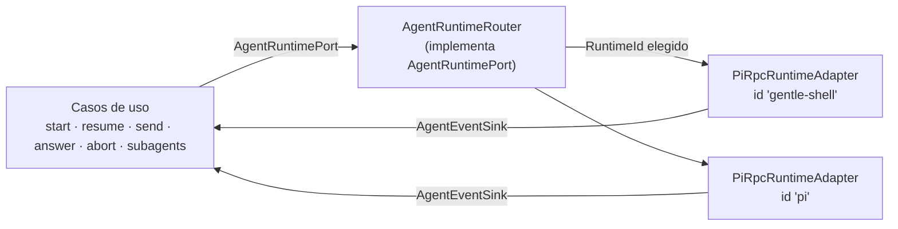

**El puerto** (`domain/ports/outbound/agent_runtime_port.rs`):

| Método | Contrato |
|---|---|
| `start(task_id, cwd, resume, &LaunchOptions, sink)` | Lanza el agente en el worktree y empieza a entregar eventos al `AgentEventSink`. `resume` = continuar la sesión previa si el agente lo soporta |
| `send(task_id, AgentCommand)` | Entrega una orden; puede fallar con `TaskError::Unsupported` |
| `stop(task_id)` | Parada ordenada (forzada tras un timeout); al volver, `ProcessExited` ya se ha entregado |
| `is_running(task_id)` | ¿Hay un agente vivo para la tarea? |
| `subagents(task_id)` | Última actividad conocida de los subagentes (se conserva tras terminar el agente); vacía si no los soporta |
| `capabilities(task_id)` | Capacidades del agente **de esa tarea** (`minimal()` si es desconocida) |
| `runtime_capabilities(Option<&RuntimeId>)` | Capacidades del runtime que se usaría en un arranque, consultables **antes** de `start` |

**Órdenes** (`AgentCommand`): `Prompt`, `Steer` (mensaje que se entrega tras las tool calls en curso), `FollowUp` (se entrega cuando el agente termina), `Abort` y `AnswerDialog { dialog_id, answer }`. Los tres mensajes pueden llevar imágenes (`ImageAttachment`). `prompt` y `abort` son el mínimo que todo agente debe ofrecer; el resto se declara como capacidad.

**Capacidades** (`AgentCapabilities`) y quién las aplica:

| Capacidad | Aplica | Efecto si falta |
|---|---|---|
| `steer` / `follow_up` | `SendMessage` (según `MessageMode`) | `TaskError::Unsupported` |
| `dialogs` | `AnswerDialog` | `TaskError::Unsupported` |
| `resume` | `ResumeTask` | `TaskError::Unsupported` |
| `model_selection` | `StartTask` / `ResumeTask` vía `LaunchOptions::restricted_to` | se descarta `LaunchOptions::model` |
| `thinking_levels` | ídem | se descarta `LaunchOptions::thinking` |
| `subagents` | `GetTaskSubagents` | la lista llega vacía |

Los casos de uso consultan las capacidades antes de actuar; los adaptadores, por tanto, no necesitan duplicar esa validación.

**Eventos** (`AgentEvent`, normalizados): ciclo de ejecución (`RunStarted`, `RunSettled`, `ProcessExited { code }`), mensajes (`UserMessage`, `AssistantMessage`, `TextDelta`, `ThinkingDelta`), herramientas (`ToolStarted`, `ToolUpdated`, `ToolFinished`), diálogos (`DialogRequested`, `DialogResolved`), y auxiliares (`QueueChanged`, `Notice`, `StatusChanged`, `WidgetChanged`, `SubagentsChanged { active, waiting }`). `is_persistent()` separa el historial del tráfico efímero (deltas, `ToolUpdated`, cola, estado, widgets y subagentes solo se difunden en vivo).

**El router** (`AgentRuntimeRouter`). Recibe el `RuntimeId` predeterminado y un `HashMap<RuntimeId, Arc<dyn AgentRuntimePort>>` (falla al construirse si el predeterminado no está registrado). En `start` resuelve el adaptador con `LaunchOptions::runtime` (o el predeterminado; un id desconocido da `Unsupported`), recuerda la elección **por tarea** (con una *generación* para no borrar un registro más nuevo) y delega en él `send`, `stop`, `is_running`, `subagents` y `capabilities`. Una reserva atómica (`StartReservation`) impide que dos `start` concurrentes de la misma tarea lancen dos agentes. `runtime_capabilities` se resuelve sin tarea, solo con el id.

**Selección del runtime.** `agent_settings` guarda el runtime elegido; `PrepareLaunch` lo entrega como `LaunchPreferences` y `LaunchSettingsBridge` lo traduce a `LaunchOptions { runtime: Some(RuntimeId), model, thinking }`. Las tareas no cambian de runtime a mitad de vida: la elección queda registrada al arrancar.

**El adaptador pi** (`runtime/pi/`). Un único `PiRpcRuntimeAdapter` sirve a ambos ids; solo cambia el binario (`PiRpcRuntimeAdapter::new(bin)` en `TasksContext::build_router`). Declara `AgentCapabilities::full()`. Detalles de lanzamiento (`build_command`):

- Se ejecuta con `exec` a través de la shell de login, con el entorno limpio salvo variables de sesión y `GENTLE_SHELL_INTERACTIVE_HOST=1` (activa diálogos `ask_user_*` y widgets de actividad).
- Argumentos: los base del runtime, `--continue` si `resume`, `--provider <p> --model <m>` si hay modelo y `--thinking <nivel>` si hay thinking.
- `rpc_protocol::encode` traduce cada `AgentCommand` a un registro JSONL: `prompt` (con `streamingBehavior: followUp`), `steer`, `follow_up`, `abort` y `extension_ui_response` para los diálogos (`value` / `confirmed` / `cancelled`). `decode` hace el camino inverso y descarta lo irrelevante; `strip_ansi` limpia la salida de herramientas.
- **Subagentes:** la extensión `gentle-agents` publica su actividad como *widget* (`widgetKey = "gentle-agents"`). `decode` extrae un resumen (`SubagentsChanged`) y `decode_subagent_tasks` la instantánea completa (`gentle-agents.activity/v1`, tolerante a esquemas desconocidos). El adaptador guarda en memoria la última instantánea por tarea (sobrevive a la salida del proceso) y la expone con `subagents()`.

**El núcleo de procesos** (`runtime/agent_process.rs`). `ProcessRuntime` concentra lo común a los agentes que son un proceso hijo con JSON por líneas: lanzamiento (shell de login con `exec`, entorno limpio más `LaunchSpec::extra_env`, `systemd-run` con límites), supervisor `supervise`, registro por tarea, `send`, `stop` ordenado (cierra stdin; fuerza el cierre pasado el timeout) y `ProcessExited`. Cada protocolo aporta solo un `LineCodec` (`decode` de líneas de stdout a `AgentEvent`, `encode` de `AgentCommand` a una línea de stdin); el códec es por proceso y puede guardar estado.

**El adaptador Claude** (`runtime/claude/`). `ClaudeStreamRuntimeAdapter` lanza `claude -p --input-format stream-json --output-format stream-json --verbose --include-partial-messages --replay-user-messages --permission-prompt-tool stdio` (binario `IWF_CLAUDE_BIN`). Claude Code no tiene servidor RPC; este es su protocolo bidireccional por stdio. `ClaudeProtocol` (`stream_protocol.rs`) es el códec:

- Salida: `stream_event` → `TextDelta`/`ThinkingDelta`; `assistant` → `AssistantMessage` y `ToolStarted` (`tool_use`); `user` con `tool_result` → `ToolFinished` (el nombre de la herramienta se recuerda por id); `user` con `isReplay` → `UserMessage`; `result` → `RunSettled` (más un aviso si fue error o interrupción). `RunStarted` se emite una vez por ejecución. Las líneas con `parent_tool_use_id` (subagentes) se ignoran.
- Permisos: `control_request`/`can_use_tool` → `DialogRequested(Confirm)` (se guarda la entrada original); la respuesta del usuario se codifica como `control_response` `allow` (con `updatedInput`) o `deny`.
- `Abort` → `control_request` `interrupt`. Prompt, steer y follow-up se codifican como mensaje de usuario (con imágenes como bloques `base64`).
- Permisos: se lanza con `--permission-mode acceptEdits` (las ediciones de ficheros se aceptan; Bash y el resto piden confirmación). El diálogo muestra primero lo que realmente se va a ejecutar o tocar (comando completo, ruta, URL) y después la descripción del modelo.
- Diálogos propios de Claude: `AskUserQuestion` genera un diálogo `Select` por pregunta (id `<petición>#<índice>`, título `cabecera: pregunta`, opciones `etiqueta — descripción`); `claude` recibe una única respuesta `allow` con `answers` cuando están todas contestadas, y cancelar una pregunta rechaza la petición entera. `multiSelect` se presenta como elección única. `ExitPlanMode` se muestra como «Aprobar plan» con el texto del plan. Por eso `LineCodec::encode` devuelve `Option`: una respuesta parcial no genera mensaje.
- Contexto del proyecto: `claude` carga el `AGENTS.md` del worktree de la tarea (verificado: sin `CLAUDE.md`, obedece las reglas del `AGENTS.md`); el repo no tiene `CLAUDE.md`.
- Argumentos: `--continue` si `resume`, `--model <alias>` (el proveedor no aplica) y `--effort <nivel>`; `off` no lleva flag y `minimal` se traduce a `low`.
- Capacidades: `dialogs`, `resume`, `model_selection` y `thinking_levels`; no declara `steer`, `follow_up` ni `subagents`. Los modelos son alias estáticos (`fable`, `opus`, `sonnet`, `haiku`) en `AgentCliModelCatalogAdapter`, porque `claude` no tiene `--list-models`.

**El adaptador Cursor** (`runtime/cursor/`). `CursorAcpRuntimeAdapter` lanza `agent acp` (binario `IWF_CURSOR_BIN`) sobre el mismo `ProcessRuntime`. `AcpProtocol` (`acp_protocol.rs`) es el códec: ACP (*Agent Client Protocol*) es JSON-RPC 2.0 por líneas y el códec es una máquina de estados por proceso.

- Arranque: envía `initialize → authenticate → session/new` (o `session/load` al reanudar), retiene los prompts hasta tener sesión y modelo aplicado, y luego los envía de uno en uno.
- Reanudar: ACP no sabe «continuar la última sesión de una carpeta» (`session/list` no responde), así que el id de sesión de cada tarea se guarda en `IWF_CURSOR_SESSIONS_DIR/<tarea>` y se reabre con `session/load`.
- Permisos: las herramientas de edición se aceptan sin preguntar (política `acceptEdits`); el resto genera un `DialogRequested`, mostrando antes el comando o fichero real que el título. `cursor/ask_question` genera un diálogo por pregunta.
- Capacidades: `dialogs`, `resume` y `model_selection`; no declara `steer`, `follow_up`, `thinking_levels` ni `subagents`. Los modelos se piden al propio agente por ACP (`cursor_acp_model_catalog.rs`, cacheados; un fallo no se cachea).

**Subagentes en la UI.** `GetTaskSubagents` → server function `get_task_subagents` → `SubagentTaskDto`. `task_actions.rs` abre `components/subagents_panel.rs` desde las acciones de la tarea; la actividad de subagentes (`SubagentActivity` en `Task`) también cuenta para considerar la tarea en trabajo (`TaskStage`).

**Añadir un agente nuevo:**

1. Implementar `AgentRuntimePort` en `adapters/outbound/runtime/<agente>/` (traducción propia órdenes/eventos y `capabilities()` honestas).
2. Registrarlo en `TasksContext::build_router` con su `RuntimeId`.
3. Añadir la variante a `AgentRuntime` en `agent_settings` (su `as_str()` debe coincidir con el `RuntimeId`) y, si aplica, su binario/catálogo de modelos.
4. Test de integración en `tests/modules/tasks/` con un proceso falso (`tests/fixtures/`) y tests de mapeo del protocolo.

El dominio, los casos de uso y la UI no cambian.

---

## 7. Flujos de extremo a extremo

### 7.1 Arrancar una tarea

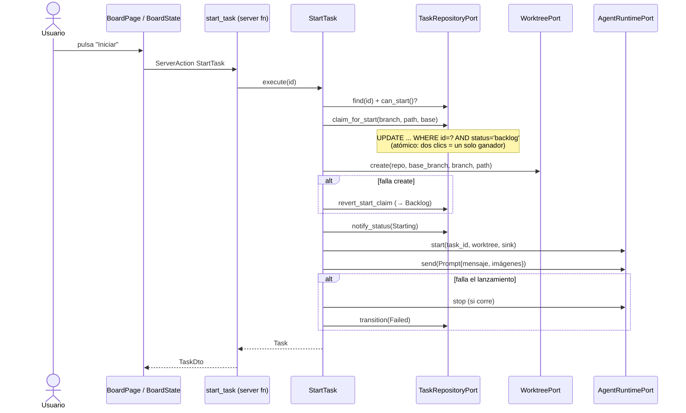

Puntos de diseño a notar en `src/modules/tasks/application/usecases/start_task.rs`:

- **Reclamo atómico (optimistic claim)**: `claim_for_start` es un único `UPDATE … WHERE status = 'backlog'`; devuelve `false` si alguien ya la reclamó. Sustituye a un lock o a `SELECT … FOR UPDATE`.
- **Compensación explícita**: si `worktrees.create` falla se revierte el reclamo; si `launch` falla se para el agente y se marca `Failed` conservando el worktree para inspección.
- `branch_name(&title, &uuid)` y `worktree_dir_name(...)` generan nombres únicos (`pi/<slug>-<id8>`).

### 7.2 Eventos del agente: el pipeline más importante

El agente es un proceso hijo que habla **JSONL por stdin/stdout** (`pi` o `gentle-shell`, que hablan el mismo protocolo RPC). Cada línea de stdout se convierte en un `AgentEvent`, se persiste (si procede), provoca transiciones de estado y se difunde al navegador.

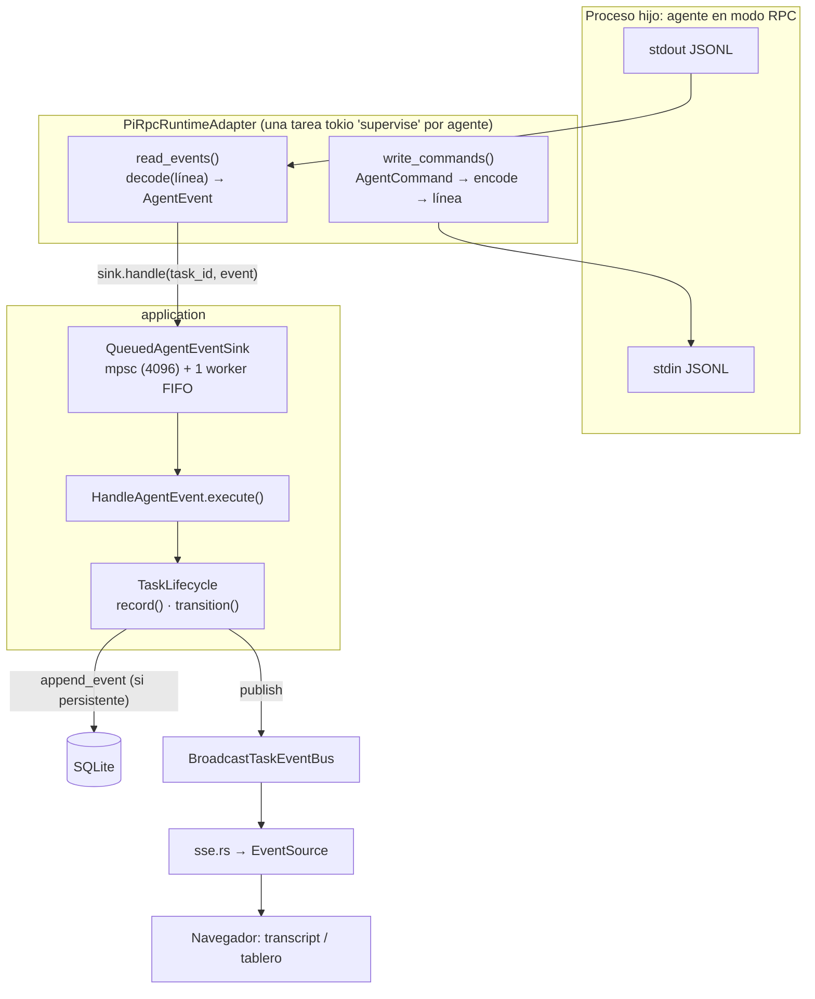

**Paso 1 — el runtime** (`runtime/pi/pi_rpc_runtime_adapter.rs`; el `AgentRuntimeRouter` ya ha delegado en él). `start()` lanza el proceso (vía la shell de login con `exec`, entorno limpio salvo variables de sesión, `kill_on_drop`) y crea una tarea tokio `supervise` por agente. Mantiene un registro `HashMap<TaskId, AgentProcess>` protegido por `Mutex`. `supervise` usa `tokio::select!` para esperar a la vez: lectura de stdout, escritura a stdin y señal de kill. Al terminar el proceso emite `AgentEvent::ProcessExited { code }`.

```rust
loop {
    tokio::select! {
        _ = &mut reader => break,                          // stdout cerrado: el agente terminó
        _ = &mut writer, if !writer_done => writer_done = true,
        signal = &mut kill_rx, if kill_armed => { /* start_kill() */ }
    }
}
```

`select!` es como esperar a "el primero que ocurra" entre varios `Future`s (parecido a `CompletableFuture.anyOf`, pero cancelando los demás). `stop()` cierra stdin (señal de apagado ordenado), espera un timeout y, si no basta, mata el proceso.

**Paso 2 — traducción** (`rpc_protocol.rs`): `encode(AgentCommand) -> String` y `decode(&str) -> Vec<AgentEvent>`. Aquí vive todo el conocimiento del protocolo de pi; el dominio no sabe nada de JSON-RPC.

**Paso 3 — desacoplar con una cola** (`QueuedAgentEventSink`). Si el lector de stdout escribiera en SQLite directamente, una base de datos bloqueada pararía la lectura y el pipe del agente se llenaría. En su lugar, `handle()` solo encola (con *backpressure*: si la cola se llena, espera; nada se descarta) y **un único worker** consume en orden FIFO, preservando el orden por tarea. Cada evento se procesa en su propio `tokio::spawn` para que un `panic` solo pierda ese evento.

**Paso 4 — `HandleAgentEvent`**:

```rust
pub async fn execute(&self, id: TaskId, event: AgentEvent) -> Result<(), TaskError> {
    let next: Option<(TaskStatus, Option<String>)> = if event.is_persistent() {
        let task: Task = self.lifecycle.load(id).await?;
        task.status.after_agent_event(&event)       // regla pura del dominio
    } else { None };
    self.lifecycle.record(id, event).await?;         // persistir (si procede) + publicar
    if let Some((status, error)) = next {
        self.lifecycle.transition(id, status, error).await?;
    }
    Ok(())
}
```

`AgentEvent::is_persistent()` separa los eventos **efímeros** (`TextDelta`, `ThinkingDelta`, `ToolUpdated`, …: se difunden pero no se guardan) de los **persistentes** (mensajes completos, herramientas terminadas, diálogos, salida del proceso).

**Paso 5 — difusión y cliente**: `TaskLifecycle::emit` publica en el bus; `sse.rs` filtra y serializa; en el navegador un `EventSource` actualiza signals ([§9](#9-frontend-leptos-y-signals)).

### 7.3 Finalizar, integrar y descartar

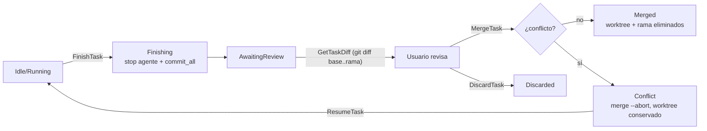

`MergeTask` (resumen): antes de integrar fija el rango de commits con `worktrees.pin_range(...)` (debe ser *antes*: tras el merge el merge-base coincide con la punta) y crea la referencia `refs/iworkflow/tasks/<id>` para que los commits sobrevivan al borrado de la rama. Tras un merge correcto guarda el rango con `record_diff_range` (columnas `base_sha`/`head_sha` de `tasks`). Fijar y guardar son *best-effort*: un fallo no impide integrar, solo deja una nota en el error de la tarea. Así, `GetTaskDiff` en una tarea `Merged` regenera el diff con `worktrees.diff_range(...)` en lugar de `diff(base, rama)`. Luego llama a `worktrees.merge(...)`, que devuelve un `MergeOutcome`; con `match` se decide entre pasar a `Merged` (intentando limpiar el worktree) o `Conflict` con la lista de ficheros. Las reglas de `GitCliWorktreeAdapter` (rechazar si la rama base tiene cambios sin commitear, merge en worktree temporal si la rama base no está checkouteada, abortar ante conflictos) están en el adaptador, no en el caso de uso: son detalles de git.

### 7.4 Reinicio del servidor

`ReconcileTasks` (llamado desde `main`) busca tareas en `Starting`, `Running`, `Idle` o `Finishing` —que no pueden tener agente vivo tras un reinicio— y las pasa a `Interrupted` con un mensaje (avisando si el worktree ya no existe). Desde ahí el usuario puede **reanudar** (`ResumeTask` relanza el agente con `--continue`).

---

## 8. Persistencia

### Pool y conexión (`src/core/db/pool.rs`)

```rust
pub type DbConnectionRaw = SyncConnectionWrapper<SqliteConnection>;
pub type DbPool = Pool<DbConnectionRaw>;                 // deadpool

const CONNECTION_PRAGMAS: &str =
    "PRAGMA foreign_keys = ON; PRAGMA journal_mode = WAL; PRAGMA busy_timeout = 5000;";

pub const MIGRATIONS: EmbeddedMigrations = embed_migrations!("migrations");
```

- SQLite es síncrono; `SyncConnectionWrapper` lo envuelve para usarlo con `async`/`await`.
- WAL + `busy_timeout` reducen los bloqueos, pero con varios escritores aún pueden aparecer `database is locked`: de ahí `TaskError::Busy` y el decorador de reintentos.
- Las migraciones se compilan **dentro** del binario y se aplican en `main` antes de aceptar tráfico.

### Esquema y migraciones

`src/core/db/schema.rs` lo genera `diesel print-schema` (no se edita a mano). Tablas actuales: `workspaces`, `tasks`, `task_events`, `task_attachments`, `agent_settings`, `agents_files`, `code_host_settings`, `jira_connection`, `jira_issues`. Cada migración en `migrations/<fecha>_<nombre>/` tiene `up.sql` y `down.sql`.

### Adaptador Diesel: patrón

Tres piezas por tabla:

1. **Row struct** (`persistence/models/task_row.rs`): representación en BD, con `#[derive(Queryable, Selectable, Insertable)]`. Solo tipos primitivos (`String`, `NaiveDateTime`, `i32`).
2. **Conversiones** `From<&Task> for TaskRow` y `TryFrom<TaskRow> for Task` (aquí `TryFrom` porque parsear un estado o un JSON puede fallar). Es el *mapper* entre dominio y persistencia.
3. **Adaptador** que implementa el puerto:

```rust
async fn claim_for_start(&self, id: TaskId, branch: String, worktree_path: PathBuf,
                         base_branch: String) -> Result<bool, TaskError> {
    let mut connection: DbConnection = self.connection().await?;     // saca del pool
    let updated: usize = diesel::update(
        tasks::table
            .filter(tasks::id.eq(id.to_string()))
            .filter(tasks::status.eq(TaskStatus::Backlog.as_str())),
    )
    .set((tasks::branch.eq(branch), tasks::status.eq(TaskStatus::Starting.as_str()), /* ... */))
    .execute(&mut connection)
    .await
    .map_err(db_error)?;                                              // DieselError → TaskError
    Ok(updated > 0)
}
```

Diesel es un *query builder* tipado en tiempo de compilación (a medio camino entre JOOQ y JPA Criteria): si `tasks::status` no existe o el tipo no encaja, **no compila**. No hay SQL en texto salvo los `PRAGMA`.

### Decorador de reintentos (`retrying_task_repository.rs`)

`RetryingTaskRepository` implementa `TaskRepositoryPort` **envolviendo** a otro `TaskRepositoryPort` (patrón Decorator). Cada método llama a `self.retry("nombre", || self.inner.método(...))`, que reintenta con backoff exponencial (25 ms → 1 s) mientras el error cumpla `is_transient()`. Se reintenta cada llamada por separado porque cada método del puerto es atómico (una sola sentencia o transacción).

---

## 9. Frontend: Leptos y Signals

### Modelo mental

Leptos es reactivo de grano fino (más parecido a Solid.js que a React): **no hay *virtual DOM* ni re-render del componente**. Una función `#[component]` se ejecuta **una vez**; lo que cambia son los nodos del DOM suscritos a signals concretos.

| Primitiva | Para qué | Analogía |
|---|---|---|
| `RwSignal<T>` / `signal()` | Estado local de UI | `useState` / `ObservableValue` |
| `Memo<T>` | Valor derivado y cacheado | `computed` |
| `Resource` | Lectura asíncrona vía server function (con SSR + Suspense) | `useQuery` |
| `ServerAction<F>` | Mutación vía server function; expone `pending()`, `value()`, `version()` | `useMutation` |
| `Effect` | Efecto secundario de UI (no para orquestar llamadas al backend) | `useEffect` |
| `provide_context` / `use_context` | Compartir estado con descendientes | `Context` |

`view! { ... }` es una macro con sintaxis tipo JSX. `<Suspense>`, `<Transition>` y `<ErrorBoundary>` gestionan carga y errores.

### Patrón *Page → State → Server fn*

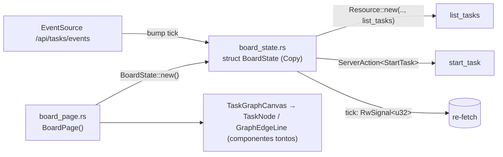

`BoardState` (`presentation/state/board_state.rs`) es un struct `Copy` de signals (los signals de Leptos son *handles* baratos de copiar). Su `Resource` se vuelve a ejecutar cuando cambia su "clave": una tupla de contadores de versión de cada acción más `tick`.

```rust
let tasks: Resource<Result<Vec<TaskDto>, ServerFnError>> = Resource::new(
    move || (tick.get(), create.version().get(), delete.version().get(),
             start.version().get(), finish.version().get(), merge.version().get()),
    |_| list_tasks(None),
);
```

Lectura: "recarga la lista cada vez que una acción termine **o** `tick` cambie". `tick` lo incrementa el `EventSource` SSE cuando el servidor avisa de un cambio. Así el flujo es: acción del usuario / evento del servidor → cambia una dependencia → el `Resource` refetchea → la UI se actualiza solo donde cambió.

### Tablero por workspace (grafo de dependencias)

El tablero está acotado a un workspace (`/board/:workspace_id`; `/` resuelve el primero por nombre) y pinta el grafo de dependencias entre tareas: nodos HTML (`TaskNode`) y aristas Bézier SVG (`GraphEdgeLine`) dentro de una capa desplazable y con zoom (`TaskGraphCanvas`). `BoardState` carga el grafo con `get_task_graph` en un `Resource` cuya clave es el workspace, los contadores de versión de las acciones de aristas/posición y una firma de los estados de las tareas del workspace, de modo que una sucesora que el servidor arranca sola (todas sus predecesoras `merged`) aparece sin recargar. Los gestos acaban en `add_task_dependency`, `remove_task_dependency` o `set_task_position`; las aristas rechazadas (ciclo, duplicada, otro workspace…) se muestran como avisos y dejan el grafo intacto. *Añadir tarea siguiente / en paralelo* crea la tarea con `start_now = false` y después añade las aristas necesarias. El modelo de vista de la arista reserva una `label` opcional para las futuras condiciones; no hay ninguna implementada. En la barra lateral, pulsar un workspace abre su tablero y el menú del elemento ofrece **Ver ficheros** (`/workspaces/:id`, el árbol del proyecto).

**Panel de tareas sueltas.** Cada tarea visible del workspace es un nodo del grafo o está *suelta*, nunca ambas cosas ni ninguna: `partition_tasks` en `graph_model.rs` es la única definición (es nodo si tiene una arista hacia otra tarea *visible*, una posición guardada o una recién fijada; las aristas hacia tareas ocultas por el filtro de *mostrar terminadas* no cuentan) y de ella derivan `loose_tasks` y `build_graph`. Las sueltas no se pintan en el lienzo. Aparecen en el `LooseTasksPanel` de la izquierda (`CollapsiblePanel` de `core/components`, 280 px fijos, con scroll) como `LooseTaskCard`, que reutilizan `TaskCardActions` y por tanto se ejecutan por separado. Arrastrar una tarjeta al lienzo (helpers de puntero en `loose_drag.rs`: prueba de impacto contra el rectángulo del lienzo y posición de caída mediante la transformación de la vista) o el botón *Añadir al grafo* (centro visible del lienzo) llaman al `set_task_position` existente, que la convierte en nodo; un override optimista (transiciones puras en `placement.rs`: colocar, deshacer si falla el guardado y descartar cuando el servidor devuelve la misma posición) evita que parpadee de vuelta al panel. Por debajo de 768 px los dos paneles pasan a subpestañas con `SegmentedControl` (*Sueltas (N)* / *Grafo*, señal `BoardTab` en `BoardState`, por defecto Grafo salvo que no haya nodos y sí sueltas); el panel inactivo se oculta con CSS pero mantiene su layout para que el lienzo conserve su tamaño, y arrastrar al lienzo se desactiva en favor del botón.

### Lógica fuera de los componentes

Los componentes (`task_node.rs`, `graph_edge.rs`, `task_graph_canvas.rs`, …) solo pintan y reciben `Callback`s. Las reglas de presentación **puras** se extraen a funciones testeables en `state/`: `graph_model.rs` (`build_graph`, `waiting_count`, `resolve_positions` —el layout automático por capas para nodos sin posición guardada—, `link_predecessors` para tareas *siguiente*/*paralela*, `resolve_board_workspace`), `graph_geometry.rs` (transformaciones pantalla↔lienzo, zoom, encuadre, anclajes y trazado Bézier de las aristas) y `graph_interaction.rs` (la máquina de estados de los gestos: desplazar, arrastrar nodo, conectar). Al ser funciones sin I/O, se prueban con `#[test]` normales sin navegador.

### Código solo de navegador

El `EventSource` (`task_events.rs`, `task_detail_state.rs`) usa `web_sys` y solo existe bajo `#[cfg(feature = "hydrate")]`; en SSR hay una versión vacía:

```rust
#[cfg(not(feature = "hydrate"))]
pub fn subscribe_task_events(_tick: RwSignal<u32>) {}

#[cfg(feature = "hydrate")]
pub fn subscribe_task_events(tick: RwSignal<u32>) { /* EventSource + reconexión + sondeo de respaldo 60 s */ }
```

### Shell, rutas y tema

`src/app.rs` define `shell()` (el HTML del documento con `HydrationScripts`) y `App()` con `<Router>` y las rutas:

| Ruta | Página |
|---|---|
| `/` · `/board/:workspace_id` | `BoardPage` (tablero de grafo de dependencias de un workspace; `/` muestra el primero por nombre) |
| `/workspaces` | `WorkspacesPage` |
| `/workspaces/:id` · `/workspaces/:id/files/*` | Árbol y editor de ficheros del workspace |
| `/tasks/:id` · `/tasks/:id/edit` | `TaskDetailPage` · `TaskEditPage` |
| `/tasks/:id/diff` · `/tasks/:id/terminal` · `/tasks/:id/files[/*]` | Diff, terminal y explorador del worktree de la tarea |
| `/terminals` · `/terminals/:session_id` · `/workspaces/:id/terminal` | Terminales |
| `/agents-files` | `AgentsFilesPage` |

Cada ruta se abre como **pestaña** del dock (`src/core/dock/`): `TabRoute` en `app.rs` traduce la URL a título, icono y vista, y `DockLayout` (`layout.rs`, lógica pura y testeada) modela grupos divisibles y operaciones sobre pestañas (abrir, cerrar, mover entre grupos, dividir, reordenar con `reorder_tab`). `host.rs` pinta el árbol y `dock.js` gestiona el arrastre en el navegador.

`lib.rs` expone `hydrate()` (`#[wasm_bindgen]`), que monta la app sobre el HTML ya renderizado por el servidor.

---

## 10. Resto de módulos

Todos siguen la misma estructura que `tasks`, con menos piezas.

### `workspaces` — repositorios registrados

Un *workspace* es una carpeta con un repo git donde se lanzan tareas.

- Casos de uso: `RegisterWorkspace` (normaliza la ruta a la raíz del repo; si no existe/no es git y `initialize` es `true`, crea e inicializa; si no tiene commits, crea uno inicial vacío para poder crear worktrees), `ListWorkspaces`, `GetWorkspace`, `DeleteWorkspace` (borra tareas en cascada vía `WorkspaceTasksPort`), `BrowseDirectories` / `CreateDirectory` (selector de carpetas), `ListAgentsFileOptions`.
- Adaptadores: `WorkspaceRepositoryAdapter` (Diesel), `GitCliRepositoryAdapter` (`git`), `FsDirectoryBrowserAdapter`.
- Dependencias entre features: **inbound** de `tasks` y `agents_files` (consultan workspaces vía bridges); **outbound** hacia ambos (puertos `WorkspaceTasksPort`, `AgentsFilesPort`).

### `terminal` — terminales en el navegador

- Dominio: `TerminalSession`, `TerminalSize`, `TerminalSessionId`. Puertos: `PtyPort` (spawn, attach, write, resize, close), `WorkspacePathPort`.
- Adaptador: `PortablePtyAdapter` (crate `portable-pty`).
- **WebSocket** (`ws.rs`): frames binarios = bytes del PTY en ambas direcciones; frames de texto = JSON de redimensionado. La sesión **sobrevive** al socket (permite reconectar); solo termina con `close_terminal` o cuando acaba la shell. Valida que `Origin` coincida con `Host` (`is_same_origin`) para evitar secuestro de la shell desde otra web.
- No usa base de datos.

### `agent_settings` — cómo se lanza el agente

- Guarda en SQLite (una fila) el **runtime** (`AgentRuntime::GentleShell` = `gentle-shell`, predeterminado, `AgentRuntime::Pi` = `pi` o `AgentRuntime::Claude` = `claude` o `AgentRuntime::Cursor` = `cursor`; su `as_str()` coincide con el `RuntimeId` registrado en el router de `tasks`), **modelo**, **perfil** y **nivel de thinking**.
- `PrepareLaunch` lee los ajustes, aplica el *pin* de perfil de la tarea (`ProfilePinPort`; `GitProfilePinAdapter` escribe `<git-common-dir>/gentle-ai/profile-pin.json`) y devuelve las `LaunchPreferences` que `tasks` usa al lanzar (a través de `LaunchSettingsBridge`).
- Adaptadores: `AgentSettingsRepositoryAdapter`, `AgentCliModelCatalogAdapter` (lista modelos ejecutando el CLI), `ProfilesFileCatalogAdapter` (lee `profiles.json`), `GitProfilePinAdapter`.

### `agent_profiles` — perfiles y enrutado de agentes

- Gestiona los **perfiles** de `gentle-ai` (crear, duplicar, renombrar, borrar, importar/exportar JSON), los **roles de agente** (`create_agent_role`) y el **enrutado** rol → modelo/thinking, tanto global (`get_global_routing` / `set_global_routing`) como por perfil (`set_profile_routing`).
- Puertos outbound: `ProfileStorePort`, `AgentRolePort`, `GlobalRoutingPort`, `ProfileExchangePort`, `ModelOptionsPort`; los adaptadores leen y escriben los ficheros de configuración del agente (`WriteGuard`, un `Mutex` compartido, serializa el ciclo cargar → mutar → guardar de `profiles.json`).
- Páginas: `/profiles` y `/models`. Es independiente de `agent_settings`, que solo *selecciona* el perfil activo al lanzar.

### `project_tree` — explorador de ficheros y editor

- El alcance es un `ProjectScope` (workspace o tarea): `WorkspaceRootPort` resuelve la raíz (la del repositorio o el worktree de la tarea), de modo que el mismo árbol y editor sirven en ambos casos (`/workspaces/:id/files/…` y `/tasks/:id/files/…`).
- Casos de uso: `ListProjectDirectory`, `ReadProjectFile`, `WriteProjectFile`, y para el estado de git `ListProjectGitChanges` y `ReadProjectFileBase` (contenido en `HEAD`). Puerto `GitStatusPort`, adaptador `GitCliStatusAdapter` (CLI `git`).
- Presentación: el árbol colorea entradas y carpetas ancestras según el estado git (`state/git_status.rs`); el editor (`core/components/code.rs`) usa `core/line_diff.rs` para marcar en el margen las líneas añadidas, modificadas y borradas respecto a `HEAD`, en vivo mientras se edita.

### `agents_files` — biblioteca de AGENTS.md

- Permite subir ficheros `AGENTS.md`, guardarlos (metadatos en SQLite, contenido en `~/.iworkflow/agents-files/`) e instalarlos en un workspace (`InstallAgentsFile`, con control de "ya existe").
- Adaptadores: `AgentsFileRepositoryAdapter` (Diesel), `FsAgentsFileStorageAdapter`, `GitAgentsFileInstallerAdapter`.
- Obtiene los "proyectos" de `workspaces` a través de `ProjectLookupBridge`.

### `jira` — importación desde Jira Server / Data Center

Importa tareas de un Jira on-premise, permite gestionarlas (estado, comentarios) y convertirlas en tareas de iworkflow. Es read-mostly: solo escribe en Jira al transicionar o comentar.

- **Conexión** (`jira_connection`, fila única `id = 1`): URL base, token PAT (`Authorization: Bearer`, API REST v2), JQL (por defecto `assignee = currentUser() AND resolution = Unresolved ORDER BY updated DESC`), `accept_invalid_certs` y estado de la última sincronización. `SaveConnection` valida contra Jira antes de guardar; el token **nunca viaja al cliente** (el DTO solo expone si está configurado; vacío al editar conserva el guardado).
- **Sincronizar** (`SyncIssues`): trae como máximo 500 issues del JQL a `jira_issues`. El estado local (`new` / `converted` / `ignored`) y el `task_id` enlazado se conservan entre sincronizaciones; las issues nuevas que Jira ya no devuelve se retiran.
- **Gestionar**: `ListIssues` (con filtros y búsqueda), `GetIssue`, `ListIssueComments`/`AddIssueComment`, `ListIssueTransitions`/`TransitionIssue` (workflow de Jira) y `SetIssueIgnored` (solo local).
- **Convertir**: `PrepareConversion` propone título, prompt y prioridad (`PriorityHint` mapea el nombre de prioridad de Jira); `ListConversionBranches` y `ConvertIssue` crean la tarea y marcan la issue como `converted` con su `task_id`.
- **Acoplamiento**: `jira` no importa `tasks`. Define `TaskCreationPort` y `WorkspaceCatalogPort`, implementados en `app_state.rs` por `TaskCreationBridge` (`tasks::CreateTask`) y `WorkspaceCatalogBridge` (`tasks::ListWorkspaceOptions`/`ListWorkspaceBranches`).
- **Cliente HTTP** (`ReqwestJiraClientAdapter`, `jira_json.rs` para el mapeo): `reqwest`, tope de issues por sincronización y opción de certificado no verificado.
- **Tests**: unitarios con `mockall` (`mocks.rs`) e integración en `tests/modules/jira/` (SQLite temporal).

### `code_hosting` — merge/pull requests, CI y merge contra GitLab o GitHub

Permite, desde cada tarea, abrir un MR (GitLab) o PR (GitHub), ver el estado y el último pipeline/workflow de CI, y mezclarlo. Un workspace puede ser de cualquiera de los dos proveedores: se detecta por el host de `origin`. No usa `git push`: la rama de la tarea debe estar ya publicada.

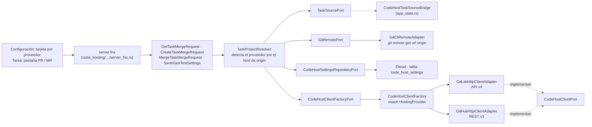

- **Patrón factoría**: los casos de uso dependen de `CodeHostClientFactoryPort::client_for(HostingProvider)`; `CodeHostClientFactory` (infraestructura) construye el adaptador con un `match` exhaustivo, sin rama por defecto, así que añadir un proveedor obliga a implementar su adaptador. `GitLabHttpClientAdapter` y `GitHubHttpClientAdapter` implementan el mismo puerto neutro `CodeHostClientPort` y comparten el gestor de clientes HTTP y los helpers de `http_support.rs`. El vocabulario del dominio es neutro (`MergeRequest`, `Pipeline`): cada adaptador normaliza estados (GitHub `open`/`closed`+`merged` → `opened`/`merged`/`closed`; `mergeable_state` → `mergeable`/`conflict`/`blocked_status`/`checking`; runs y jobs de Actions → `pending`/`running`/`success`/`failed`/`canceled`/`skipped`/`manual`).
- **Ajustes globales por proveedor** (`SaveCodeHostSettings`, `GetCodeHostSettings`, `TestCodeHostConnection`, todos con `HostingProvider`): URL base, token personal y `insecure_tls`, una fila por proveedor en `code_host_settings` (clave `provider`: `gitlab` | `github`). La migración `2026-10-17-100000-0000_create_code_host_settings` copia la fila previa de `gitlab_settings` (token incluido) y `down.sql` la restaura. `CodeHostSettings` valida la URL (`http(s)`, sin credenciales), oculta el token en `Debug` y calcula la raíz de la API: GitLab `/api/v4`; GitHub `https://api.github.com` para github.com o `<base>/api/v3` para GitHub Enterprise. El token **nunca viaja al cliente**: `CodeHostSettingsDto` solo expone `token_configured`; guardar con el token vacío conserva el existente del mismo proveedor, salvo que cambie la URL.
- **Proveedor y proyecto según `origin`**: `TaskProjectResolver` obtiene la tarea por `TaskSourcePort`, lee `origin` por `GitRemotePort` y `RemoteUrl::parse` extrae host y ruta (https, `ssh://`, scp; credenciales redactadas en errores). `CodeHostSettings::select_for_host` elige los ajustes cuyo host coincide (ignora puerto y esquema; `ssh.github.com` cuenta como github.com). Sin coincidencia: github.com sin configurar → `NotConfigured(GitHub)`; cualquier otro host → `UnknownHost`. `project_path` descarta el prefijo de URL relativa (`/gitlab`) y en GitHub exige `propietario/repositorio`.
- **Casos de uso por tarea**: `GetTaskMergeRequest` (MR/PR más reciente de la rama, prefiriendo el abierto, + último CI), `CreateTaskMergeRequest` (reutiliza el abierto; si no, comprueba que la rama exista en el servidor —`BranchNotPublished`— y lo crea hacia la rama base), `MergeTaskMergeRequest` (el mensaje del proveedor se propaga al usuario). `MergeRequestStatus` lleva el `provider` para que la UI use el vocabulario correcto (`presentation/provider_text.rs`: MR/PR, `!`/`#`, pipeline/workflow).
- **Clientes HTTP**: `reqwest` con rustls y timeouts. GitLab: cabecera `PRIVATE-TOKEN`; GitHub: `Authorization: Bearer`, `Accept: application/vnd.github+json`, `X-GitHub-Api-Version` y `User-Agent`. Componentes de ruta codificados. **Las redirecciones están desactivadas** a propósito: `reqwest` no retira cabeceras propias al cambiar de host y el token podría filtrarse; un 30x se devuelve como error. Los errores de red no incluyen la URL. En GitHub, buscar el PR de una rama y leer el CI hacen una petición extra cada uno (el listado no trae `mergeable` ni `head.sha`).
- **Acoplamiento**: `code_hosting` no importa `tasks` ni `workspaces`. `CodeHostTaskSourceBridge` (en `app_state.rs`) implementa `TaskSourcePort` con `tasks::GetTask` y `workspaces::GetWorkspace` (devuelve `None` para tareas en `Backlog`, sin rama). En la UI, `app.rs` inyecta las tarjetas (`CodeHostSettingsCard provider=…`) en `SettingsPage` y la pestaña en `TaskDetailPage` (`TaskExtraTab`).
- **Tests**: unitarios con `mockall` (`mocks.rs`) y GitLab/GitHub falsos con `axum` para los clientes (incluido el test de no-fuga del token por redirección); integración en `tests/modules/code_hosting/` (SQLite temporal y repos git temporales).

### Soporte nativo de Windows

El código específico de plataforma está acotado a infraestructura:

- `core/config.rs`: el home sale de `HOME` o, si falta, de `USERPROFILE`.
- `agent_process.rs` y el PTY (`portable_pty_adapter.rs`): en Unix los agentes y la terminal se lanzan con la shell de login y `exec`; en Windows con `powershell.exe` (sin `exec`, `PATH` heredado). `core/process.rs` mata el árbol de procesos con `taskkill /T` en Windows.
- `nix` solo se compila en Unix; los límites de RAM/CPU por tarea (`systemd-run`) solo existen en Linux.
- El soporte tiene tests de lógica en Linux pero no se ha ejecutado aún sobre un Windows real. Ver «Binarios precompilados» en el README.

---

## 11. Estrategia de tests

| Qué | Dónde | Cómo |
|---|---|---|
| Reglas de dominio | `#[cfg(test)] mod tests` junto al código | `#[test]` puros (`TaskStatus`, `after_agent_event`, `build_graph`) |
| Casos de uso | `#[cfg(test)] mod tests` en cada `usecases/*.rs` | `#[tokio::test]` + mocks `mockall` de los puertos; `application/test_support.rs` ofrece una `Recorded` para inspeccionar estados y eventos emitidos |
| Mocks | `src/modules/<feature>/mocks.rs` | `mock! { pub TaskRepository {} #[async_trait] impl TaskRepositoryPort for TaskRepository { ... } }` — el equivalente a `@Mock` de Mockito generado a partir del trait |
| Adaptadores Diesel / FS / git / runtime | `tests/modules/<feature>/*_test.rs` | Integración contra SQLite temporal (`tempfile`) con migraciones reales aplicadas; `tests/common/mod.rs` provee `test_db()` y `git_repo()` |
| Runtime de agente | `tests/modules/tasks/pi_rpc_runtime_adapter_test.rs`, `tests/modules/tasks/claude_stream_runtime_adapter_test.rs`, `tests/modules/tasks/cursor_acp_runtime_adapter_test.rs` | Procesos falsos en `tests/fixtures/` (`fake_agent.py`, `stubborn_agent.py`, `fake_claude.py`, `fake_cursor.py` para ACP) |
| Resiliencia de la cola | `tests/modules/tasks/event_queue_resilience_test.rs` | Simula bloqueos de SQLite |
| UI | `end2end/` | Playwright (`run_smoke.sh`) con agente falso |

Ejemplo de test de caso de uso (patrón general; ver `finish_task.rs`):

```rust
#[tokio::test]
async fn stops_agent_commits_and_awaits_review() {
    let task: Task = test_support::task(TaskStatus::Idle);
    let recorded: Recorded = Recorded::default();
    let mut worktrees: MockWorktree = MockWorktree::new();
    worktrees.expect_commit_all()
        .withf(|path: &Path, message: &str| path == Path::new(WORKTREE) && message == "pi: Arregla el login")
        .times(1)
        .returning(|_, _| Ok(true));

    FinishTask::new(test_support::lifecycle(Some(task), &recorded), Arc::new(worktrees), /* ... */)
        .execute(id).await.expect("finalizada");

    assert_eq!(recorded.statuses(), vec![TaskStatus::Finishing, TaskStatus::AwaitingReview]);
}
```

Comandos:

```bash
cargo test --features ssr                                    # todo
cargo test --features ssr modules::tasks                     # un feature
cargo test --features ssr --test task_repository_adapter_test  # un test de integración
cargo fmt --all -- --check
cargo clippy --features ssr --all-targets -- -D warnings
cargo clippy --features hydrate --target wasm32-unknown-unknown --lib -- -D warnings
cargo leptos watch                                           # desarrollo en http://127.0.0.1:3000
```

Los `[[test]]` de `Cargo.toml` declaran cada test de integración con `required-features = ["ssr"]` porque dependen del código solo-servidor.

---

## 12. Ruta de lectura recomendada

Orden sugerido para entender el código con el mínimo de saltos:

1. **`src/lib.rs`, `src/app.rs`** — qué se compila y qué rutas existen (5 min).
2. **`src/main.rs`** — arranque, cierre ordenado, dónde se inyectan los contextos.
3. **`src/app_state.rs`** — composición y *bridges*; lee solo `AppState::new` y un bridge.
4. **`src/core/db/pool.rs`** — pool, pragmas, migraciones.
5. **`modules/tasks/domain/models/task.rs`** — `TaskId`, `TaskStatus`, reglas de transición. Es el corazón del dominio.
6. **`modules/tasks/domain/ports/outbound/`** — lee los traits como si fueran las interfaces de un servicio Java.
7. **`modules/tasks/application/services/task_lifecycle.rs`** y luego `usecases/start_task.rs`, `finish_task.rs`, `merge_task.rs`.
8. **`modules/tasks/infrastructure/di/tasks_context.rs`** — ve cómo se enchufa todo.
9. **`modules/tasks/infrastructure/adapters/inbound/server_fns.rs`** + `dto/task_dto.rs`.
10. **`modules/tasks/infrastructure/adapters/outbound/persistence/task_repository_adapter.rs`** (y `retrying_task_repository.rs`).
11. **El pipeline de eventos**: `runtime/agent_runtime_router.rs` → `runtime/pi/pi_rpc_runtime_adapter.rs` → `pi/rpc_protocol.rs` → `queued_agent_event_sink.rs` → `handle_agent_event.rs` → `sse.rs`.
12. **`modules/tasks/presentation/state/board_state.rs`**, `pages/board_page.rs` y `state/task_events.rs`.
13. Después, `workspaces` y `terminal` como segundas lecturas: ya reconocerás el patrón y solo cambiarán los detalles.

### Checklist para añadir una funcionalidad (patrón de trabajo)

1. Modelo / regla en `domain/models` (con tests).
2. Si necesita algo externo, un trait en `domain/ports/outbound` + su mock en `mocks.rs`.
3. Caso de uso en `application/usecases` con tests `mockall`.
4. Adaptador en `infrastructure/adapters/outbound` + test de integración en `tests/modules/<feature>/`; si toca BD, migración con `up.sql`/`down.sql` y regenerar `schema.rs`.
5. Registrar el caso de uso en `<feature>_context.rs`.
6. DTO + server function (sin lógica) + test del mapeo y del error.
7. Estado en `presentation/state`, página/componente (sin lógica de negocio).
