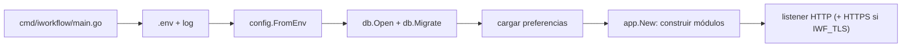
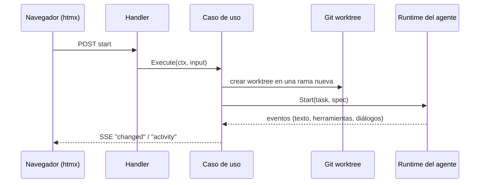

# Arquitectura de iworkflow

> 🇬🇧 English version: [ARCHITECTURE.md](ARCHITECTURE.md)

Un mapa del código de iworkflow: dónde vive cada cosa, cómo se conecta y cómo ampliarlo. El comportamiento del producto está en [README.es.md](README.es.md); las reglas de código y de proceso, en [AGENTS.md](AGENTS.md). Las rutas son relativas a la raíz del repositorio y los diagramas usan [Mermaid](https://mermaid.js.org/).

## Contenido

1. [Visión general](#1-visión-general)
2. [Estructura del repositorio](#2-estructura-del-repositorio)
3. [Reglas de arquitectura](#3-reglas-de-arquitectura)
4. [Arranque y composition root](#4-arranque-y-composition-root)
5. [Anatomía de un módulo: `tasks`](#5-anatomía-de-un-módulo-tasks)
6. [Runtimes de agente](#6-runtimes-de-agente)
7. [Persistencia](#7-persistencia)
8. [Frontend](#8-frontend)
9. [Otros módulos e `internal/core`](#9-otros-módulos-e-internalcore)
10. [Configuración y carpeta de datos](#10-configuración-y-carpeta-de-datos)
11. [Tests](#11-tests)
12. [Comandos y cómo añadir una feature](#12-comandos-y-cómo-añadir-una-feature)

---

## 1. Visión general

iworkflow es una aplicación web autoalojada que lanza agentes de código con IA en paralelo. Cada tarea ejecuta un agente en su propio **git worktree**; el usuario revisa el diff y lo integra o lo descarta.

- **Backend:** Go, `net/http` + `chi`. Un único binario (`cmd/iworkflow`), sin CGO salvo el reconocedor de voz opcional (build tag `sherpa`).
- **UI:** render en servidor con `templ`, interactividad con `htmx`, Tailwind CSS. JavaScript propio solo donde htmx no llega (terminal, editor, diffs, dock), siempre bajo `web/static/`.
- **Datos:** SQLite (`modernc.org/sqlite`, Go puro) con consultas generadas por `sqlc`; migraciones SQL estilo `goose` embebidas en el binario.
- **Tiempo real:** SSE para eventos de tareas y refrescos, WebSocket para terminales.
- **Escritorio:** `electron/` envuelve el mismo servidor en una ventana; es una carcasa, no una segunda implementación.

## 2. Estructura del repositorio

```text
cmd/iworkflow/          main, flags, listener HTTPS (secure.go), configuración del log
internal/
  app/                  composición de todos los módulos, router, shell, puentes entre módulos
  core/                 código transversal; nunca importa internal/modules
  modules/<feature>/    un slice vertical por feature (sección 3)
web/                    tailwind.css y recursos estáticos (web/static/: CSS compilado, JS)
electron/               carcasa de escritorio e instaladores de Windows/macOS/Linux
tests/modules/<f>/      tests de integración por módulo (SQLite temporal)
end2end/                suites Playwright; end2end/go/run_go.sh las ejecuta contra el servidor Go
scripts/                utilidades de empaquetado (stage_server.sh, copy_sherpa_libs.sh)
```

La carpeta `migrations/` de la raíz es un resto de la versión Rust (formato Diesel) y el servidor Go no la usa; las migraciones vigentes están en `internal/core/db/migrations/`.

## 3. Reglas de arquitectura

Arquitectura hexagonal con slicing vertical. Cada feature es un paquete bajo `internal/modules/<feature>/`:

```text
domain/        models/ errors/ ports/{inbound,outbound}   Go puro
application/   un fichero por caso de uso (Execute(ctx, input))
infrastructure/
  adapters/inbound/    handlers HTTP + dto/
  adapters/outbound/   persistence/ (sqlc), api/, storage/, git/, runtime/, ...
  di/<feature>_module.go   construye adaptadores y casos de uso, expone Routes(r chi.Router)
presentation/  state/ pages/ components/   vistas .templ
```

Dirección de las dependencias (se verifica con `depguard` en `.golangci.yml`):

| Capa | Puede importar |
|---|---|
| `domain` | `domain` y stdlib sin I/O |
| `application` | `domain` |
| `infrastructure` | `domain`, `application` |
| `presentation` | llega a `application` solo a través de handlers y DTOs |
| `internal/core` | nunca `internal/modules` |

Los puertos outbound (interfaces) viven en `domain/ports/outbound/` y se implementan en `infrastructure`; los inbound solo existen cuando un caso de uso necesita un contrato explícito. Los módulos no se importan entre sí: lo que uno necesita de otro se expone con un puerto de dominio y se mapea en `internal/app` (ver `internal/app/bridges.go`). Todo método de I/O recibe `context.Context` primero, y el tiempo y los ids se inyectan.

## 4. Arranque y composition root



1. `main` carga el `.env` de la carpeta de trabajo, abre el log (`$IWF_HOME/logs/iworkflow.log`, rotado por tamaño) y procesa los flags (`internal/core/launch`).
2. `serve` lee la configuración (`internal/core/config`), abre SQLite y aplica las migraciones embebidas.
3. Las preferencias guardadas (acceso a la red, puerto, token) deciden la dirección de escucha, salvo que `--addr` / `IWORKFLOW_ADDR` la fije (`internal/core/listen`).
4. `app.New` (`internal/app/app.go`) construye un `Module` por feature con su `di.NewModule(deps)` y reúne sus `Routes`. También es dueño de los puentes entre módulos, la página shell y los bucles en segundo plano (grafo de tareas, reanudación, limpieza).
5. TLS opcional abre un segundo listener en el puerto HTTP más 443 (`internal/core/tlsx`). El apagado espera a todas las goroutines; una petición de reinicio desde la UI sale con código 75 si `IWF_SUPERVISED` está definida (`internal/core/restart`).

No hay estado global ni framework de DI: las dependencias viajan por constructores y la `*sql.DB` nunca llega a un handler.

## 5. Anatomía de un módulo: `tasks`

`tasks` es el módulo más grande y muestra todo el patrón (`internal/modules/tasks/`).

- **Dominio** (`domain/models`): `Task` y sus value objects (`TaskStatus`, prioridad, límites de recursos, opciones del agente, adjuntos, grafo de tareas, límite de uso). Estados: `backlog`, `starting`, `running`, `idle`, `finishing`, `awaiting_review`, `merged`, `discarded`, `conflict`, `failed`, `interrupted`, `rate_limited`.
- **Puertos** (`domain/ports/outbound`): `TaskRepository`, `TaskGraphRepository`, `AgentRuntime`, `Worktree`, `AgentCatalog`, adjuntos, eventos, proyectos relacionados.
- **Casos de uso** (`application`): uno por fichero, p. ej. `create_task`, `finish_task`, `discard_task`, `add_task_dependency`, `get_task_graph`, `prune_merged_tasks`.
- **Inbound** (`infrastructure/adapters/inbound`): handlers por recurso (tablero, detalle, diff, formulario, compositor, ficheros, grafo, subagentes), `sse.go` para el stream en vivo y `dto/`.
- **Outbound** (`infrastructure/adapters/outbound`): `persistence` (sqlc), `git` (worktrees y merge), `runtime/{pi,claude,cursor}`, `events`, `files`, `storage`, `probe`.
- **Segundo plano** (`infrastructure/background`): bucles que arrancan las tareas cuyas predecesoras están integradas, reanudan las interrumpidas y limpian las integradas.
- **Presentación** (`presentation/{state,pages,components}`): páginas templ de creación, detalle, diff y edición.

Arrancar una tarea, de punta a punta:



Cuando el agente termina, la tarea pasa a `awaiting_review`; integrar hace `--no-ff` (si hay conflicto aborta y pasa a `conflict`), descartar elimina el worktree.

## 6. Runtimes de agente

Todo runtime implementa el puerto `AgentRuntime` y declara sus capacidades con honestidad (diálogos, reanudar, selección de modelo, niveles de razonamiento, steer, follow-up, subagentes). `runtime/agent_runtime_router.go` elige el adaptador por id de runtime; `runtime/agent_process.go` reúne lo que comparten los agentes que son un proceso hijo (shell de login con `exec`, entorno limpio, límites de recursos, parada supervisada).

| Runtime | Binario | Protocolo | Notas |
|---|---|---|---|
| `gentle-shell`, `pi` | `IWF_GENTLE_SHELL_BIN`, `IWF_PI_BIN` | RPC JSONL (`runtime/pi`) | Capacidades completas, incluidos steer, follow-up y actividad de subagentes (widget `gentle-agents`). |
| `claude` | `IWF_CLAUDE_BIN` | `claude -p` stream-json por stdio (`runtime/claude`) | Las peticiones de permiso son diálogos; se lanza con `acceptEdits`; lee el `AGENTS.md` del worktree. Modelos: alias estáticos. |
| `cursor` | `IWF_CURSOR_BIN` | ACP, JSON-RPC 2.0 (`runtime/cursor`) | El id de sesión de cada tarea se guarda en `$IWF_HOME/cursor-sessions/<tarea>` para reanudar con `session/load`; la lista de modelos la da el propio agente. |

Cada codec traduce entre el formato del runtime y los tipos de dominio `AgentCommand` / `AgentEvent`, de modo que los casos de uso y la UI no conocen el protocolo.

**Añadir un agente:** implementar `AgentRuntime` en `runtime/<agente>/`, registrarlo en el router con su id, añadir la variante a `AgentRuntime` en `agent_settings` (y su binario o catálogo de modelos) y probarlo con un proceso falso (`tests/fixtures/`) más tests de mapeo del protocolo. Dominio, casos de uso y UI no cambian.

## 7. Persistencia

- Fichero SQLite `$IWF_HOME/workspaces.db`, abierto por `internal/core/db` en modo WAL con timeout de bloqueo. Las migraciones son ficheros SQL en `internal/core/db/migrations/`, embebidos y aplicados al arrancar (`-- +goose Up` / `Down`); `goose redo` debe funcionar con cada una nueva.
- Cada módulo es dueño de su acceso al esquema: las consultas están en `persistence/queries/*.sql`, `persistence/sqlc.yaml` configura `sqlc` y el código generado va a `persistence/gen/`. Los repositorios mapean filas a modelos de dominio; los tipos generados no salen del paquete. Nunca se construye SQL concatenando cadenas.
- Lo que no pertenece a la base de datos vive en la carpeta de datos: worktrees de tareas, adjuntos, biblioteca de `AGENTS.md`, ids de sesión de Cursor y el modelo de voz.

## 8. Frontend

- El **servidor es la fuente de verdad**. Un handler devuelve un fragmento templ si llega `HX-Request` y la página completa en otro caso; el estado de la pantalla es un view-model construido por el handler (`presentation/state`).
- Las páginas se abren como pestañas del **dock** (`internal/core/dock`): un árbol de grupos divisibles, cada uno con pestañas; `internal/core/urlpath` codifica las rutas de fichero en las URL de las pestañas.
- Las actualizaciones en vivo usan un único stream SSE por página (`/api/tasks/events`) y `internal/core/refresh` / `internal/core/notify` para avisar entre módulos de que cambió un dato. Los terminales usan un WebSocket (`terminal/.../terminal_ws.go`) que solo acepta peticiones del mismo origen.
- El JavaScript del navegador está en `web/static/js/` con tests en Node plano; el CSS se compila desde `web/tailwind.css` a `web/static/app.css`.
- Los textos se localizan con `internal/core/i18n` (idioma por petición, mensajes por módulo).

## 9. Otros módulos e `internal/core`

| Módulo | Función |
|---|---|
| `workspaces` | Registrar, editar y borrar workspaces; explorador de directorios. |
| `tasks` | Ciclo de vida de tareas, tablero, grafo, diff, eventos (sección 5). |
| `terminal` | Terminales PTY (`creack/pty`) por WebSocket. |
| `agent_settings` | Runtime, modelo, razonamiento y límites por workspace. |
| `agent_profiles` | Perfiles de Gentle AI y enrutado global de modelos (`profiles.json`, `models.json`). |
| `agents_files` | Biblioteca de `AGENTS.md` e instalación en un workspace. |
| `project_tree` | Árbol de ficheros, editor, git status/stage/commit de un proyecto. |
| `code_hosting` | Merge/pull requests y estado de CI de GitLab y GitHub. |
| `jira` | Importación desde Jira Server / Data Center, carriles, conversión en tareas. |
| `preferences` | Idioma, acceso a la red, puerto, token de acceso, petición de reinicio. |
| `open_with` | Lanzadores externos y selector de ejecutables. |
| `transcription` | Dictado por voz con sherpa-onnx (Qwen3-ASR). |

| Paquete de `internal/core` | Función |
|---|---|
| `config`, `env` | Configuración del proceso (`.env`, `IWF_*`) y entorno de los procesos hijo. |
| `db`, `logfile`, `logx` | SQLite y migraciones; log rotado por tamaño; utilidades de `slog`. |
| `web`, `components`, `site`, `browser` | Contrato `Module`, middlewares, componentes templ compartidos, recursos estáticos, contrato con el navegador. |
| `listen`, `tlsx`, `launch`, `restart` | Dirección de escucha, TLS, flags y apertura del navegador, reinicio supervisado. |
| `gitx`, `process`, `linediff` | Ejecutor del CLI git, matar árboles de procesos, marcas de cambio por línea. |
| `dock`, `i18n`, `markdown`, `urlpath`, `refresh`, `notify` | Shell del workspace, idiomas, Markdown seguro, rutas en URL, avisos de cambio. |

## 10. Configuración y carpeta de datos

La carpeta de datos la resuelve `config.DataDir`: primero `IWF_HOME`, luego el fichero puntero que escribe la tarjeta de configuración, y por último `~/.iworkflow` (`%USERPROFILE%\.iworkflow` en Windows). Todo lo siguiente se deriva de ella y no se puede cambiar por separado:

| Ruta | Contenido |
|---|---|
| `workspaces.db` | Base de datos SQLite |
| `worktrees/`, `attachments/`, `agents-files/`, `cursor-sessions/` | Worktrees de tareas, imágenes de tareas, biblioteca de `AGENTS.md`, ids de sesión de Cursor |
| `models/` | Modelo de voz (`make model`) |
| `tls/` | Certificado autofirmado (`IWF_TLS=auto`) |
| `logs/` | `iworkflow.log`, rotado y comprimido con gzip |

Otras variables: los binarios de los agentes (`IWF_GENTLE_SHELL_BIN`, `IWF_PI_BIN`, `IWF_CLAUDE_BIN`, `IWF_CURSOR_BIN`), `IWF_GENTLE_PI_CONFIG_HOME`, `IWF_PI_AGENTS_DIR`, TLS (`IWF_TLS`, `IWF_TLS_PORT`, `IWF_TLS_CERT`, `IWF_TLS_KEY`), el log (`IWF_LOG_LEVEL`, `IWF_LOG_MAX_MB`, `IWF_LOG_BACKUPS`), `IWORKFLOW_ADDR` e `IWF_SUPERVISED`. La tabla completa, con valores por defecto, está en el README. En Windows el instalador guarda una carpeta de datos personalizada como variable de usuario `IWF_HOME`.

### Mover la carpeta de datos

`internal/core/datahome` es dueño del puntero (`data-home`, una ruta absoluta en la carpeta de configuración del usuario, escrita de forma atómica; un puntero corrupto detiene el arranque en vez de caer a una carpeta por defecto vacía) y del motor de movimiento. El módulo `data_home` solo pide el movimiento: `Mover.Request` valida el destino y escribe `move-pending.json` junto al puntero, y el servidor se reinicia. El movimiento se ejecuta en `cmd/iworkflow/movehome.go`, **antes de abrir el log y la base de datos**, así nada escribe en la carpeta mientras se copia. Pasos: volcar el WAL de SQLite, listar la carpeta (sin seguir enlaces), copiar a `<destino>.iwf-moving` (fsync por fichero, enlaces absolutos hacia la carpeta antigua reescritos), verificar el árbol, reescribir `tasks.worktree_path` y `agents_files.path` en la base copiada y compararla con la original (integridad, número de filas), renombrar la copia a su sitio, ejecutar `git worktree repair` por repositorio (si no, el siguiente `git worktree prune` olvidaría los worktrees movidos), escribir el puntero y borrar de la carpeta antigua solo lo que la nueva también contiene. Un fallo antes del cambio de puntero deja la carpeta antigua intacta (los enlaces de los worktrees vuelven a apuntar a ella y la copia se elimina); el resultado queda en `move-result.json` y se muestra en la tarjeta. Una caída en cualquier punto se reanuda en el siguiente arranque a partir de las marcas (`move-pending.json`, `.iwf-move-complete` en la copia, el puntero). El shell de escritorio trata las líneas `data folder move:` del log como señal de vida, así una copia larga no agota su tiempo de arranque.

## 11. Tests

| Qué | Dónde | Cómo |
|---|---|---|
| Casos de uso | `*_test.go` junto al código | Table-driven, puertos outbound simulados |
| Adaptadores SQL | `tests/modules/<feature>/` | SQLite temporal por test con las migraciones embebidas |
| Handlers y DTOs | junto al handler | `httptest`: DTO ↔ dominio, error de dominio → código HTTP y fragmento |
| Codecs de runtime | `runtime/*/` (+ `testdata/`) | Mapeo del protocolo con líneas grabadas y procesos falsos |
| JS del navegador | `web/static/js/` | `node --test` |
| UI | `end2end/` | Playwright contra el servidor Go (`make e2e`) |
| Launcher de escritorio | `electron/test/` | `node --test` (`npm test` en `electron/`) |

Cada feature mantiene los mocks de sus puertos en `mocks_test.go`. Los tests de Go se lanzan con `-p 2` y de un módulo en uno mientras se itera.

## 12. Comandos y cómo añadir una feature

```bash
make generate     # templ + sqlc + tailwind (tras tocar .templ, SQL o CSS)
make dev          # servidor con el .env de la carpeta de trabajo, http://127.0.0.1:3000
make test         # go test -p 2 ./... más los tests de los scripts de empaquetado
make vet lint     # go vet y golangci-lint
make e2e          # suites Playwright (FILTER=<nombre> para elegir una)
make dist         # paquete de release en dist/;  make electron-build para el instalador
```

Para añadir una feature:

1. Crea `internal/modules/<feature>/` con la estructura de la sección 3; mantén dominio y aplicación libres de `net/http`, `chi`, `templ`, `database/sql` y código generado.
2. Define los puertos outbound en el dominio, un caso de uso por acción y los adaptadores en `infrastructure`.
3. Conéctala en `infrastructure/di/<feature>_module.go` (`NewModule(deps)` + `Routes`) y añádela a `internal/app/app.go`.
4. Añade una migración (`Up` y `Down`) y sus consultas; ejecuta `make generate`.
5. Escribe los tests de la sección 11, incluido uno de Playwright para el caso de uso en el navegador.
6. Termina con `gofmt -l .` (vacío), `go vet ./...`, `golangci-lint run` y los tests de los paquetes tocados.
