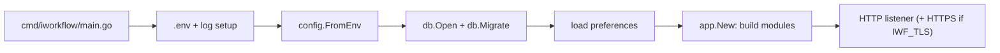
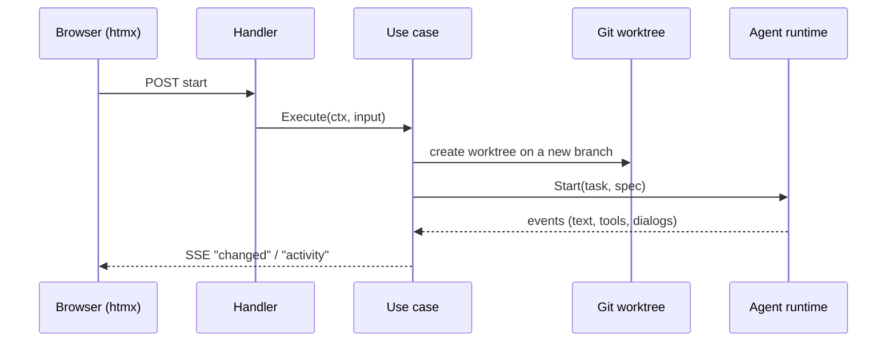

# iworkflow Architecture

> 🇪🇸 Versión en castellano: [ARCHITECTURE.es.md](ARCHITECTURE.es.md)

A map of the iworkflow code: where things live, how they are wired and how to add to them. Product behaviour is in [README.md](README.md); coding and process rules are in [AGENTS.md](AGENTS.md). File paths are relative to the repository root and diagrams use [Mermaid](https://mermaid.js.org/).

## Contents

1. [Overview](#1-overview)
2. [Repository layout](#2-repository-layout)
3. [Architecture rules](#3-architecture-rules)
4. [Startup and composition root](#4-startup-and-composition-root)
5. [Anatomy of a module: `tasks`](#5-anatomy-of-a-module-tasks)
6. [Agent runtimes](#6-agent-runtimes)
7. [Persistence](#7-persistence)
8. [Frontend](#8-frontend)
9. [Other modules and `internal/core`](#9-other-modules-and-internalcore)
10. [Configuration and data folder](#10-configuration-and-data-folder)
11. [Testing](#11-testing)
12. [Commands and adding a feature](#12-commands-and-adding-a-feature)

---

## 1. Overview

iworkflow is a self-hosted web app that launches AI coding agents in parallel. Each task runs an agent in its own **git worktree**; the user reviews the diff and merges or discards it.

- **Backend:** Go, `net/http` + `chi`. One binary (`cmd/iworkflow`), no CGO except the optional speech recognizer (`sherpa` build tag).
- **UI:** server-side rendering with `templ`, interactivity with `htmx`, Tailwind CSS. Own JavaScript only where htmx does not reach (terminal, editor, diffs, dock), always under `web/static/`.
- **Data:** SQLite (`modernc.org/sqlite`, pure Go) through `sqlc`-generated queries; `goose`-style SQL migrations embedded in the binary.
- **Real time:** SSE for task events and refreshes, WebSocket for terminals.
- **Desktop:** `electron/` wraps the same server in a window; it is a shell, not a second implementation.

## 2. Repository layout

```text
cmd/iworkflow/          main, flags, HTTPS listener (secure.go), log setup
internal/
  app/                  composition of all modules, router, shell, cross-module bridges
  core/                 transversal code; never imports internal/modules
  modules/<feature>/    one vertical slice per feature (section 3)
web/                    tailwind.css and static assets (web/static/: compiled CSS, JS)
electron/               desktop shell and Windows/macOS/Linux installers
tests/modules/<f>/      integration tests per module (temporary SQLite)
end2end/                Playwright suites; end2end/go/run_go.sh runs them against the Go server
scripts/                packaging helpers (stage_server.sh, copy_sherpa_libs.sh)
```

The `migrations/` folder at the root is a leftover of the Rust version (Diesel layout) and is not used by the Go server; the live migrations are in `internal/core/db/migrations/`.

## 3. Architecture rules

Hexagonal architecture with vertical slicing. Every feature is a package under `internal/modules/<feature>/`:

```text
domain/        models/ errors/ ports/{inbound,outbound}   pure Go
application/   one file per use case (Execute(ctx, input))
infrastructure/
  adapters/inbound/    HTTP handlers + dto/
  adapters/outbound/   persistence/ (sqlc), api/, storage/, git/, runtime/, ...
  di/<feature>_module.go   builds adapters and use cases, exposes Routes(r chi.Router)
presentation/  state/ pages/ components/   .templ views
```

Dependency direction (enforced with `depguard` in `.golangci.yml`):

| Layer | May import |
|---|---|
| `domain` | `domain` and I/O-free stdlib only |
| `application` | `domain` |
| `infrastructure` | `domain`, `application` |
| `presentation` | reaches `application` only through handlers and DTOs |
| `internal/core` | never `internal/modules` |

Outbound ports (interfaces) live in `domain/ports/outbound/` and are implemented in `infrastructure`; inbound ports exist only when a use case needs an explicit contract. Modules never import each other: what one needs from another is exposed through a domain port and mapped in `internal/app` (see `internal/app/bridges.go`). All I/O methods take `context.Context` first, and time and ids are injected.

## 4. Startup and composition root



1. `main` loads the `.env` of the working folder, opens the log (`$IWF_HOME/logs/iworkflow.log`, rotated by size) and parses the flags (`internal/core/launch`).
2. `serve` reads the configuration (`internal/core/config`), opens SQLite and applies the embedded migrations.
3. The saved preferences (network access, port, token) decide the bind address, unless `--addr` / `IWORKFLOW_ADDR` pins it (`internal/core/listen`).
4. `app.New` (`internal/app/app.go`) builds one `Module` per feature through its `di.NewModule(deps)` and collects their `Routes`. It also owns the cross-module bridges, the shell page and background loops (task graph, resume, prune).
5. Optional TLS runs a second listener on the HTTP port plus 443 (`internal/core/tlsx`). Shutdown waits for every goroutine; a restart request from the UI exits with code 75 when `IWF_SUPERVISED` is set (`internal/core/restart`).

There is no global state and no DI framework: dependencies travel through constructors, and the `*sql.DB` never reaches a handler.

## 5. Anatomy of a module: `tasks`

`tasks` is the largest module and shows the whole pattern (`internal/modules/tasks/`).

- **Domain** (`domain/models`): `Task` and its value objects (`TaskStatus`, priority, resource limits, agent options, attachments, task graph, usage limit). Status values: `backlog`, `starting`, `running`, `idle`, `finishing`, `awaiting_review`, `merged`, `discarded`, `conflict`, `failed`, `interrupted`, `rate_limited`.
- **Ports** (`domain/ports/outbound`): `TaskRepository`, `TaskGraphRepository`, `AgentRuntime`, `Worktree`, `AgentCatalog`, attachments, events, related projects.
- **Use cases** (`application`): one file each, e.g. `create_task`, `finish_task`, `discard_task`, `add_task_dependency`, `get_task_graph`, `prune_merged_tasks`.
- **Inbound** (`infrastructure/adapters/inbound`): handlers per resource (board, detail, diff, form, composer, files, graph, subagents), `sse.go` for the live stream and `dto/`.
- **Outbound** (`infrastructure/adapters/outbound`): `persistence` (sqlc), `git` (worktrees and merge), `runtime/{pi,claude,cursor}`, `events`, `files`, `storage`, `probe`.
- **Background** (`infrastructure/background`): loops that start tasks whose predecessors are merged, resume interrupted tasks and prune merged ones.
- **Presentation** (`presentation/{state,pages,components}`): templ pages for create, detail, diff and edit.

Starting a task, end to end:



When the agent finishes, the task moves to `awaiting_review`; merging integrates with `--no-ff` (on a conflict it aborts and sets `conflict`), discarding removes the worktree.

## 6. Agent runtimes

Every runtime implements the `AgentRuntime` port and declares its capabilities honestly (dialogs, resume, model selection, thinking levels, steer, follow-up, subagents). `runtime/agent_runtime_router.go` picks the adapter by runtime id; `runtime/agent_process.go` holds what child-process agents share (login shell with `exec`, clean environment, resource limits, supervised stop).

| Runtime | Binary | Protocol | Notes |
|---|---|---|---|
| `gentle-shell`, `pi` | `IWF_GENTLE_SHELL_BIN`, `IWF_PI_BIN` | JSONL RPC (`runtime/pi`) | Full capabilities, including steer, follow-up and subagent activity (`gentle-agents` widget). |
| `claude` | `IWF_CLAUDE_BIN` | `claude -p` stream-json over stdio (`runtime/claude`) | Permission prompts become dialogs; launched with `acceptEdits`; reads the worktree's `AGENTS.md`. Models are static aliases. |
| `cursor` | `IWF_CURSOR_BIN` | ACP, JSON-RPC 2.0 (`runtime/cursor`) | The session id of each task is stored in `$IWF_HOME/cursor-sessions/<task>` to resume with `session/load`; the model list comes from the agent. |

Each codec translates between the runtime's wire format and the domain `AgentCommand` / `AgentEvent` types, so the use cases and the UI do not know the protocol.

**Adding an agent:** implement `AgentRuntime` in `runtime/<agent>/`, register it in the router with its runtime id, add the variant to `AgentRuntime` in `agent_settings` (and its binary or model catalog), and test it with a fake process (`tests/fixtures/`) plus protocol-mapping tests. Domain, use cases and UI do not change.

## 7. Persistence

- SQLite file `$IWF_HOME/workspaces.db`, opened by `internal/core/db` in WAL mode with a busy timeout. Migrations are SQL files in `internal/core/db/migrations/`, embedded and applied at startup (`-- +goose Up` / `Down`); `goose redo` must work for every new one.
- Each module owns its schema access: queries live in `persistence/queries/*.sql`, `persistence/sqlc.yaml` configures `sqlc`, and the generated code goes to `persistence/gen/`. Repositories map rows to domain models; generated types never leave the package. No SQL is built by string concatenation.
- Files that do not belong in the database live in the data folder: task worktrees, attachments, the `AGENTS.md` library, Cursor session ids and the speech model.

## 8. Frontend

- The **server is the source of truth**. A handler returns a templ fragment when `HX-Request` is present and the full page otherwise; screen state is a view-model built by the handler (`presentation/state`).
- Pages open as tabs of the **dock** (`internal/core/dock`): a tree of split groups, each with tabs; `internal/core/urlpath` encodes file paths in tab URLs.
- Live updates use one SSE stream per page (`/api/tasks/events`) and `internal/core/refresh` / `internal/core/notify` to announce changed data across modules. Terminals use a WebSocket (`terminal/.../terminal_ws.go`) that accepts only same-origin requests.
- Browser-side JavaScript lives in `web/static/js/` with plain-Node unit tests; CSS is built from `web/tailwind.css` into `web/static/app.css`.
- Text is localized through `internal/core/i18n` (per-request locale, messages per module).

## 9. Other modules and `internal/core`

| Module | Purpose |
|---|---|
| `workspaces` | Register, edit and delete workspaces; directory browser. |
| `tasks` | Task lifecycle, board, graph, diff, events (section 5). |
| `terminal` | PTY terminals (`creack/pty`) streamed over WebSocket. |
| `agent_settings` | Per-workspace runtime, model, thinking and limits. |
| `agent_profiles` | Gentle AI profiles and global model routing (`profiles.json`, `models.json`). |
| `agents_files` | `AGENTS.md` library and installation into a workspace. |
| `project_tree` | File tree, editor, git status/stage/commit of a project. |
| `code_hosting` | GitLab and GitHub merge/pull requests and CI status. |
| `jira` | Jira Server / Data Center import, lanes, conversion to tasks. |
| `preferences` | Language, network access, port, access token, restart request. |
| `open_with` | External launchers and executable picker. |
| `transcription` | Voice dictation with sherpa-onnx (Qwen3-ASR). |

| `internal/core` package | Purpose |
|---|---|
| `config`, `env` | Process configuration (`.env`, `IWF_*`) and child-process environment. |
| `db`, `logfile`, `logx` | SQLite and migrations; size-rotated log; `slog` helpers. |
| `web`, `components`, `site`, `browser` | `Module` contract, middlewares, shared templ components, static assets, browser contract. |
| `listen`, `tlsx`, `launch`, `restart` | Bind address, TLS, flags and opening the browser, supervised restart. |
| `gitx`, `process`, `linediff` | git CLI runner, process-tree kill, per-line change marks. |
| `dock`, `i18n`, `markdown`, `urlpath`, `refresh`, `notify` | Workspace shell, locales, safe Markdown, URL paths, change notices. |

## 10. Configuration and data folder

The data folder is resolved by `config.DataDir`: `IWF_HOME` first, then the pointer file written by the settings card, then `~/.iworkflow` (`%USERPROFILE%\.iworkflow` on Windows). Everything below is derived from it and cannot be set separately:

| Path | Content |
|---|---|
| `workspaces.db` | SQLite database |
| `worktrees/`, `attachments/`, `agents-files/`, `cursor-sessions/` | Task worktrees, task images, `AGENTS.md` library, Cursor session ids |
| `models/` | Speech model (`make model`) |
| `tls/` | Self-signed certificate (`IWF_TLS=auto`) |
| `logs/` | `iworkflow.log`, rotated and gzip-compressed |

Other variables: the agent binaries (`IWF_GENTLE_SHELL_BIN`, `IWF_PI_BIN`, `IWF_CLAUDE_BIN`, `IWF_CURSOR_BIN`), `IWF_GENTLE_PI_CONFIG_HOME`, `IWF_PI_AGENTS_DIR`, TLS (`IWF_TLS`, `IWF_TLS_PORT`, `IWF_TLS_CERT`, `IWF_TLS_KEY`), logging (`IWF_LOG_LEVEL`, `IWF_LOG_MAX_MB`, `IWF_LOG_BACKUPS`), `IWORKFLOW_ADDR` and `IWF_SUPERVISED`. The full table, with defaults, is in the README. On Windows the installer stores a custom data folder as the `IWF_HOME` user variable.

### Moving the data folder

`internal/core/datahome` owns the pointer (`data-home`, one absolute path in the per-user configuration folder, written atomically; a corrupt pointer stops the start instead of falling back to an empty default) and the move engine. The `data_home` module only asks for a move: `Mover.Request` validates the destination and writes `move-pending.json` next to the pointer, then the server restarts. The move itself runs in `cmd/iworkflow/movehome.go`, **before the log and the database are opened**, so nothing writes to the folder while it is copied. Steps: fold the SQLite WAL, scan the folder (without following links), copy to `<dest>.iwf-moving` (fsync per file, absolute links into the old folder rebased), verify the tree, rewrite `tasks.worktree_path` and `agents_files.path` in the copied database and compare it with the original (integrity check, row counts), rename the copy into place, run `git worktree repair` per repository (otherwise the next `git worktree prune` would forget the moved worktrees), write the pointer, delete from the old folder only what the new one also holds. A failure before the pointer switch leaves the old folder untouched (the repaired worktree links are pointed back and the copy removed); the outcome is kept in `move-result.json` and shown in the card. A crash at any point is resumed at the next start from the markers (`move-pending.json`, `.iwf-move-complete` in the copy, the pointer). The desktop shell treats the `data folder move:` log lines as signs of life, so a long copy does not trip its start timeout.

## 11. Testing

| What | Where | How |
|---|---|---|
| Use cases | `*_test.go` next to the code | Table-driven, mocked outbound ports |
| SQL adapters | `tests/modules/<feature>/` | Temporary SQLite per test with the embedded migrations |
| Handlers and DTOs | next to the handler | `httptest`: DTO ↔ domain, domain error → HTTP status and fragment |
| Runtime codecs | `runtime/*/` (+ `testdata/`) | Protocol mapping with recorded lines and fake processes |
| Browser JS | `web/static/js/` | `node --test` |
| UI | `end2end/` | Playwright against the Go server (`make e2e`) |
| Desktop launcher | `electron/test/` | `node --test` (`npm test` in `electron/`) |

Each feature keeps its port mocks in `mocks_test.go`. Run Go tests with `-p 2` and one module at a time while iterating.

## 12. Commands and adding a feature

```bash
make generate     # templ + sqlc + tailwind (run after touching .templ, SQL or CSS)
make dev          # server with the .env of the working folder, http://127.0.0.1:3000
make test         # go test -p 2 ./... plus the packaging script tests
make vet lint     # go vet and golangci-lint
make e2e          # Playwright suites (FILTER=<name> to pick one)
make dist         # release package in dist/;  make electron-build for the installer
```

To add a feature:

1. Create `internal/modules/<feature>/` with the layout of section 3; keep domain and application free of `net/http`, `chi`, `templ`, `database/sql` and generated code.
2. Define outbound ports in the domain, one use case per action, and the adapters in `infrastructure`.
3. Wire it in `infrastructure/di/<feature>_module.go` (`NewModule(deps)` + `Routes`) and add it to `internal/app/app.go`.
4. Add a migration (`Up` and `Down`) and its queries; run `make generate`.
5. Write the tests of section 11, including a Playwright test for the use case in the browser.
6. Finish with `gofmt -l .` (empty), `go vet ./...`, `golangci-lint run` and the tests of the packages touched.
