# iworkflow Architecture

> 🇪🇸 Versión en castellano: [ARCHITECTURE.es.md](ARCHITECTURE.es.md)

A guide to reading the iworkflow code, aimed at someone with solid Java experience who is learning Rust. New here? Start with the [Quick glossary](#quick-glossary) and the [reading path](#12-recommended-reading-path). It follows the order in which the code is best read: first the overall map, then startup, one complete *slice* (`tasks`) and, finally, the remaining modules.

> Diagrams use [Mermaid](https://mermaid.js.org/) (GitHub and most editors render it). File paths are relative to the repository root. The project's style and process rules live in [AGENTS.md](AGENTS.md); this document explains **how it is built**, not how to contribute.

## Table of contents

1. [What the application does](#1-what-the-application-does)
2. [Rust for a Java developer](#2-rust-for-a-java-developer)
3. [Stack and dual `ssr` / `hydrate` compilation](#3-stack-and-dual-ssr--hydrate-compilation)
4. [Code structure](#4-code-structure)
5. [Startup and composition root](#5-startup-and-composition-root)
6. [Anatomy of a slice: `tasks`](#6-anatomy-of-a-slice-tasks)
7. [End-to-end flows](#7-end-to-end-flows)
8. [Persistence](#8-persistence)
9. [Frontend: Leptos and Signals](#9-frontend-leptos-and-signals)
10. [Remaining modules](#10-remaining-modules)
11. [Testing strategy](#11-testing-strategy)
12. [Recommended reading path](#12-recommended-reading-path)

Also: [Quick glossary](#quick-glossary) · [Rust for Java developers](docs/rust-for-java.md)

---

## Quick glossary

| Term | Meaning in this repo |
|---|---|
| **Slice / feature** | Directory under `modules/` with its own layers |
| **Port** | Trait defining what the domain needs (outbound) or offers (inbound) |
| **Adapter** | Concrete implementation of a port (Diesel, `git`, process, FS) or entry point (server fn, SSE, WS) |
| **Use case** | `struct` with `execute()`; one user or system action |
| **Context (`XxxContext`)** | Struct with a feature's use cases, injected with `provide_context` |
| **Bridge** | Adapter in `app_state.rs` that connects two features without them importing each other |
| **Worktree** | Isolated git working copy per task, in `~/.iworkflow/worktrees` |
| **Sink** | Receiver of agent events (`AgentEventSink`) |
| **SSR / hydration** | The server renders HTML; the WASM "activates" it in the browser without repainting it |
| **DTO** | Serializable type that crosses client ↔ server; the domain never travels |

---

## 1. What the application does

iworkflow is an ADE (Agentic Development Environment) to launch, orchestrate and review coding agents (`gentle-shell`, `pi`, `claude` or `cursor`) over an RPC protocol. The concrete agent sits behind a port (`AgentRuntimePort`), so the domain does not know which agent or transport lies underneath ([§6.7](#67-agent-runtime-abstraction)). Each **task** runs in its own **git worktree**; when it finishes, the user reviews the diff and decides whether to integrate (`merge --no-ff`) or discard.

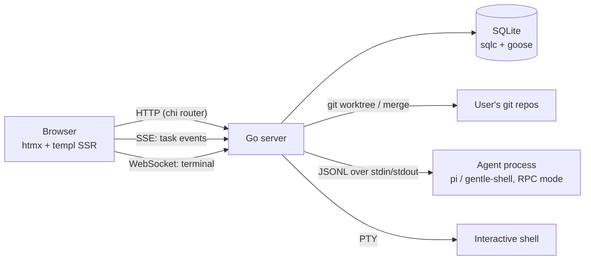

It is a single Go binary (`cmd/iworkflow`) that serves the HTML (SSR with templ), static assets, HTTP endpoints, an SSE endpoint and a WebSocket. The desktop installers (`electron/`) are only a shell: a window plus a child process running this same binary, with no extra logic.

Task lifecycle (the state machine lives in `src/modules/tasks/domain/models/task.rs`):

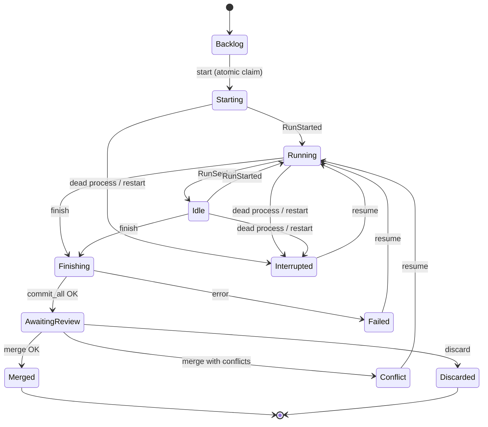

Transitions are validated by methods on the enum itself (`can_start`, `can_finish`, `can_merge`, …), not by `if`s scattered across the use cases.

---

## 2. Rust for a Java developer

The Java ↔ Rust equivalence table and the concepts with no direct equivalent (ownership, `Arc`, `Send + Sync`, macros…) live in [docs/rust-for-java.md](docs/rust-for-java.md). Skim it first if you come from Java.

---

## 3. Stack and dual `ssr` / `hydrate` compilation

| Piece | Technology |
|---|---|
| Language | Rust (2024 edition) |
| UI + server | [Leptos](https://leptos.dev) 0.8 (SSR + hydration, reactivity with *signals*) on `axum`, orchestrated by `cargo-leptos` |
| Persistence | Diesel + `diesel-async` (`SyncConnectionWrapper<SqliteConnection>`) + `deadpool` pool, embedded SQLite (`libsqlite3-sys` bundled) |
| Migrations | `migrations/` (Diesel), embedded with `embed_migrations!` and applied on startup |
| Styles | Tailwind CSS (`style/tailwind.css`) |
| Processes / PTY | `tokio::process`, `portable-pty` |
| Tests | `cargo test`, `mockall`, `tempfile`, Playwright for e2e |

### One crate, two binaries

Leptos compiles the same crate **twice**:

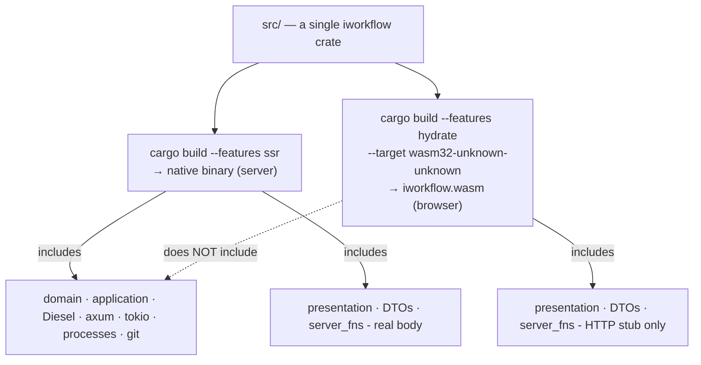

Configuration in `Cargo.toml`:

```toml
[features]
hydrate = ["leptos/hydrate", "dep:console_error_panic_hook", "dep:wasm-bindgen", "dep:web-sys", "dep:js-sys"]
ssr = ["dep:axum", "dep:tokio", "dep:diesel", "dep:diesel-async", "leptos/ssr", /* ... */]

[package.metadata.leptos]
bin-features = ["ssr"]      # the server binary is built with ssr
lib-features = ["hydrate"]  # the WASM library is built with hydrate
```

Server dependencies are `optional = true` and only `ssr` enables them: **Diesel and tokio never reach the WASM bundle**. The rule is enforced in code with `#[cfg(feature = "ssr")]`. Look at `src/modules/tasks/mod.rs`:

```rust
#[cfg(feature = "ssr")]
pub mod application;     // use cases: server only
#[cfg(feature = "ssr")]
pub mod domain;          // domain: server only
pub mod infrastructure;  // exists in both (DTOs and server fns), but filters inside
#[cfg(all(test, feature = "ssr"))]
pub mod mocks;
pub mod presentation;    // UI: in both
```

Important consequence: **the WASM client does not know the domain**. That is why the types that cross the network are DTOs in `infrastructure/adapters/inbound/dto/`, compiled in both features. `TaskStatusDto` deliberately duplicates the domain's `TaskStatus` enum (and even replicates `has_live_agent`), and the `From<Task> for TaskDto` conversion is inside a `#[cfg(feature = "ssr")]` block.

### What a *server function* is

```rust
#[server]
pub async fn get_task(id: String) -> Result<TaskDto, ServerFnError> { /* server-only body */ }
```

The `#[server]` macro generates **two** things: on the server, the HTTP endpoint with the real body; on the client, a *stub* with the same signature that does a `fetch` to the endpoint. From a component it is called like a normal async function. It is the equivalent of a REST controller + a generated client, without writing either. In hexagonal-architecture terms, **it is the inbound adapter**.

---

## 4. Code structure

```text
src/
├── main.rs            # axum startup (ssr only)
├── lib.rs             # WASM entry (hydrate) + module declarations
├── app.rs             # <App>, HTML shell, router routes
├── app_state.rs       # COMPOSITION ROOT: groups contexts and bridges between features
├── core/              # cross-cutting; CANNOT import from modules/
│   ├── config.rs      # AppConfig (IWF_* environment variables)
│   ├── db/            # pool.rs (DbPool, migrations), schema.rs (generated by Diesel)
│   ├── http/          # body limit for server functions
│   ├── dock/          # tabbed workspace with splittable groups (layout, drag, reordering)
│   ├── line_diff.rs   # pure line diff (editor gutter marks)
│   ├── git.rs, env.rs # domain-free utilities
│   └── components/    # base UI components (modal, toast, select, shell, ...)
└── modules/           # one directory per feature (vertical slice)
    ├── tasks/         # the core: tasks, worktrees, agents, events
    ├── workspaces/    # registered git repositories
    ├── terminal/      # PTY terminals over WebSocket
    ├── agent_settings/# global model/profile/runtime/thinking
    ├── agent_profiles/# agent profiles and role/model routing
    ├── project_tree/  # file explorer and editor (workspace or task worktree), git status
    ├── agents_files/  # reusable AGENTS.md files
    ├── code_hosting/  # MR/PR, CI and merge against GitLab or GitHub (provider detected from origin)
    └── jira/          # import from Jira Server/DC and conversion into tasks
```

### Vertical slice + hexagonal layers

Each feature contains **all** its layers. Within each one, dependencies only point inward:

```text
modules/<feature>/
├── domain/            # Pure Rust: models, errors (thiserror), PORTS (traits)
│   ├── models/
│   ├── errors/
│   └── ports/{inbound,outbound}/
├── application/       # use cases: one struct per action with an execute() method
│   └── usecases/
├── infrastructure/    # technical adapters
│   ├── adapters/inbound/{dto/, server_fns.rs [, sse.rs | ws.rs]}
│   ├── adapters/outbound/{persistence/, git/, runtime/, fs/, ...}
│   └── di/<feature>_context.rs     # wires ports ↔ adapters ↔ use cases
├── presentation/      # Leptos UI
│   ├── state/         # signals / Resources / Actions of a screen
│   ├── pages/
│   └── components/
└── mocks.rs           # mockall mocks of the ports (#[cfg(test)] only)
```

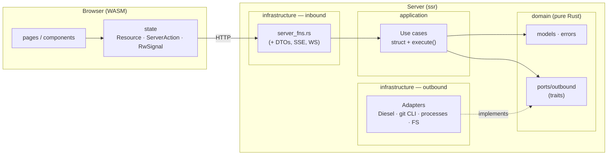

Dependency rules (equivalent to ArchUnit in Java, but here by convention and review):

- `domain` and `application` do **not** import `leptos`, `diesel`, `axum`, nor anything from `infrastructure` / `presentation`.
- A use case depends on **traits** (`Arc<dyn TaskRepositoryPort>`), never on concrete adapters.
- Diesel queries only exist in `infrastructure/adapters/outbound/persistence/`.
- `core/` imports nothing from `modules/`. A feature does not import another: they communicate through ports and bridges in `app_state.rs`.

---

## 5. Startup and composition root

### `src/main.rs`

It is the equivalent of the `@SpringBootApplication` class + the bean configuration. Sequence, in order:

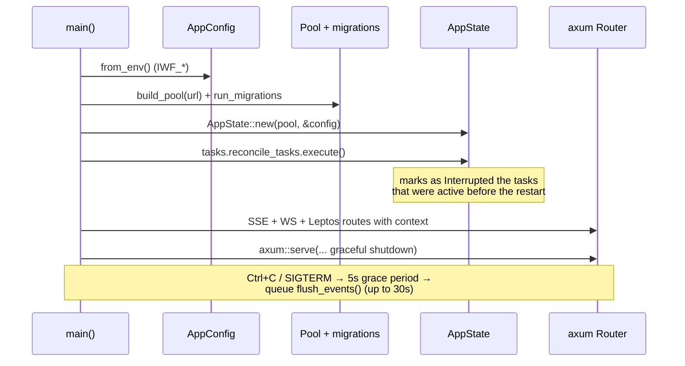

Useful details for reading it:

- `#[tokio::main] async fn main()` starts the async runtime (in Java it would be the container/embedded server).
- `expect()`/`panic!` are allowed in `main.rs` (AGENTS.md permits them only at startup): if the configuration or migrations fail, there is no point continuing.
- The SSE (`task_events_router`) and WebSocket (`terminal_ws_router`) routers are mounted with `.merge(...)` next to the Leptos router.
- `leptos_routes_with_context(..., move || context_state.provide(), ...)` is the point where the contexts are **injected**: that closure runs on every request and calls `provide_context` for each feature.
- Orderly shutdown matters: agent events are queued in memory (see [§7.2](#72-agent-events-the-most-important-pipeline)) and `flush_events()` waits for them to be persisted before exiting.

### `src/app_state.rs` — the composition root

```rust
#[derive(Clone)]
pub struct AppState {
    pub workspaces: WorkspacesContext,
    pub tasks: TasksContext,
    pub agent_settings: AgentSettingsContext,
    pub agents_files: AgentsFilesContext,
    pub terminal: TerminalContext,
}

impl AppState {
    pub fn provide(&self) {
        provide_context(self.workspaces.clone());
        provide_context(self.tasks.clone());
        // ...
    }
}
```

**Dependency injection without a framework.** There is no reflection-based IoC container. The pattern is:

1. Each feature exposes an `XxxContext` (a struct with its use cases already built as `Arc<UseCase>`), in `infrastructure/di/<feature>_context.rs`.
2. `AppState::new` builds the contexts in the right order.
3. On every request, `provide()` registers them in the **Leptos context** (`provide_context`).
4. Server functions retrieve them with `use_context::<TasksContext>()`.

Think of `provide_context` / `use_context` as a lightweight `ApplicationContext` typed by class.

### The *bridges*: how features talk without coupling

A feature **cannot import another**. When `tasks` needs to know which workspace a task has, it defines its **own port** and `app_state.rs` implements it with an adapter (a "bridge") that uses the `workspaces` use cases:

```rust
/// Exposes workspaces to the tasks feature through its own port.
pub struct WorkspaceLookupBridge {
    pub get_workspace: Arc<GetWorkspace>,
    pub list_workspaces: Arc<ListWorkspaces>,
}

#[async_trait::async_trait]
impl WorkspaceLookupPort for WorkspaceLookupBridge {   // port defined in tasks/
    async fn find(&self, workspace_id: &str) -> Result<Option<WorkspaceRef>, TaskError> {
        let Ok(id) = WorkspaceId::parse(workspace_id) else { return Ok(None); };
        match self.get_workspace.execute(id).await {   // use case from workspaces/
            Ok(workspace) => Ok(Some(to_ref(workspace))),
            Err(WorkspaceError::NotFound(_)) => Ok(None),
            Err(error) => Err(TaskError::Repository(error.to_string())),
        }
    }
    // ...
}
```

It is the *anti-corruption layer* pattern: `tasks` sees a `WorkspaceRef` (its own minimal view), not another domain's `Workspace`.

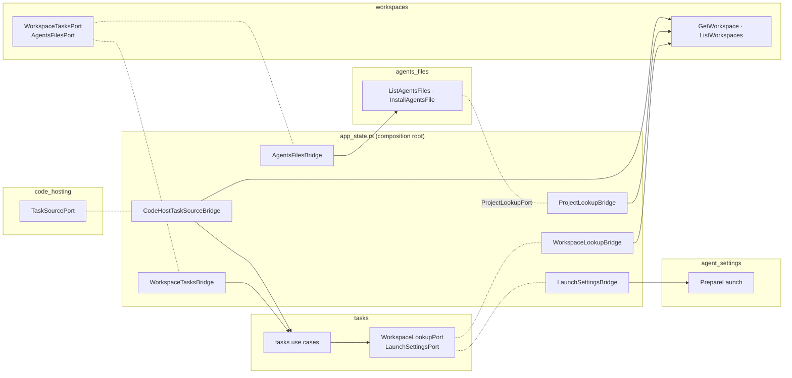

| Bridge | Port (defined by…) | Delegates to… |
|---|---|---|
| `WorkspaceLookupBridge` | `WorkspaceLookupPort` (tasks) | `workspaces::GetWorkspace`/`ListWorkspaces` |
| `LaunchSettingsBridge` | `LaunchSettingsPort` (tasks) | `agent_settings::PrepareLaunch` |
| `WorkspaceTasksBridge` | `WorkspaceTasksPort` (workspaces) | `tasks::DeleteWorkspaceTasks` |
| `AgentsFilesBridge` | `AgentsFilesPort` (workspaces) | `agents_files::ListAgentsFiles`/`InstallAgentsFile` |
| `ProjectLookupBridge` | `ProjectLookupPort` (agents_files) | `workspaces::GetWorkspace`/`ListWorkspaces` |
| `CodeHostTaskSourceBridge` | `TaskSourcePort` (code_hosting) | `tasks::GetTask` + `workspaces::GetWorkspace` |
| `TaskCreationBridge` | `TaskCreationPort` (jira) | `tasks::CreateTask` |
| `WorkspaceCatalogBridge` | `WorkspaceCatalogPort` (jira) | `tasks::ListWorkspaceOptions`/`ListWorkspaceBranches` |
| `workspace_path_resolver` (closure) | `PathResolver` (terminal) | `workspaces::GetWorkspace` |

The order in `AppState::new` is not arbitrary: `workspaces` needs `tasks` and `agents_files` (for cascade deletion and installing AGENTS.md), but those first need the workspace read use cases. That is why `get_workspace` / `list_workspaces` are created first with their repository and the other contexts are built on top of them.

---

## 6. Anatomy of a slice: `tasks`

`src/modules/tasks/` is the largest feature and the best example. We walk through it from the inside out.

### 6.1 Domain (`domain/`)

Pure Rust. No Leptos, Diesel or axum.

**Models** (`domain/models/`):

| File | Contents |
|---|---|
| `task.rs` | `Task`, `TaskId` (newtype of `Uuid`), `TaskStatus` (11 states + transition rules, `can_view_diff`), `diff_range: Option<DiffRange>`, `TaskStage` (aggregated view for the board), `NewTask`, `branch_name(...)` helpers |
| `agent_event.rs` | `AgentEvent`: normalized events emitted by the agent (`RunStarted`, `TextDelta`, `ToolFinished`, `DialogRequested`, `ProcessExited`, …) |
| `agent_command.rs` | `AgentCommand`: commands sent to the agent (`Prompt`, `Steer`, `FollowUp`, `Abort`, `AnswerDialog`) and `MessageMode` (`Steer`/`FollowUp`) |
| `agent_capabilities.rs` | `AgentCapabilities`: what each runtime supports (`steer`, `follow_up`, `dialogs`, `model_selection`, `thinking_levels`, `resume`, `subagents`); `full()` and `minimal()` |
| `runtime_id.rs` | `RuntimeId`: validated runtime slug (`pi`, `gentle-shell`) |
| `launch_options.rs` | `LaunchOptions` (`runtime`, `model`, `thinking`) and `restricted_to(&caps)`, which drops what the runtime does not support |
| `subagent_task.rs` / `subagent_activity.rs` | `SubagentTask`, `SubagentStatus`, `SubagentThreadItem`: runtime-neutral subagent activity |
| `task_event.rs` | `TaskEvent` / `TaskEventKind`: what is persisted and broadcast (state, agent, ephemeral) |
| `worktree.rs` | `MergeOutcome` (`Merged` / `Conflict { files }`), `TaskDiff`, `DiffRange` (`base_sha..head_sha`: the task's commits, to regenerate its diff after integrating) |
| `workspace_ref.rs` | Minimal view of a workspace from the tasks point of view |

The most important part is that `TaskStatus` **encapsulates the rules**:

```rust
pub fn can_finish(&self) -> bool {
    matches!(self, TaskStatus::Running | TaskStatus::Idle | TaskStatus::Interrupted
                 | TaskStatus::Failed  | TaskStatus::Conflict)
}

/// Transition caused by an agent event, if applicable.
pub fn after_agent_event(&self, event: &AgentEvent) -> Option<(TaskStatus, Option<String>)> {
    match event {
        AgentEvent::RunStarted if self.has_live_agent() => Some((TaskStatus::Running, None)),
        AgentEvent::RunSettled if matches!(self, TaskStatus::Starting | TaskStatus::Running)
            => Some((TaskStatus::Idle, None)),
        AgentEvent::ProcessExited { code } if self.has_live_agent() => Some((
            TaskStatus::Interrupted,
            Some(format!("the agent exited unexpectedly ({})", /* ... */)),
        )),
        _ => None,
    }
    .filter(|(next, _)| next != self)
}
```

Reading it as a Java developer: `matches!(x, A | B)` is a `switch` that returns `boolean`; the `if`s after the pattern (`RunStarted if self.has_live_agent()`) are *guards*; returning `Option<(TaskStatus, Option<String>)>` means "maybe there is a transition, and maybe it carries an error message". This function is **pure** (it does not touch the DB), which makes it trivial to test.

`TaskStage` is a projection (`Backlog`, `Working`, `Attention`, `Review`, `Done`) computed from the status, pending dialogs and subagent activity; the board colours nodes by it and `needs_attention()` decides what to highlight.

**Errors** (`domain/errors/task_error.rs`): a `TaskError` enum with `thiserror`. It is the equivalent of an exception hierarchy, but closed and exhaustive. It includes `is_transient()` (only `Busy`, "SQLite locked"), which the retry decorator uses.

### 6.2 Ports (`domain/ports/`)

**Outbound** (what the domain *needs* from the outside world) — all `#[async_trait] pub trait X: Send + Sync`:

| Port | Responsibility | Adapter |
|---|---|---|
| `TaskRepositoryPort` | Persist tasks and events; atomic conditional operations | `TaskRepositoryAdapter` (Diesel) |
| `TaskAttachmentRepositoryPort` | Metadata of attached images | `TaskAttachmentRepositoryAdapter` (Diesel) |
| `AttachmentStoragePort` | Image files on disk | `FsAttachmentStorageAdapter` |
| `WorktreePort` | `git worktree add`, commit, diff, `pin_range` / `diff_range` (diff of integrated tasks), merge, remove | `GitCliWorktreeAdapter` (runs `git`) |
| `AgentRuntimePort` | Launch/stop/talk to a task's agent without assuming the transport; see [§6.7](#67-agent-runtime-abstraction) | `AgentRuntimeRouter` → `PiRpcRuntimeAdapter` (registered as `gentle-shell` and `pi`), `ClaudeStreamRuntimeAdapter` (`claude`) or `CursorAcpRuntimeAdapter` (`cursor`) |
| `TaskEventPublisherPort` | Broadcast live events | `BroadcastTaskEventBus` (tokio broadcast) |
| `WorkspaceLookupPort` | Query workspaces | `WorkspaceLookupBridge` (in `app_state.rs`) |
| `LaunchSettingsPort` | Model/thinking to use at launch | `LaunchSettingsBridge` |

**Inbound** (`ports/inbound/agent_event_sink.rs`): the only inbound port. It exists because there are **two** drivers: the agent runtime pushes events into the domain.

```rust
#[async_trait::async_trait]
pub trait AgentEventSink: Send + Sync {
    async fn handle(&self, task_id: TaskId, event: AgentEvent);
}
```

Server functions have *no* inbound port: they call the use case struct directly (AGENTS.md allows this when there is a single consumer).

Example of a port with a documented contract (`agent_runtime_port.rs`):

```rust
#[async_trait::async_trait]
pub trait AgentRuntimePort: Send + Sync {
    async fn start(&self, task_id: TaskId, cwd: &Path, resume: bool,
                   options: &LaunchOptions, sink: Arc<dyn AgentEventSink>) -> Result<(), TaskError>;
    async fn send(&self, task_id: TaskId, command: AgentCommand) -> Result<(), TaskError>;
    async fn stop(&self, task_id: TaskId) -> Result<(), TaskError>;
    async fn is_running(&self, task_id: TaskId) -> bool;
}
```

Note that `start` receives a `sink`: the runtime does not know the DB, only "someone who wants the events".

### 6.3 Use cases (`application/`)

A use case = a `struct` with its ports as `Arc<dyn …>` fields, a `new(...)` and an `execute(...)`. It is the equivalent of a `@Service` with a single public method.

One file per use case lives in `application/usecases/` (for example `create_task`, `start_task`, `finish_task`, `merge_task`, `discard_task`; `handle_agent_event` implements `AgentEventSink`). Browse the directory for the full list.

**`TaskLifecycle`** (`application/services/task_lifecycle.rs`) is the collaborator shared by almost all of them: it loads tasks, changes state, records events and broadcasts them.

```rust
pub async fn transition(&self, id: TaskId, status: TaskStatus, error: Option<String>)
    -> Result<(), TaskError>
{
    self.repository.update_status(id, status, error.clone()).await?;
    if !status.has_live_agent() {
        self.repository.clear_pending_dialogs(id).await?;
    }
    self.emit(id, TaskEventKind::status(status, error)).await
}

async fn emit(&self, id: TaskId, kind: TaskEventKind) -> Result<(), TaskError> {
    let event: TaskEvent = if kind.is_persistent() {
        self.repository.append_event(id, kind).await?   // stored and gets its `seq`
    } else {
        TaskEvent::ephemeral(id, kind)                   // live only
    };
    self.publisher.publish(event);                       // broadcast to SSE
    Ok(())
}
```

Other services: `AttachmentCleanup` (deletes images when the task ends, best effort) and `QueuedAgentEventSink` (queue, see §7.2).

**Commented example: `FinishTask`** (abridged):

```rust
pub async fn execute(&self, id: TaskId) -> Result<(), TaskError> {
    let task: Task = self.lifecycle.load(id).await?;         // `?` = on failure, return the Err
    if !task.status.can_finish() {                            // domain rule
        return Err(invalid_state("finish", task.status));
    }
    self.lifecycle.transition(id, TaskStatus::Finishing, None).await?;

    if let Err(error) = self.consolidate(&task).await {       // stop agent + commit_all
        self.lifecycle.transition(id, TaskStatus::Failed, Some(error.to_string())).await?;
        return Err(error);
    }
    self.lifecycle.transition(id, TaskStatus::AwaitingReview, None).await?;
    self.cleanup.cleanup_task(id).await;                      // image cleanup
    Ok(())
}
```

Notice the pattern: **validate with the domain → transition → operate through ports → compensate on failure**. Almost all use cases follow this shape.

### 6.4 Infrastructure (`infrastructure/`)

**Outbound adapters** (`adapters/outbound/`):

| Folder | What it does |
|---|---|
| `persistence/` | `TaskRepositoryAdapter` (Diesel), `TaskAttachmentRepositoryAdapter`, `RetryingTaskRepository` (decorator), `models/*_row.rs` (`Queryable`/`Insertable` structs) |
| `git/` | `GitCliWorktreeAdapter`: invokes the `git` binary (worktree add, commit, merge `--no-ff`, merge in a temporary worktree if the base branch is not checked out, …) |
| `runtime/` | `AgentRuntimeRouter` (delegation by `RuntimeId`); `agent_process.rs`: common process core (`ProcessRuntime`, `LineCodec`, `LaunchSpec`); `pi/`: `PiRpcRuntimeAdapter` + `rpc_protocol.rs` (JSONL ↔ `AgentEvent`/`AgentCommand`); `claude/`: `ClaudeStreamRuntimeAdapter` + `stream_protocol.rs` (stream-json of `claude -p`); `cursor/`: `CursorAcpRuntimeAdapter` + `acp_protocol.rs` (ACP of `agent acp`). Adding an agent = a new `AgentRuntimePort` adapter registered in `tasks_context.rs` (see [§6.7](#67-agent-runtime-abstraction)) |
| `events/` | `BroadcastTaskEventBus`: `tokio::sync::broadcast` with capacity 4096 |
| `storage/` | `FsAttachmentStorageAdapter`: images in `~/.iworkflow/attachments/` |

**Inbound adapters** (`adapters/inbound/`): `server_fns.rs`, `sse.rs` and `dto/`.

**DI** (`di/tasks_context.rs`): `TasksContext::with_runtime(...)` is the feature's "bean configuration file". It builds adapters, wraps them in decorators and injects them into the use cases. Essential excerpt:

```rust
let base_repository: Arc<dyn TaskRepositoryPort> = Arc::new(TaskRepositoryAdapter::new(pool));
// Two decorators over the SAME repository, with different retry policies:
let repository: Arc<dyn TaskRepositoryPort> =
    Arc::new(RetryingTaskRepository::new(base_repository.clone(), RetryPolicy::bounded()));      // 30 s
let events_repository: Arc<dyn TaskRepositoryPort> =
    Arc::new(RetryingTaskRepository::new(base_repository, RetryPolicy::persistent()));           // unbounded

let lifecycle        = Arc::new(TaskLifecycle::new(repository.clone(), publisher.clone(), workspaces.clone()));
let events_lifecycle = Arc::new(TaskLifecycle::new(events_repository, publisher, workspaces.clone()));
let handler: Arc<dyn AgentEventSink> = Arc::new(HandleAgentEvent::new(events_lifecycle));
let event_queue = Arc::new(QueuedAgentEventSink::new(handler, DEFAULT_QUEUE_CAPACITY));
```

The idea: user requests fail after 30 s of retries (the user is waiting for a response), but agent events **retry indefinitely** because losing them would corrupt the history.

### 6.5 DTOs and server functions

DTOs (`dto/task_dto.rs`, …) are `Serialize`/`Deserialize` structs compiled in client and server. Diesel structs never leave the server. A typical server function has no logic:

```rust
#[server]
pub async fn get_task(id: String) -> Result<TaskDto, ServerFnError> {
    use crate::modules::tasks::domain::models::task::Task;

    let task: Task = support::context()?          // use_context::<TasksContext>()
        .get_task                                  // Arc<GetTask>
        .execute(support::task_id(&id)?)           // parses the id, errors → ServerFnError
        .await
        .map_err(support::to_server_error)?;       // TaskError → ServerFnError
    Ok(TaskDto::from(task))                        // domain → DTO
}
```

The domain `use`s go *inside* the function: that way the WASM client stub does not try to resolve them.

**SSE** (`sse.rs`): two axum endpoints (not server functions, because they are streams):

- `GET /api/tasks/{id}/events`: persisted history + live stream of one task. Protocol: a `reset` event, the history, and live events filtered by `seq` to avoid duplicates.
- `GET /api/tasks/events`: global board stream; emits `changed` with the id only for relevant events (`is_board_relevant`).

If a subscriber lags more than the channel capacity, it receives `lagged` and the client must reconnect and refetch.

### 6.6 Presentation (`presentation/`)

```text
presentation/
├── pages/        board_page.rs · task_detail_page.rs · task_edit_page.rs
├── state/        board_state.rs · graph_model.rs · graph_geometry.rs · graph_interaction.rs · loose_drag.rs · task_detail_state.rs · task_edit_state.rs · task_events.rs · ...
└── components/   task_graph_canvas.rs · task_node.rs · loose_tasks_panel.rs · loose_task_card.rs · graph_edge.rs · workspace_switcher.rs · board_toolbar.rs · task_card.rs · composer.rs · diff_view.rs · transcript_view.rs · ...
```

The page creates its state, and the components render. Full detail in [§9](#9-frontend-leptos-and-signals).

`state/diff_report_state.rs` manages the printable (PDF) diff report, plain or with agent explanations (`ReportPhase`: `Preparing` → `Plain`/`Waiting` → `Ready`). While busy it shows the cancellable `ProgressDialog` from `core/components/`; the heavy render is delayed a moment (`PREPARE_DELAY`) so the browser paints the dialog first.

### 6.7 Agent runtime abstraction

Until now `tasks` talked directly to a single `gentle-shell` process. Today the agent is an infrastructure detail behind `AgentRuntimePort`, and the domain only knows three neutral concepts: **commands** (`AgentCommand`), **events** (`AgentEvent`) and **capabilities** (`AgentCapabilities`).

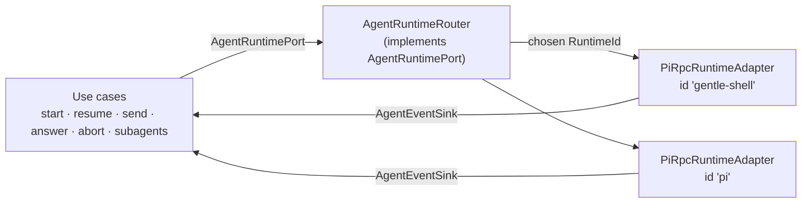

**The port** (`domain/ports/outbound/agent_runtime_port.rs`):

| Method | Contract |
|---|---|
| `start(task_id, cwd, resume, &LaunchOptions, sink)` | Launches the agent in the worktree and starts delivering events to the `AgentEventSink`. `resume` = continue the previous session if the agent supports it |
| `send(task_id, AgentCommand)` | Delivers a command; may fail with `TaskError::Unsupported` |
| `stop(task_id)` | Orderly stop (forced after a timeout); on return, `ProcessExited` has already been delivered |
| `is_running(task_id)` | Is there a live agent for the task? |
| `subagents(task_id)` | Last known subagent activity (kept after the agent ends); empty if unsupported |
| `capabilities(task_id)` | Capabilities of **that task's** agent (`minimal()` if unknown) |
| `runtime_capabilities(Option<&RuntimeId>)` | Capabilities of the runtime that would be used on a start, queryable **before** `start` |

**Commands** (`AgentCommand`): `Prompt`, `Steer` (a message delivered after the in-flight tool calls), `FollowUp` (delivered when the agent finishes), `Abort` and `AnswerDialog { dialog_id, answer }`. The three messages can carry images (`ImageAttachment`). `prompt` and `abort` are the minimum every agent must offer; the rest is declared as a capability.

**Capabilities** (`AgentCapabilities`) and who enforces them:

| Capability | Enforced by | Effect if missing |
|---|---|---|
| `steer` / `follow_up` | `SendMessage` (per `MessageMode`) | `TaskError::Unsupported` |
| `dialogs` | `AnswerDialog` | `TaskError::Unsupported` |
| `resume` | `ResumeTask` | `TaskError::Unsupported` |
| `model_selection` | `StartTask` / `ResumeTask` via `LaunchOptions::restricted_to` | `LaunchOptions::model` is dropped |
| `thinking_levels` | same | `LaunchOptions::thinking` is dropped |
| `subagents` | `GetTaskSubagents` | the list comes back empty |

Use cases check capabilities before acting; adapters therefore do not need to duplicate that validation.

**Events** (`AgentEvent`, normalized): run cycle (`RunStarted`, `RunSettled`, `ProcessExited { code }`), messages (`UserMessage`, `AssistantMessage`, `TextDelta`, `ThinkingDelta`), tools (`ToolStarted`, `ToolUpdated`, `ToolFinished`), dialogs (`DialogRequested`, `DialogResolved`), and auxiliary ones (`QueueChanged`, `Notice`, `StatusChanged`, `WidgetChanged`, `SubagentsChanged { active, waiting }`). `is_persistent()` separates history from ephemeral traffic (deltas, `ToolUpdated`, queue, status, widgets and subagents are only broadcast live).

**The router** (`AgentRuntimeRouter`). It receives the default `RuntimeId` and a `HashMap<RuntimeId, Arc<dyn AgentRuntimePort>>` (construction fails if the default is not registered). On `start` it resolves the adapter with `LaunchOptions::runtime` (or the default; an unknown id gives `Unsupported`), remembers the choice **per task** (with a *generation* so a newer record is not deleted) and delegates `send`, `stop`, `is_running`, `subagents` and `capabilities` to it. An atomic reservation (`StartReservation`) prevents two concurrent `start`s of the same task from launching two agents. `runtime_capabilities` is resolved without a task, from the id alone.

**Runtime selection.** `agent_settings` stores the chosen runtime; `PrepareLaunch` hands it over as `LaunchPreferences` and `LaunchSettingsBridge` translates it into `LaunchOptions { runtime: Some(RuntimeId), model, thinking }`. Tasks do not switch runtime mid-life: the choice is recorded at start.

**The pi adapter** (`runtime/pi/`). A single `PiRpcRuntimeAdapter` serves both ids; only the binary changes (`PiRpcRuntimeAdapter::new(bin)` in `TasksContext::build_router`). It declares `AgentCapabilities::full()`. Launch details (`build_command`):

- It runs with `exec` through the login shell, with a clean environment except session variables and `GENTLE_SHELL_INTERACTIVE_HOST=1` (enables `ask_user_*` dialogs and activity widgets).
- Arguments: the runtime's base ones, `--continue` if `resume`, `--provider <p> --model <m>` if there is a model and `--thinking <level>` if there is thinking.
- `rpc_protocol::encode` translates each `AgentCommand` into a JSONL record: `prompt` (with `streamingBehavior: followUp`), `steer`, `follow_up`, `abort` and `extension_ui_response` for dialogs (`value` / `confirmed` / `cancelled`). `decode` does the reverse path and discards what is irrelevant; `strip_ansi` cleans tool output.
- **Subagents:** the `gentle-agents` extension publishes its activity as a *widget* (`widgetKey = "gentle-agents"`). `decode` extracts a summary (`SubagentsChanged`) and `decode_subagent_tasks` the full snapshot (`gentle-agents.activity/v1`, tolerant of unknown schemas). The adapter keeps the latest snapshot per task in memory (it survives the process exit) and exposes it with `subagents()`.

**The process core** (`runtime/agent_process.rs`). `ProcessRuntime` concentrates what is common to agents that are a child process speaking line-delimited JSON: launching (login shell with `exec`, clean environment plus `LaunchSpec::extra_env`, `systemd-run` with limits), the `supervise` supervisor, per-task registry, `send`, orderly `stop` (closes stdin; forces closing after the timeout) and `ProcessExited`. Each protocol contributes only a `LineCodec` (`decode` from stdout lines to `AgentEvent`, `encode` from `AgentCommand` to a stdin line); the codec is per process and may keep state.

**The Claude adapter** (`runtime/claude/`). `ClaudeStreamRuntimeAdapter` launches `claude -p --input-format stream-json --output-format stream-json --verbose --include-partial-messages --replay-user-messages --permission-prompt-tool stdio` (binary `IWF_CLAUDE_BIN`). Claude Code has no RPC server; this is its bidirectional stdio protocol. `ClaudeProtocol` (`stream_protocol.rs`) is the codec:

- Output: `stream_event` → `TextDelta`/`ThinkingDelta`; `assistant` → `AssistantMessage` and `ToolStarted` (`tool_use`); `user` with `tool_result` → `ToolFinished` (the tool name is remembered by id); `user` with `isReplay` → `UserMessage`; `result` → `RunSettled` (plus a notice if it was an error or interruption). `RunStarted` is emitted once per run. Lines with `parent_tool_use_id` (subagents) are ignored.
- Permissions: `control_request`/`can_use_tool` → `DialogRequested(Confirm)` (the original input is stored); the user's answer is encoded as a `control_response` `allow` (with `updatedInput`) or `deny`.
- `Abort` → `control_request` `interrupt`. Prompt, steer and follow-up are encoded as a user message (with images as `base64` blocks).
- Permissions: it is launched with `--permission-mode acceptEdits` (file edits are accepted; Bash and the rest ask for confirmation). The dialog first shows what will actually be executed or touched (full command, path, URL) and then the model's description.
- Claude's own dialogs: `AskUserQuestion` produces one `Select` dialog per question (id `<request>#<index>`, title `header: question`, options `label — description`); `claude` receives a single `allow` response with `answers` once all are answered, and cancelling one question rejects the whole request. `multiSelect` is presented as a single choice. `ExitPlanMode` is shown as "Approve plan" with the plan text. That is why `LineCodec::encode` returns `Option`: a partial answer produces no message.
- Project context: `claude` loads the task worktree's `AGENTS.md` (verified: without `CLAUDE.md`, it obeys the `AGENTS.md` rules); the repo has no `CLAUDE.md`.
- Arguments: `--continue` if `resume`, `--model <alias>` (the provider does not apply) and `--effort <level>`; `off` carries no flag and `minimal` is translated to `low`.
- Capabilities: `dialogs`, `resume`, `model_selection` and `thinking_levels`; it does not declare `steer`, `follow_up` or `subagents`. Models are static aliases (`fable`, `opus`, `sonnet`, `haiku`) in `AgentCliModelCatalogAdapter`, because `claude` has no `--list-models`.

**The Cursor adapter** (`runtime/cursor/`). `CursorAcpRuntimeAdapter` launches `agent acp` (binary `IWF_CURSOR_BIN`) on the same `ProcessRuntime`. `AcpProtocol` (`acp_protocol.rs`) is the codec: ACP (*Agent Client Protocol*) is line-delimited JSON-RPC 2.0 and the codec is a per-process state machine.

- Startup: it sends `initialize → authenticate → session/new` (or `session/load` when resuming), holds prompts until there is a session and the model is applied, and then sends them one at a time.
- Resuming: ACP cannot "continue the last session of a folder" (`session/list` does not respond), so each task's session id is stored in `IWF_CURSOR_SESSIONS_DIR/<task>` and reopened with `session/load`.
- Permissions: edit tools are accepted without asking (`acceptEdits` policy); the rest produces a `DialogRequested`, showing the actual command or file before the title. `cursor/ask_question` produces one dialog per question.
- Capabilities: `dialogs`, `resume` and `model_selection`; it does not declare `steer`, `follow_up`, `thinking_levels` or `subagents`. Models are requested from the agent itself over ACP (`cursor_acp_model_catalog.rs`, cached; a failure is not cached).

**Subagents in the UI.** `GetTaskSubagents` → server function `get_task_subagents` → `SubagentTaskDto`. `task_actions.rs` opens `components/subagents_panel.rs` from the task actions; subagent activity (`SubagentActivity` in `Task`) also counts toward considering the task as working (`TaskStage`).

**Adding a new agent:**

1. Implement `AgentRuntimePort` in `adapters/outbound/runtime/<agent>/` (own command/event translation and honest `capabilities()`).
2. Register it in `TasksContext::build_router` with its `RuntimeId`.
3. Add the variant to `AgentRuntime` in `agent_settings` (its `as_str()` must match the `RuntimeId`) and, if applicable, its binary/model catalog.
4. Integration test in `tests/modules/tasks/` with a fake process (`tests/fixtures/`) and protocol mapping tests.

The domain, use cases and UI do not change.

---

## 7. End-to-end flows

### 7.1 Starting a task

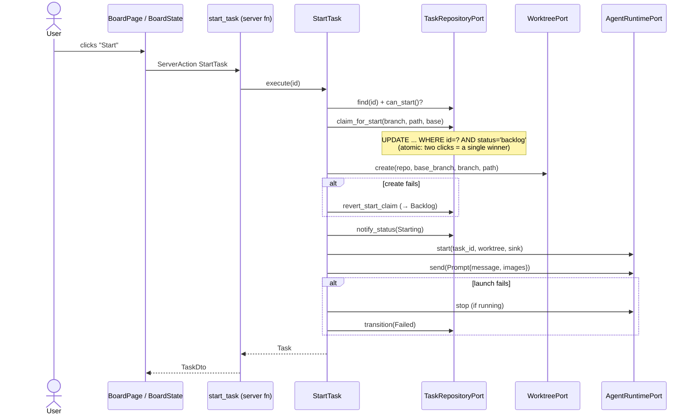

Design points to note in `src/modules/tasks/application/usecases/start_task.rs`:

- **Atomic claim (optimistic claim)**: `claim_for_start` is a single `UPDATE … WHERE status = 'backlog'`; it returns `false` if someone already claimed it. It replaces a lock or `SELECT … FOR UPDATE`.
- **Explicit compensation**: if `worktrees.create` fails, the claim is reverted; if `launch` fails, the agent is stopped and the task is marked `Failed`, keeping the worktree for inspection.
- `branch_name(&title, &uuid)` and `worktree_dir_name(...)` generate unique names (`pi/<slug>-<id8>`).

### 7.2 Agent events: the most important pipeline

The agent is a child process that speaks **JSONL over stdin/stdout** (`pi` or `gentle-shell`, which speak the same RPC protocol). Each stdout line becomes an `AgentEvent`, is persisted (if applicable), triggers state transitions and is broadcast to the browser.

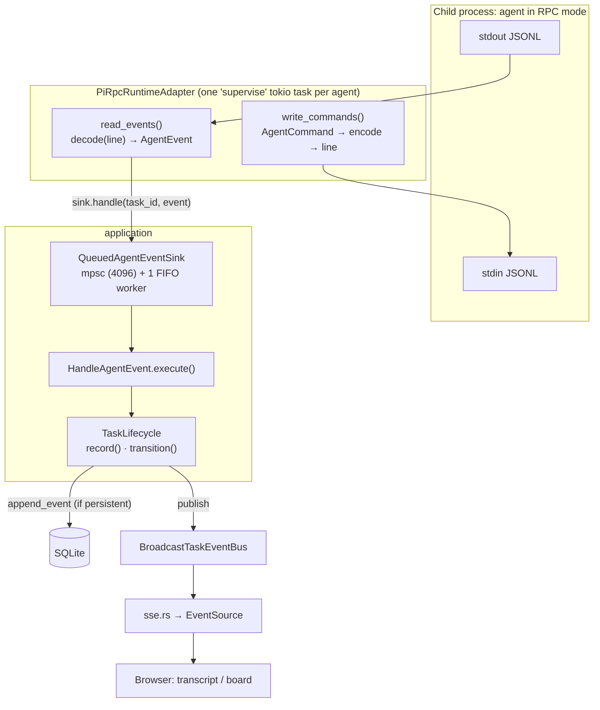

**Step 1 — the runtime** (`runtime/pi/pi_rpc_runtime_adapter.rs`; the `AgentRuntimeRouter` has already delegated to it). `start()` launches the process (via the login shell with `exec`, clean environment except session variables, `kill_on_drop`) and creates one `supervise` tokio task per agent. It keeps a `HashMap<TaskId, AgentProcess>` registry protected by a `Mutex`. `supervise` uses `tokio::select!` to wait simultaneously on: reading stdout, writing to stdin and the kill signal. When the process ends it emits `AgentEvent::ProcessExited { code }`.

```rust
loop {
    tokio::select! {
        _ = &mut reader => break,                          // stdout closed: the agent ended
        _ = &mut writer, if !writer_done => writer_done = true,
        signal = &mut kill_rx, if kill_armed => { /* start_kill() */ }
    }
}
```

`select!` is like waiting for "whichever happens first" among several `Future`s (similar to `CompletableFuture.anyOf`, but cancelling the others). `stop()` closes stdin (orderly shutdown signal), waits for a timeout and, if that is not enough, kills the process.

**Step 2 — translation** (`rpc_protocol.rs`): `encode(AgentCommand) -> String` and `decode(&str) -> Vec<AgentEvent>`. All the knowledge of pi's protocol lives here; the domain knows nothing about JSON-RPC.

**Step 3 — decoupling with a queue** (`QueuedAgentEventSink`). If the stdout reader wrote to SQLite directly, a locked database would stall reading and the agent's pipe would fill up. Instead, `handle()` only enqueues (with *backpressure*: if the queue fills, it waits; nothing is dropped) and **a single worker** consumes in FIFO order, preserving per-task order. Each event is processed in its own `tokio::spawn` so a `panic` only loses that event.

**Step 4 — `HandleAgentEvent`**:

```rust
pub async fn execute(&self, id: TaskId, event: AgentEvent) -> Result<(), TaskError> {
    let next: Option<(TaskStatus, Option<String>)> = if event.is_persistent() {
        let task: Task = self.lifecycle.load(id).await?;
        task.status.after_agent_event(&event)       // pure domain rule
    } else { None };
    self.lifecycle.record(id, event).await?;         // persist (if applicable) + publish
    if let Some((status, error)) = next {
        self.lifecycle.transition(id, status, error).await?;
    }
    Ok(())
}
```

`AgentEvent::is_persistent()` separates **ephemeral** events (`TextDelta`, `ThinkingDelta`, `ToolUpdated`, …: broadcast but not stored) from **persistent** ones (complete messages, finished tools, dialogs, process output).

**Step 5 — broadcast and client**: `TaskLifecycle::emit` publishes on the bus; `sse.rs` filters and serializes; in the browser an `EventSource` updates signals ([§9](#9-frontend-leptos-and-signals)).

### 7.3 Finish, integrate and discard

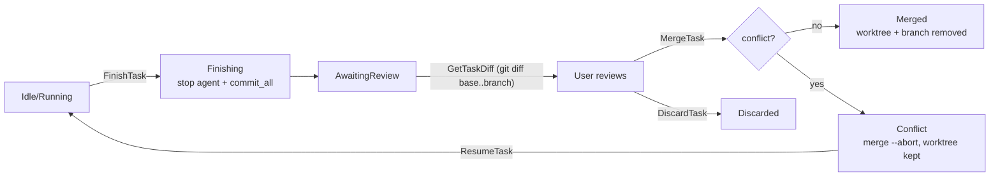

`MergeTask` (summary): before integrating, it pins the commit range with `worktrees.pin_range(...)` (this must happen *before*: after the merge the merge-base coincides with the tip) and creates the `refs/iworkflow/tasks/<id>` reference so the commits survive the branch deletion. After a successful merge it stores the range with `record_diff_range` (`base_sha`/`head_sha` columns of `tasks`). Pinning and storing are *best-effort*: a failure does not prevent integrating, it only leaves a note in the task's error. Thus `GetTaskDiff` on a `Merged` task regenerates the diff with `worktrees.diff_range(...)` instead of `diff(base, branch)`. Then it calls `worktrees.merge(...)`, which returns a `MergeOutcome`; a `match` decides between moving to `Merged` (trying to clean up the worktree) or `Conflict` with the list of files. The rules of `GitCliWorktreeAdapter` (reject if the base branch has uncommitted changes, merge in a temporary worktree if the base branch is not checked out, abort on conflicts) live in the adapter, not in the use case: they are git details.

### 7.4 Server restart

`ReconcileTasks` (called from `main`) looks for tasks in `Starting`, `Running`, `Idle` or `Finishing` —which cannot have a live agent after a restart— and moves them to `Interrupted` with a message (warning if the worktree no longer exists). From there the user can **resume** (`ResumeTask` relaunches the agent with `--continue`).

---

## 8. Persistence

### Pool and connection (`src/core/db/pool.rs`)

```rust
pub type DbConnectionRaw = SyncConnectionWrapper<SqliteConnection>;
pub type DbPool = Pool<DbConnectionRaw>;                 // deadpool

const CONNECTION_PRAGMAS: &str =
    "PRAGMA foreign_keys = ON; PRAGMA journal_mode = WAL; PRAGMA busy_timeout = 5000;";

pub const MIGRATIONS: EmbeddedMigrations = embed_migrations!("migrations");
```

- SQLite is synchronous; `SyncConnectionWrapper` wraps it to be used with `async`/`await`.
- WAL + `busy_timeout` reduce locking, but with several writers `database is locked` can still appear: hence `TaskError::Busy` and the retry decorator.
- Migrations are compiled **into** the binary and applied in `main` before accepting traffic.

### Schema and migrations

`src/core/db/schema.rs` is generated by `diesel print-schema` (not edited by hand). Current tables: `workspaces`, `tasks`, `task_events`, `task_attachments`, `agent_settings`, `agents_files`, `code_host_settings`, `jira_connection`, `jira_issues`. Each migration in `migrations/<date>_<name>/` has `up.sql` and `down.sql`.

### Diesel adapter: pattern

Three pieces per table:

1. **Row struct** (`persistence/models/task_row.rs`): DB representation, with `#[derive(Queryable, Selectable, Insertable)]`. Only primitive types (`String`, `NaiveDateTime`, `i32`).
2. **Conversions** `From<&Task> for TaskRow` and `TryFrom<TaskRow> for Task` (`TryFrom` here because parsing a state or JSON can fail). This is the *mapper* between domain and persistence.
3. **Adapter** implementing the port:

```rust
async fn claim_for_start(&self, id: TaskId, branch: String, worktree_path: PathBuf,
                         base_branch: String) -> Result<bool, TaskError> {
    let mut connection: DbConnection = self.connection().await?;     // take from the pool
    let updated: usize = diesel::update(
        tasks::table
            .filter(tasks::id.eq(id.to_string()))
            .filter(tasks::status.eq(TaskStatus::Backlog.as_str())),
    )
    .set((tasks::branch.eq(branch), tasks::status.eq(TaskStatus::Starting.as_str()), /* ... */))
    .execute(&mut connection)
    .await
    .map_err(db_error)?;                                              // DieselError → TaskError
    Ok(updated > 0)
}
```

Diesel is a query builder typed at compile time (halfway between JOOQ and JPA Criteria): if `tasks::status` does not exist or the type does not fit, it **does not compile**. There is no textual SQL except the `PRAGMA`s.

### Retry decorator (`retrying_task_repository.rs`)

`RetryingTaskRepository` implements `TaskRepositoryPort` by **wrapping** another `TaskRepositoryPort` (Decorator pattern). Each method calls `self.retry("name", || self.inner.method(...))`, which retries with exponential backoff (25 ms → 1 s) while the error satisfies `is_transient()`. Each call is retried separately because every port method is atomic (a single statement or transaction).

---

## 9. Frontend: Leptos and Signals

### Mental model

Leptos is fine-grained reactive (closer to Solid.js than to React): **there is no *virtual DOM* and no component re-render**. A `#[component]` function runs **once**; what changes are the DOM nodes subscribed to specific signals.

| Primitive | Purpose | Analogy |
|---|---|---|
| `RwSignal<T>` / `signal()` | Local UI state | `useState` / `ObservableValue` |
| `Memo<T>` | Derived, cached value | `computed` |
| `Resource` | Async read via server function (with SSR + Suspense) | `useQuery` |
| `ServerAction<F>` | Mutation via server function; exposes `pending()`, `value()`, `version()` | `useMutation` |
| `Effect` | UI side effect (not for orchestrating backend calls) | `useEffect` |
| `provide_context` / `use_context` | Share state with descendants | `Context` |

`view! { ... }` is a macro with JSX-like syntax. `<Suspense>`, `<Transition>` and `<ErrorBoundary>` handle loading and errors.

### *Page → State → Server fn* pattern

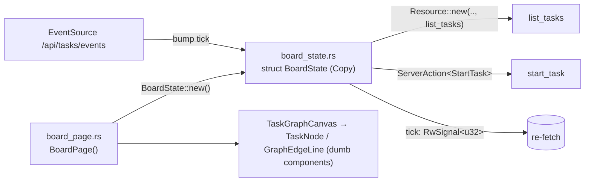

`BoardState` (`presentation/state/board_state.rs`) is a `Copy` struct of signals (Leptos signals are cheap-to-copy *handles*). Its `Resource` re-runs when its "key" changes: a tuple of version counters of each action plus `tick`.

```rust
let tasks: Resource<Result<Vec<TaskDto>, ServerFnError>> = Resource::new(
    move || (tick.get(), create.version().get(), delete.version().get(),
             start.version().get(), finish.version().get(), merge.version().get()),
    |_| list_tasks(None),
);
```

Reading: "reload the list every time an action finishes **or** `tick` changes". `tick` is incremented by the SSE `EventSource` when the server reports a change. So the flow is: user action / server event → a dependency changes → the `Resource` refetches → the UI updates only where it changed.

### Workspace board (dependency graph)

The board is scoped to one workspace (`/board/:workspace_id`; `/` resolves the first workspace by name) and renders the task dependency graph: HTML nodes (`TaskNode`) and SVG Bézier edges (`GraphEdgeLine`) inside a pannable/zoomable layer (`TaskGraphCanvas`). `BoardState` loads the graph with `get_task_graph` in a `Resource` keyed by the workspace, the version counters of the edge/position actions and a signature of the statuses of the workspace's tasks, so a successor that the server starts on its own (all its predecessors `merged`) shows up without a reload. Gestures end in `add_task_dependency`, `remove_task_dependency` or `set_task_position`; rejected edges (cycle, duplicate, cross-workspace…) are shown as toasts and leave the graph unchanged. *Add next / parallel task* creates the task with `start_now = false` and then adds the needed edges. The edge view model reserves an optional `label` for future edge conditions; none are implemented. In the sidebar, clicking a workspace opens its board and the item menu offers **View files** (`/workspaces/:id`, the project tree).

**Loose tasks panel.** Every visible task of the workspace is either a graph node or *loose*, never both and never neither: `partition_tasks` in `graph_model.rs` is the single definition (a task is a node when it has an edge to another *visible* task, a saved position or a just-placed one; edges to tasks hidden by the *show completed* filter do not count), and `loose_tasks` / `build_graph` both derive from it. Loose tasks are not drawn on the canvas. They appear in the left `LooseTasksPanel` (`CollapsiblePanel` from `core/components`, fixed 280 px, scrollable) as `LooseTaskCard`s that reuse `TaskCardActions`, so they run standalone. Dragging a card onto the canvas (pointer helpers in `loose_drag.rs`: hit-test against the canvas rect, drop position through the viewport transform) or the *Add to graph* button (visible canvas centre) calls the existing `set_task_position`, which turns it into a node; an optimistic override (pure transitions in `placement.rs`: place, roll back on a failed save, drop once the server returns the same position) keeps it from flashing back into the panel. The inverse is the *Remove from graph* node action: `detach_task_from_graph` → `DetachTaskFromGraph` → `TaskGraphRepositoryPort::detach_task`, which deletes every edge of the task (both directions) and its `task_positions` row in one immediate transaction, then runs the successor trigger (failure only logged); former successors left with no predecessors become standalone tasks (never auto-started), those whose remaining predecessors are all merged may start. `BoardState` drops the task's override and selection on success so it reappears in the panel. Under 768 px the two panels become `SegmentedControl` sub-tabs (*Loose (N)* / *Graph*, `BoardTab` signal in `BoardState`, default = Graph unless there are no nodes and some loose tasks); the inactive pane is hidden with CSS but stays laid out so the canvas keeps its size, and drag-to-canvas is disabled there in favour of the button.

### Logic outside the components

Components (`task_node.rs`, `graph_edge.rs`, `task_graph_canvas.rs`, …) only render and receive `Callback`s. **Pure** presentation rules are extracted into testable functions in `state/`: `graph_model.rs` (`build_graph`, `waiting_count`, `resolve_positions` — the layered auto layout for nodes without a saved position —, `link_predecessors` for *next*/*parallel* tasks, `resolve_board_workspace`), `graph_geometry.rs` (screen↔canvas transforms, zoom, fit, anchors and Bézier edge paths) and `graph_interaction.rs` (the pan / drag-node / connect gesture state machine). Being functions without I/O, they are tested with plain `#[test]`s without a browser.

### Browser-only code

The `EventSource` (`task_events.rs`, `task_detail_state.rs`) uses `web_sys` and only exists under `#[cfg(feature = "hydrate")]`; in SSR there is an empty version:

```rust
#[cfg(not(feature = "hydrate"))]
pub fn subscribe_task_events(_tick: RwSignal<u32>) {}

#[cfg(feature = "hydrate")]
pub fn subscribe_task_events(tick: RwSignal<u32>) { /* EventSource + reconnection + 60 s fallback polling */ }
```

### Shell, routes and theme

`src/app.rs` defines `shell()` (the document HTML with `HydrationScripts`) and `App()` with `<Router>` and the routes:

| Route | Page |
|---|---|
| `/` · `/board/:workspace_id` | `BoardPage` (dependency-graph board of one workspace; `/` shows the first workspace by name) |
| `/workspaces` | `WorkspacesPage` |
| `/workspaces/:id` · `/workspaces/:id/files/*` | Workspace file tree and editor |
| `/tasks/:id` · `/tasks/:id/edit` | `TaskDetailPage` · `TaskEditPage` |
| `/tasks/:id/diff` · `/tasks/:id/terminal` · `/tasks/:id/files[/*]` | Diff, terminal and explorer of the task worktree |
| `/terminals` · `/terminals/:session_id` · `/workspaces/:id/terminal` | Terminals |
| `/agents-files` | `AgentsFilesPage` |

Each route opens as a **tab** of the dock (`src/core/dock/`): `TabRoute` in `app.rs` translates the URL into a title, icon and view, and `DockLayout` (`layout.rs`, pure and tested logic) models splittable groups and tab operations (open, close, move between groups, split, reorder with `reorder_tab`). `host.rs` renders the tree and `dock.js` handles dragging in the browser.

`lib.rs` exposes `hydrate()` (`#[wasm_bindgen]`), which mounts the app over the HTML already rendered by the server.

---

## 10. Remaining modules

### `workspaces` — registered repositories

A *workspace* is a folder with a git repo where tasks are launched.

- Use cases: `RegisterWorkspace` (normalizes the path to the repo root; if it does not exist/is not git and `initialize` is `true`, creates and initializes it; if it has no commits, creates an empty initial one so worktrees can be created), `ListWorkspaces`, `GetWorkspace`, `DeleteWorkspace` (deletes tasks in cascade via `WorkspaceTasksPort`), `BrowseDirectories` / `CreateDirectory` (folder picker), `ListAgentsFileOptions`.
- Adapters: `WorkspaceRepositoryAdapter` (Diesel), `GitCliRepositoryAdapter` (`git`), `FsDirectoryBrowserAdapter`.
- Dependencies between features: **inbound** from `tasks` and `agents_files` (they query workspaces via bridges); **outbound** to both (ports `WorkspaceTasksPort`, `AgentsFilesPort`).

### `terminal` — terminals in the browser

- Domain: `TerminalSession`, `TerminalSize`, `TerminalSessionId`. Ports: `PtyPort` (spawn, attach, write, resize, close), `WorkspacePathPort`.
- Adapter: `PortablePtyAdapter` (`portable-pty` crate).
- **WebSocket** (`ws.rs`): binary frames = PTY bytes in both directions; text frames = resize JSON. The session **outlives** the socket (allows reconnecting); it only ends with `close_terminal` or when the shell exits. It validates that `Origin` matches `Host` (`is_same_origin`) to prevent shell hijacking from another website.
- It does not use a database.

### `agent_settings` — how the agent is launched

- Stores in SQLite (one row) the **runtime** (`AgentRuntime::GentleShell` = `gentle-shell`, the default, `AgentRuntime::Pi` = `pi`, `AgentRuntime::Claude` = `claude` or `AgentRuntime::Cursor` = `cursor`; its `as_str()` matches the `RuntimeId` registered in the `tasks` router), **model**, **profile** and **thinking level**.
- `PrepareLaunch` reads the settings, applies the task's profile *pin* (`ProfilePinPort`; `GitProfilePinAdapter` writes `<git-common-dir>/gentle-ai/profile-pin.json`) and returns the `LaunchPreferences` that `tasks` uses at launch (through `LaunchSettingsBridge`).
- Adapters: `AgentSettingsRepositoryAdapter`, `AgentCliModelCatalogAdapter` (lists models by running the CLI), `ProfilesFileCatalogAdapter` (reads `profiles.json`), `GitProfilePinAdapter`.

### `agent_profiles` — agent profiles and routing

- Manages `gentle-ai` **profiles** (create, duplicate, rename, delete, import/export JSON), **agent roles** (`create_agent_role`) and the role → model/thinking **routing**, both global (`get_global_routing` / `set_global_routing`) and per profile (`set_profile_routing`).
- Outbound ports: `ProfileStorePort`, `AgentRolePort`, `GlobalRoutingPort`, `ProfileExchangePort`, `ModelOptionsPort`; the adapters read and write the agent's configuration files (`WriteGuard`, a shared `Mutex`, serializes the load → mutate → save cycle of `profiles.json`).
- Pages: `/profiles` and `/models`. It is independent of `agent_settings`, which only *selects* the active profile at launch.

### `project_tree` — file explorer and editor

- The scope is a `ProjectScope` (workspace or task): `WorkspaceRootPort` resolves the root (the repository's or the task's worktree), so the same tree and editor serve both cases (`/workspaces/:id/files/…` and `/tasks/:id/files/…`).
- Use cases: `ListProjectDirectory`, `ReadProjectFile`, `WriteProjectFile`, and for git status `ListProjectGitChanges` and `ReadProjectFileBase` (content at `HEAD`). Port `GitStatusPort`, adapter `GitCliStatusAdapter` (`git` CLI).
- Presentation: the tree colors entries and ancestor folders according to git status (`state/git_status.rs`); the editor (`core/components/code.rs`) uses `core/line_diff.rs` to mark added, modified and deleted lines against `HEAD` in the gutter, live while editing.

### `agents_files` — AGENTS.md library

- Lets you upload `AGENTS.md` files, store them (metadata in SQLite, content in `~/.iworkflow/agents-files/`) and install them in a workspace (`InstallAgentsFile`, with an "already exists" check).
- Adapters: `AgentsFileRepositoryAdapter` (Diesel), `FsAgentsFileStorageAdapter`, `GitAgentsFileInstallerAdapter`.
- It obtains the "projects" from `workspaces` through `ProjectLookupBridge`.

### `jira` — import from Jira Server / Data Center

Imports tasks from an on-premise Jira, lets you manage them (status, comments) and convert them into iworkflow tasks. It is read-mostly: it only writes to Jira when transitioning or commenting.

- **Connection** (`jira_connection`, single row `id = 1`): base URL, PAT token (`Authorization: Bearer`, REST API v2), JQL (default `assignee = currentUser() AND resolution = Unresolved ORDER BY updated DESC`), `accept_invalid_certs` and the state of the last sync. `SaveConnection` validates against Jira before saving; the token **never travels to the client** (the DTO only exposes whether it is configured; empty on edit keeps the stored one).
- **Sync** (`SyncIssues`): fetches at most 500 issues from the JQL into `jira_issues`. The local state (`new` / `converted` / `ignored`) and the linked `task_id` are preserved across syncs; new issues that Jira no longer returns are removed.
- **Manage**: `ListIssues` (with filters and search), `GetIssue`, `ListIssueComments`/`AddIssueComment`, `ListIssueTransitions`/`TransitionIssue` (Jira workflow) and `SetIssueIgnored` (local only).
- **Convert**: `PrepareConversion` proposes title, prompt and priority (`PriorityHint` maps Jira's priority name); `ListConversionBranches` and `ConvertIssue` create the task and mark the issue as `converted` with its `task_id`.
- **Coupling**: `jira` does not import `tasks`. It defines `TaskCreationPort` and `WorkspaceCatalogPort`, implemented in `app_state.rs` by `TaskCreationBridge` (`tasks::CreateTask`) and `WorkspaceCatalogBridge` (`tasks::ListWorkspaceOptions`/`ListWorkspaceBranches`).
- **HTTP client** (`ReqwestJiraClientAdapter`, `jira_json.rs` for the mapping): `reqwest`, issue cap per sync and an unverified-certificate option.
- **Tests**: unit tests with `mockall` (`mocks.rs`) and integration in `tests/modules/jira/` (temporary SQLite).

### `code_hosting` — merge/pull requests, CI and merge against GitLab or GitHub

From each task, it lets you open an MR (GitLab) or PR (GitHub), see its status and the latest CI pipeline/workflow, and merge it. A workspace can belong to either provider: it is detected from the host of `origin`. It does not use `git push`: the task branch must already be published.

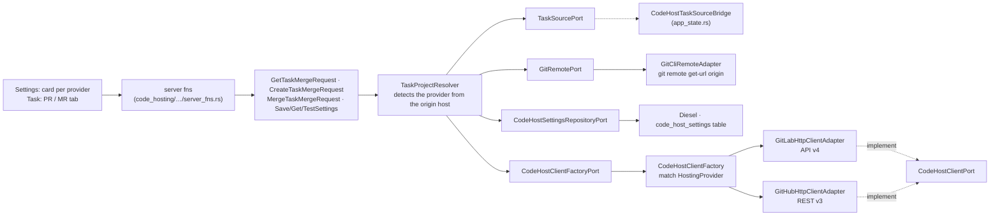

- **Factory pattern**: use cases depend on `CodeHostClientFactoryPort::client_for(HostingProvider)`; `CodeHostClientFactory` (infrastructure) builds the adapter with an exhaustive `match`, without a default branch, so adding a provider forces implementing its adapter. `GitLabHttpClientAdapter` and `GitHubHttpClientAdapter` implement the same neutral port `CodeHostClientPort` and share the HTTP client manager and the helpers in `http_support.rs`. The domain vocabulary is neutral (`MergeRequest`, `Pipeline`): each adapter normalizes states (GitHub `open`/`closed`+`merged` → `opened`/`merged`/`closed`; `mergeable_state` → `mergeable`/`conflict`/`blocked_status`/`checking`; Actions runs and jobs → `pending`/`running`/`success`/`failed`/`canceled`/`skipped`/`manual`).
- **Global per-provider settings** (`SaveCodeHostSettings`, `GetCodeHostSettings`, `TestCodeHostConnection`, all with `HostingProvider`): base URL, personal token and `insecure_tls`, one row per provider in `code_host_settings` (key `provider`: `gitlab` | `github`). The migration `2026-10-17-100000-0000_create_code_host_settings` copies the previous row from `gitlab_settings` (token included) and `down.sql` restores it. `CodeHostSettings` validates the URL (`http(s)`, no credentials), hides the token in `Debug` and computes the API root: GitLab `/api/v4`; GitHub `https://api.github.com` for github.com or `<base>/api/v3` for GitHub Enterprise. The token **never travels to the client**: `CodeHostSettingsDto` only exposes `token_configured`; saving with an empty token keeps the existing one of the same provider, unless the URL changes.
- **Provider and project from `origin`**: `TaskProjectResolver` obtains the task through `TaskSourcePort`, reads `origin` through `GitRemotePort` and `RemoteUrl::parse` extracts host and path (https, `ssh://`, scp; credentials redacted in errors). `CodeHostSettings::select_for_host` picks the settings whose host matches (ignores port and scheme; `ssh.github.com` counts as github.com). No match: unconfigured github.com → `NotConfigured(GitHub)`; any other host → `UnknownHost`. `project_path` discards the relative URL prefix (`/gitlab`) and on GitHub requires `owner/repository`.
- **Per-task use cases**: `GetTaskMergeRequest` (the branch's most recent MR/PR, preferring the open one, + latest CI), `CreateTaskMergeRequest` (reuses the open one; otherwise normalizes the base branch to its server name —`origin/develop` → `develop`—, rejects it if it equals the task branch —`SameSourceAndTarget`— or is not on the server —`BaseBranchNotPublished`—, pushes the task branch with `git push` if missing —`BranchPublishFailed` on failure; `GitRemotePort::publish_branch` pushes to `CodeHostSettings::push_url` (`<base>/<project>.git`) with the provider token as HTTP Basic through `GIT_CONFIG_*` environment variables scoped to that instance, so the token never reaches the command line, other hosts or a credential helper, and `origin` may be SSH— and creates the MR/PR), `MergeTaskMergeRequest` (the provider's message is propagated to the user). `MergeRequestStatus` carries the `provider` so the UI uses the right vocabulary (`presentation/provider_text.rs`: MR/PR, `!`/`#`, pipeline/workflow).
- **HTTP clients**: `reqwest` with rustls and timeouts. GitLab: `PRIVATE-TOKEN` header; GitHub: `Authorization: Bearer`, `Accept: application/vnd.github+json`, `X-GitHub-Api-Version` and `User-Agent`. Path components are encoded. **Redirects are disabled** on purpose: `reqwest` does not strip custom headers when changing host and the token could leak; a 30x is returned as an error. Network errors do not include the URL. On GitHub, finding a branch's PR and reading CI each make one extra request (the listing carries neither `mergeable` nor `head.sha`).
- **Coupling**: `code_hosting` does not import `tasks` or `workspaces`. `CodeHostTaskSourceBridge` (in `app_state.rs`) implements `TaskSourcePort` with `tasks::GetTask` and `workspaces::GetWorkspace` (returns `None` for `Backlog` tasks, which have no branch). In the UI, `app.rs` injects the cards (`CodeHostSettingsCard provider=…`) into `SettingsPage` and the tab into `TaskDetailPage` (`TaskExtraTab`).
- **Tests**: unit tests with `mockall` (`mocks.rs`) and fake GitLab/GitHub servers built with `axum` for the clients (including the no-token-leak-on-redirect test); integration in `tests/modules/code_hosting/` (temporary SQLite and temporary git repos).

### Native Windows support

Platform-specific code is confined to infrastructure:

- `core/config.rs`: the home directory comes from `HOME` or, if missing, `USERPROFILE`.
- `agent_process.rs` and the PTY (`portable_pty_adapter.rs`): on Unix, agents and the terminal are launched with the login shell and `exec`; on Windows with `powershell.exe` (no `exec`, inherited `PATH`). `core/process.rs` kills the process tree with `taskkill /T` on Windows.
- `nix` is only compiled on Unix; per-task RAM/CPU limits (`systemd-run`) exist only on Linux.
- The support has logic tests on Linux but has not yet been run on a real Windows. See "Prebuilt binaries" in the README.
- Desktop updates (`electron/`): `update-policy.js` (pure, tested) decides `auto` / `notify` / `off`; `updater.js` wires it to Electron. Windows (NSIS) and Linux (AppImage) use `electron-updater` against the GitHub release (`publish` in `electron-builder.yml`; `release.yml` must upload `latest*.yml`). macOS only notifies through the GitHub API because Squirrel.Mac needs a valid signature and the app is signed ad hoc, so its `latest-mac.yml` (it would also collide between arm64 and x86_64) is not published. Before `quitAndInstall` the shell stops the server, since the installer cannot replace a running binary.

### macOS support

macOS runs the Unix code paths, so the server needs almost nothing of its own:

- `core/launch.rs`: the browser is opened with `open` (`opener_command`, `cfg(target_os = "macos")`).
- Agents, terminal and model catalogs use the login shell (`$SHELL`, `zsh` by default on macOS) with `-l` and `exec`, exactly as on Linux; `nix` (signals, `getifaddrs` for the network interfaces) is compiled because `cfg(unix)` holds.
- Per-task RAM/CPU limits (`systemd-run`) exist only on Linux, so they do not apply.
- Desktop shell (`electron/`): the `dmg` target is built per architecture (`macos-arm64` and `macos-x86_64` runners in `release.yml`) and signed ad hoc (`identity: "-"`) because Apple Silicon rejects an app whose signature broke when the server was added to its resources; it is not notarized, so Gatekeeper blocks the first launch. `launcher.js` (`buildServerEnv`) appends `/opt/homebrew/bin` and `/usr/local/bin` to the server `PATH`, since apps opened from Finder do not inherit the shell one. `main.js` brings the window back on the Dock `activate` event and uses an 18 px menu bar icon.
- `scripts/bump-version.sh` uses `perl` instead of GNU `sed`, which BSD `sed` does not match.
- The support has logic tests on Linux but has not yet been run on a real Mac.

---

## 11. Testing strategy

| What | Where | How |
|---|---|---|
| Domain rules | `#[cfg(test)] mod tests` next to the code | Pure `#[test]`s (`TaskStatus`, `after_agent_event`, `build_graph`) |
| Use cases | `#[cfg(test)] mod tests` in each `usecases/*.rs` | `#[tokio::test]` + `mockall` mocks of the ports; `application/test_support.rs` offers a `Recorded` to inspect emitted states and events |
| Mocks | `src/modules/<feature>/mocks.rs` | `mock! { pub TaskRepository {} #[async_trait] impl TaskRepositoryPort for TaskRepository { ... } }` — the equivalent of Mockito's `@Mock` generated from the trait |
| Diesel / FS / git / runtime adapters | `tests/modules/<feature>/*_test.rs` | Integration against temporary SQLite (`tempfile`) with the real migrations applied; `tests/common/mod.rs` provides `test_db()` and `git_repo()` |
| Agent runtime | `tests/modules/tasks/pi_rpc_runtime_adapter_test.rs`, `tests/modules/tasks/claude_stream_runtime_adapter_test.rs`, `tests/modules/tasks/cursor_acp_runtime_adapter_test.rs` | Fake processes in `tests/fixtures/` (`fake_agent.py`, `stubborn_agent.py`, `fake_claude.py`, `fake_cursor.py` for ACP) |
| Queue resilience | `tests/modules/tasks/event_queue_resilience_test.rs` | Simulates SQLite locks |
| UI | `end2end/` | Playwright (`run_smoke.sh`) with a fake agent |

Example of a use case test (general pattern; see `finish_task.rs`):

```rust
#[tokio::test]
async fn stops_agent_commits_and_awaits_review() {
    let task: Task = test_support::task(TaskStatus::Idle);
    let recorded: Recorded = Recorded::default();
    let mut worktrees: MockWorktree = MockWorktree::new();
    worktrees.expect_commit_all()
        .withf(|path: &Path, message: &str| path == Path::new(WORKTREE) && message == "pi: Arregla el login")
        .times(1)
        .returning(|_, _| Ok(true));

    FinishTask::new(test_support::lifecycle(Some(task), &recorded), Arc::new(worktrees), /* ... */)
        .execute(id).await.expect("finished");

    assert_eq!(recorded.statuses(), vec![TaskStatus::Finishing, TaskStatus::AwaitingReview]);
}
```

Commands:

```bash
cargo test --features ssr                                    # everything
cargo test --features ssr modules::tasks                     # one feature
cargo test --features ssr --test task_repository_adapter_test  # one integration test
cargo fmt --all -- --check
cargo clippy --features ssr --all-targets -- -D warnings
cargo clippy --features hydrate --target wasm32-unknown-unknown --lib -- -D warnings
cargo leptos watch                                           # development at http://127.0.0.1:3000
```

The `[[test]]` entries in `Cargo.toml` declare each integration test with `required-features = ["ssr"]` because they depend on server-only code.

---

## 12. Recommended reading path

Suggested order to understand the code with the fewest jumps:

1. **`src/lib.rs`, `src/app.rs`** — what gets compiled and which routes exist (5 min).
2. **`src/main.rs`** — startup, orderly shutdown, where the contexts are injected.
3. **`src/app_state.rs`** — composition and *bridges*; read only `AppState::new` and one bridge.
4. **`src/core/db/pool.rs`** — pool, pragmas, migrations.
5. **`modules/tasks/domain/models/task.rs`** — `TaskId`, `TaskStatus`, transition rules. It is the heart of the domain.
6. **`modules/tasks/domain/ports/outbound/`** — read the traits as if they were the interfaces of a Java service.
7. **`modules/tasks/application/services/task_lifecycle.rs`** and then `usecases/start_task.rs`, `finish_task.rs`, `merge_task.rs`.
8. **`modules/tasks/infrastructure/di/tasks_context.rs`** — see how everything is plugged together.
9. **`modules/tasks/infrastructure/adapters/inbound/server_fns.rs`** + `dto/task_dto.rs`.
10. **`modules/tasks/infrastructure/adapters/outbound/persistence/task_repository_adapter.rs`** (and `retrying_task_repository.rs`).
11. **The event pipeline**: `runtime/agent_runtime_router.rs` → `runtime/pi/pi_rpc_runtime_adapter.rs` → `pi/rpc_protocol.rs` → `queued_agent_event_sink.rs` → `handle_agent_event.rs` → `sse.rs`.
12. **`modules/tasks/presentation/state/board_state.rs`**, `pages/board_page.rs` and `state/task_events.rs`.
13. Afterwards, `workspaces` and `terminal` as second reads: you will already recognize the pattern and only the details change.

### Checklist for adding a feature (working pattern)

1. Model / rule in `domain/models` (with tests).
2. If it needs something external, a trait in `domain/ports/outbound` + its mock in `mocks.rs`.
3. Use case in `application/usecases` with `mockall` tests.
4. Adapter in `infrastructure/adapters/outbound` + integration test in `tests/modules/<feature>/`; if it touches the DB, a migration with `up.sql`/`down.sql` and regenerate `schema.rs`.
5. Register the use case in `<feature>_context.rs`.
6. DTO + server function (no logic) + mapping and error test.
7. State in `presentation/state`, page/component (no business logic).
