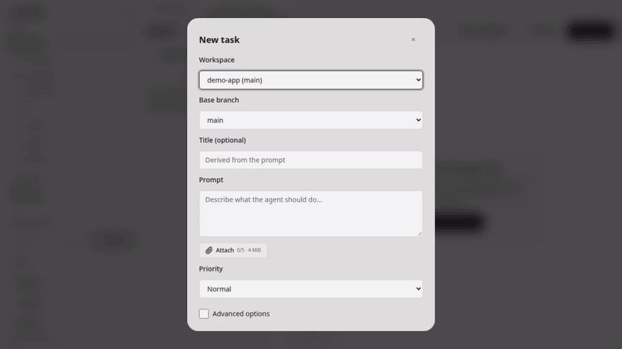
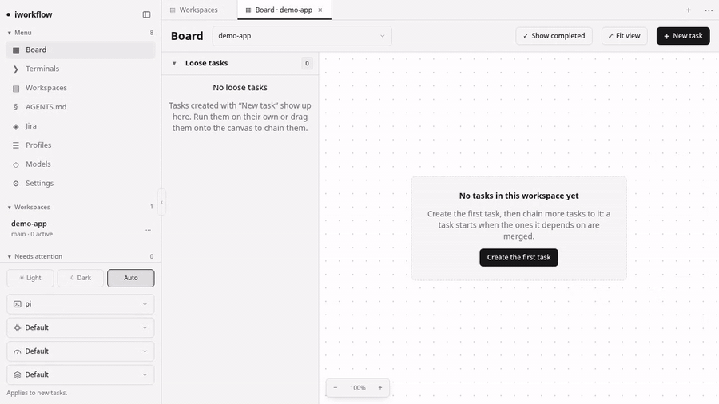

# iworkflow

> 🇪🇸 Versión en castellano: [README.es.md](README.es.md)

**iworkflow is an ADE (Agentic Development Environment)**: a self-hosted web app to launch, follow and review several AI coding agents in parallel. Instead of editing files yourself, you manage **tasks**: each one runs an agent in its own git worktree, and you review the diff before anything reaches your branch.

<p align="center">
  
  <br />
  <sub>Chain tasks on a board; when one is merged, the tasks that depend on it start on their own.</sub>
</p>

> **Status:** early and actively developed. It runs on your own machine, has no user accounts (only an optional access token for network access) and is source-available (PolyForm Shield 1.0.0), not OSI open source. See [Quick start](#quick-start) and [License](#license).

## Highlights

- **Parallel agents, one place**: launch and steer `gentle-shell`, `pi`, `claude` or `cursor` side by side.
- **Isolated by design**: every task gets its own **git worktree**, so agents never overwrite each other.
- **Review, don't redo**: when an agent finishes you read its diff and either merge it (`merge --no-ff`) or discard it.
- **Task graph**: chain tasks on a board; a task starts by itself once its predecessors are merged.
- **Integrated**: GitLab / GitHub (MR/PR and CI status) and Jira Server / Data Center.
- **Mobile-first**: check progress, answer an agent's question and merge from your phone (through Tailscale).
- **Tabbed IDE-like workspace**: board, task, diff, terminal and file editor as draggable, splittable tabs.

iworkflow imposes no workflow: each agent uses the configuration and plugins you already have installed, plus the project's `AGENTS.md`. Under the hood agents are driven over RPC (or ACP / stream-json, depending on the runtime). It is built with Rust, Leptos (SSR + hydration), Diesel and SQLite.

## Index

- [Designed for mobile](#designed-for-mobile)
- [Quick start](#quick-start)
- [Tabbed workspace](#tabbed-workspace)
- [Workspace board](#workspace-board)
- [Task lifecycle](#task-lifecycle)
- [GitLab and GitHub integration](#gitlab-and-github-integration)
- [Jira integration (Server / Data Center)](#jira-integration-server--data-center)
- [Agent profiles and models](#agent-profiles-and-models)
- [Configuration](#configuration)
  - [Agent runtimes](#agent-runtimes)
  - [Executable arguments](#executable-arguments)
- [Production](#production)
- [Developing from your phone with Tailscale](#developing-from-your-phone-with-tailscale)
- [Development](#development)
- [License](#license)
- [Support the project](#support-the-project)

## Designed for mobile

iworkflow is built **mobile-first**. Since your job is to launch, follow and review agents (not to type code), it works well from a phone:

- The UI is responsive: on small screens the side menu becomes a drawer opened from a top bar, and the tabbed workspace adapts to the viewport.
- The agent keeps running on your machine while you are away. From the phone you check progress, answer agent questions, send a message, review the diff and merge or discard.
- On iOS (Safari → Share → *Add to Home Screen*) and Android (Chrome → menu → *Add to Home screen*) you can pin it as a shortcut. For now it opens in the browser; it does not yet ship a web app manifest, so it is not a standalone full-screen app.

The server runs on your computer and the phone is only a browser, so you need a secure way to reach it: see [Developing from your phone with Tailscale](#developing-from-your-phone-with-tailscale).

## Quick start

Requirements: `git`, a Rust toolchain (edition 2024, Rust 1.85 or newer), [`cargo-leptos`](https://github.com/leptos-rs/cargo-leptos) (`cargo install cargo-leptos --locked`), the `wasm32-unknown-unknown` target (`rustup target add wasm32-unknown-unknown`) and at least one agent CLI installed and logged in (`gentle-shell`, `pi`, `claude` or `agent` for Cursor).

```bash
git clone https://github.com/plopezm/iworkflow.git
cd iworkflow
cargo leptos watch          # http://127.0.0.1:3000
```

1. **Workspaces** → register a folder with git (it needs at least one commit).
2. **Tasks** → pick a workspace, write the prompt and launch.
3. In the task detail you follow the agent live and can:
   - send messages (a prompt if it is waiting; *steer* or *follow-up* if it is working),
   - answer agent dialogs (`ask_user_question`, confirmations…),
   - abort the current run.
4. **Finish and review** → closes the agent, commits whatever is pending and shows the diff.
5. **Merge** (integrates with `--no-ff` and deletes the worktree) or **Discard**.

> **Security:** iworkflow is protected only by an optional access token and launches agents that run commands as your user. Do not expose it to untrusted networks; see [Production](#production) and [Tailscale](#developing-from-your-phone-with-tailscale). Development listens on `127.0.0.1:3000`; the production script on `0.0.0.0:9000`.

## Tabbed workspace

The interface is an IDE-like workspace: every screen (board, task, diff, terminal, settings, files…) opens as a **tab** inside groups you can split by dragging. Tabs can be reordered by dragging them within their bar, moved to another group or dropped into a new split.

- **File explorer and editor** (with syntax highlighting) over a workspace or over a task's worktree. In the task panel: **Review → Explore files**.
- Modified, added, untracked, deleted or conflicted files and folders are colored according to `git status`.
- While you edit, the left gutter marks added, modified and deleted lines against `HEAD` (as in VS Code).
- When **editing a task**, the CPU and memory limits live under *Advanced options*.

## Workspace board

Each workspace has its own **board**: a canvas of task nodes joined by arrows (`/board/<workspace>`; `/` opens the first workspace by name). Clicking a workspace in the sidebar opens its board, and the workspace chips at the top of the board switch between workspaces. The sidebar item menu keeps **View files** (the project tree), **Open terminal** and **Manage workspaces**.

- **Dependency graph:** drag from a node's right port onto another task to make it wait for the first one. Select an arrow to delete it. Self-references, duplicates, cycles, arrows across workspaces and arrows into a task that is no longer in *To do* are rejected with a message.
- **Merge trigger:** a task with predecessors starts on its own, on its configured base branch, once **all** of them are `merged`. A *To do* task without predecessors is started manually with **Start**. Arrows are drawn muted while the predecessor is pending, with a flowing dashed line while it works, and solid green once it is merged. (Edge conditions are not implemented yet; the model leaves room for them.)
- **Nested and parallel tasks:** *Add next task* creates a task that depends on the selected one; *Add parallel task* creates one with the same predecessors. Both are created in *To do*.
- **Canvas:** drag the background to pan, use the wheel to zoom and **Fit view** to frame everything. Node positions are saved; tasks without a saved position are laid out automatically in layers.
- **Loose tasks panel:** on the left, tasks with no arrows and no saved position (every task made with *New task* starts here) are listed with their usual actions (Start, Edit, Delete, Open, Merge…), so they can run standalone without any chain. Drag a card onto the canvas, or press **Add to graph**, to make it a node; *Add next / parallel task* tasks go straight into the graph. **Remove from graph** on a node deletes all its arrows and saved position (atomically) and sends it back to this panel; successors left without predecessors become ordinary standalone tasks. The panel is collapsible and counts its tasks; on screens under 768 px it becomes a **Loose (N) / Graph** tab switch.

## Task lifecycle

<p align="center">
  
  <br />
  <sub>One task end to end: launch, follow the agent live, review the diff, merge.</sub>
</p>

```text
starting → running ⇄ idle → finishing → awaiting_review → merged
                                              │               ↘ discarded
                                              ↓
              conflict · failed · interrupted ── Resume (gentle-shell --continue)
```

| Situation | What the app does |
|---|---|
| Conflict while integrating | `merge --abort`; the task moves to `conflict` and keeps its worktree. Resume the agent to resolve it. |
| Base branch with uncommitted changes | Rejects the merge without touching anything. |
| Base branch not checked out | Integrates in a temporary worktree. |
| Server restart | Active tasks move to `interrupted`; they can be resumed. |

## GitLab and GitHub integration

From each task you can create a merge request (GitLab) or pull request (GitHub), watch its CI and merge it. A workspace can be a repository on either: the provider is detected from the host of the `origin` remote and that provider's configuration is applied.

1. **Settings** has one card per provider.
   - **GitLab**: your instance URL (e.g. `https://gitlab.mycompany.local`) and a personal token with the `api` scope.
   - **GitHub**: `https://github.com` (proposed by default) or your GitHub Enterprise URL, and a personal token (`repo` scope; fine-grained: Pull requests and Contents read/write, Actions read).
   Use "Test connection" to validate them. If your certificate comes from an internal CA or is self-signed, tick "Accept untrusted TLS certificate".
2. The project is derived from the `origin` remote (https, ssh or scp). Its host must match the URL of a configured provider; if it matches none you are warned, and if it is github.com and GitHub is not configured you are asked to configure it. On GitHub the repository is `owner/repository`.
3. In the task panel, **PR / MR** tab: create the MR/PR (task branch → base branch), see its status and the latest pipeline (GitLab) or workflow (GitHub) with its jobs, and **Merge** (asks for confirmation).

Notes:
- The app **never runs `git push`**: publish the branch yourself before creating the MR; if it is not on `origin`, you are warned.
- The token is stored in clear text in the local database (`~/.iworkflow/workspaces.db`) and is never sent to the browser. Leaving it empty when editing keeps the stored one, unless you change the URL: then it has to be entered again, so it is not sent to a different server.
- HTTP redirects are disabled so the token does not leak to another host.

## Jira integration (Server / Data Center)

The **Jira** tab connects to an on-premise Jira using the server URL and a personal access token (PAT, `Authorization: Bearer`, REST API v2). On save, the connection is validated against Jira; the token is stored in the local database and never returns to the browser (leaving it empty when editing keeps the stored one).

- **Import**: "Sync" fetches the issues matching the connection's JQL (default `assignee = currentUser() AND resolution = Unresolved ORDER BY updated DESC`, at most 500). The local state (new / converted / ignored) is preserved across syncs; new issues Jira no longer returns are removed.
- **Manage**: list with search and filters, detail with description and comments, and writing back to Jira: change the status (workflow transitions) and comment. Ignore/restore is local only.
- **Convert**: the "Convert to task" button opens a form with the title, prompt and priority proposed from the Jira issue (priority is mapped from the Jira name); you choose the workspace and base branch, edit whatever you want and the task is created (optionally started). The Jira issue is marked as converted and linked.
- If the server uses a self-signed certificate or one from an internal CA the system does not know, tick "Accept unverified certificate" in the connection.

## Agent profiles and models

This feature is the integration with [Gentle AI](https://github.com/Gentleman-Programming/gentle-ai), the agent harness behind `gentle-shell` and its gentle-pi package. Profiles and per-agent model routing are Gentle AI concepts: iworkflow does not define its own, it reads and writes the same configuration files (`profiles.json`, `models.json`), so changes made here are seen by the Gentle AI TUI and vice versa. Install and configure Gentle AI first; without it these screens have nothing to manage.

Two screens equivalent to the gentle-pi commands, working on the same files:

| Screen | Equivalent to | What it does |
|---|---|---|
| `/profiles` | `/gentle:profiles` | Create, duplicate, rename, delete, import and export profiles (`profiles.json`), edit model and effort per agent and create new agent roles. |
| `/models` | `/gentle:models` | Edit the global routing (`models.json`): model and effort per agent. |

Profiles are chosen in the agent settings dropdown, which reads the same `profiles.json`. These screens do not activate a profile globally; they only manage them. The write lock prevents clobbering within one process, not against another process (e.g. the gentle-pi TUI) editing at the same time.

## Configuration

Environment variables (`.env` is supported, see `.env.example`):

| Variable | Default |
|---|---|
| `IWF_DATABASE_URL` | `~/.iworkflow/workspaces.db` (SQLite, automatic migrations) |
| `IWF_WORKTREES_DIR` | `~/.iworkflow/worktrees` |
| `IWF_GENTLE_SHELL_BIN` | `gentle-shell` (launched as `--mode rpc` with `GENTLE_SHELL_INTERACTIVE_HOST=1`) |
| `IWF_PI_BIN` | `pi` (`pi` runtime, launched as `--mode rpc`) |
| `IWF_CLAUDE_BIN` | `claude` (`claude` runtime: Claude Code with `-p` and the stream-json protocol; chosen in the runtime selector of the side menu; accepts file edits, asks for confirmation for the rest and reads the project's `AGENTS.md`) |
| `IWF_CURSOR_BIN` | `agent` (`cursor` runtime: Cursor CLI in ACP server mode, `agent acp`; requires having signed in with `agent login`) |
| `IWF_CURSOR_SESSIONS_DIR` | `cursor-sessions` next to the database (stores each task's ACP session id so it can be resumed) |
| `IWF_ATTACHMENTS_DIR` | `attachments` next to the database (images attached to tasks; deleted when the task ends) |
| `IWF_AGENTS_FILES_DIR` | `agents-files` next to the database (`AGENTS.md` library) |
| `IWF_GENTLE_PI_CONFIG_HOME` | `~/.pi/gentle-ai` (contains `profiles.json` and `models.json`) |
| `IWF_PI_AGENTS_DIR` | `~/.pi/agent/agents` (one `<role>.md` per agent role) |

The default data directories (`attachments`, `agents-files`, `cursor-sessions`) hang off the database folder: if you change `IWF_DATABASE_URL`, they move with it. On Windows the home directory is taken from `USERPROFILE` when `HOME` is missing.

### Agent runtimes

The runtime selector in the side menu supports `gentle-shell`, `pi`, `claude` and `cursor`. The choice is fixed when each task starts.

| Runtime | Binary | Capabilities |
|---|---|---|
| `gentle-shell` / `pi` | `IWF_GENTLE_SHELL_BIN` / `IWF_PI_BIN` | all (steer, follow-up, dialogs, resume, model, thinking, subagents) |
| `claude` | `IWF_CLAUDE_BIN` | dialogs, resume, model and thinking |
| `cursor` | `IWF_CURSOR_BIN` | dialogs, resume and model (the model list is obtained from the agent itself over ACP). File edits are accepted; everything else asks for confirmation |

### Executable arguments

On startup, `iworkflow` opens the web UI in the browser (`http://<host>:<port>` of the server; if it listens on `0.0.0.0`, `127.0.0.1` is used).

| Argument | Effect |
|---|---|
| `--no-open` | Starts only the server, without opening the browser. |
| `-h`, `--help` | Shows the help. |

Examples: `./iworkflow --no-open`, `./scripts/prod.sh run --no-open`, `cargo leptos watch -- --no-open`.

In development (`cargo leptos watch`) the server listens only on `127.0.0.1`.

### Access from other devices

By default the server listens only on `127.0.0.1` (this computer). To reach it from your phone, turn on **Settings → Network access** and restart the server: it then listens on `0.0.0.0` with the same port, and the card shows the address to open on the phone. The choice is stored in the database. The same card lets you change the **server port** (1024–65535, saved in the database and applied on the next start; a packaged server defaults to 9000). If `LEPTOS_SITE_ADDR` is set, it always wins and neither setting has an effect. The card shows a **QR code** and a selector with the machine's network interfaces (for example ethernet and Tailscale, each with its IP): pick the one your phone can reach and scan the code. With the token required, iworkflow opens already signed in; without it, the code just holds the plain address.

Whenever the server is reachable from the network (this setting, or a non-loopback `LEPTOS_SITE_ADDR` such as the `0.0.0.0:9000` of `scripts/prod.sh`) it demands an **access token** by default:

- The QR code and the link on the card carry the token (`http://<ip>:<port>/?token=…`) and follow the selected interface. Opening it stores the token in a cookie and redirects to a clean URL, so it does not stay in the address bar or the history. Without the cookie, the server shows a login page where you can paste the token.
- At startup the server logs that link, which is how you get it on a machine without a browser.
- **Generate a new token** on the card invalidates the old one at once; devices using it must sign in again.
- The requirement is optional: untick **Require the access token** (applies on the next start) to serve the network without it. Then anyone who can reach the port can run commands as your user, so use it only on a network you fully trust.
- Loopback-only servers (the default) never ask for the token.
- The startup log line with the link contains the token: treat the server logs as sensitive.
- Writes (`POST`, etc.) that a browser labels with an `Origin` different from the `Host` it targeted are rejected with 403, so another website cannot change these settings through your browser. A reverse proxy must therefore forward the original `Host` header.

The token is a shared secret over plain HTTP: on an untrusted network it can be sniffed. Prefer a private network such as Tailscale (see below).

## Production

Prerequisites: the Rust toolchain, `cargo-leptos` (`cargo install cargo-leptos --locked`) and the `wasm32-unknown-unknown` target (`rustup target add wasm32-unknown-unknown`).

`scripts/prod.sh` builds and runs the app in release mode:

```bash
./scripts/prod.sh build     # 1. compile in release and package into dist/
./scripts/prod.sh run       # 2. start what is already packaged
./scripts/prod.sh           # both steps in a row (build + run)
```

Typical flow: run `build` once (and again after every update), then `run` whenever you want to start the server. Arguments after `run` are passed to the binary (e.g. `--no-open`, see [Executable arguments](#executable-arguments)). The server listens on `http://0.0.0.0:9000` by default; change it with `LEPTOS_SITE_ADDR`:

```bash
LEPTOS_SITE_ADDR=127.0.0.1:3000 ./scripts/prod.sh run --no-open
DIST_DIR=/opt/iworkflow ./scripts/prod.sh build     # package somewhere else
```

`build` runs `cargo leptos build --release` and copies the `iworkflow` binary and the
`site/` folder (WASM, JS and CSS) into `dist/`. Both are required: without
`site/` the page is served but does not hydrate.

`run` exports the Leptos variables (`LEPTOS_SITE_ROOT`, `LEPTOS_ENV=PROD`…) and
starts the binary from the current directory, so the `.env` in that directory
is applied too. Variables specific to the script:

| Variable | Default |
|---|---|
| `DIST_DIR` | `dist/` at the repo root |
| `LEPTOS_SITE_ADDR` | `0.0.0.0:9000` (all interfaces) |

> **Security:** the app launches agents that run commands as your user. Its only
> protection is the access token (see [Access from other devices](#access-from-other-devices)),
> which is demanded whenever the bind is not loopback unless you switch it off, and it travels
> over plain HTTP. Restrict access with a firewall, a private network (Tailscale/WireGuard) or a
> reverse proxy with TLS. To limit it to the local machine:
> `LEPTOS_SITE_ADDR=127.0.0.1:3000 ./scripts/prod.sh run`.

To deploy on another machine, just copy `dist/` and launch it with
`LEPTOS_SITE_ROOT=site LEPTOS_ENV=PROD LEPTOS_SITE_ADDR=0.0.0.0:9000 ./iworkflow`
from inside that folder.

## Desktop app (Electron)

For people who do not want to deal with a terminal, `electron/` wraps the same server in a desktop window and `scripts/electron.sh` builds an installer for the platform it runs on (Linux: AppImage, macOS: `.dmg`, Windows: NSIS `.exe`). There is no separate "mobile server" to build: the installer already contains the same `iworkflow` binary, so a phone connects to the server running inside the app (see [Using it from your phone](#using-it-from-your-phone)).

### Build the installer

Prerequisites (once): the ones of [Production](#production) (Rust, `cargo-leptos`, the `wasm32-unknown-unknown` target), `git` and Node.js 22+ with npm. Cross-building is not supported: build each installer on its own platform.

```bash
./scripts/electron.sh build
```

It runs, in order:

1. `scripts/prod.sh build`: `cargo leptos build --release`, leaving the binary and `site/` in `dist/`.
2. Copies both into `electron/resources/server/` (outside the asar archive, so the binary stays executable).
3. `npm ci` and `electron-builder` for the current platform.
4. Writes the installer to `dist/electron/`: `iworkflow-<version>-linux-x86_64.AppImage`, `iworkflow-<version>-mac-arm64.dmg` (or `mac-x64`) or `iworkflow-<version>-win-x64.exe`.

Other forms:

```bash
SKIP_SERVER_BUILD=1 ./scripts/electron.sh build   # reuse the server already in dist/
DIST_DIR=/some/dir ./scripts/electron.sh build    # use another server package / output location
./scripts/electron.sh dev                         # open the window on dist/ without building an installer
```

On macOS the `.dmg` is built for the architecture of the Mac that builds it (Apple Silicon or Intel); it needs the Xcode Command Line Tools. On Windows run it from **Git Bash** (with the MSVC Rust toolchain). The release build of the server takes a few minutes; limit parallelism with `CARGO_BUILD_JOBS=2` on small machines.

### Run it

```bash
chmod +x dist/electron/iworkflow-*.AppImage
./dist/electron/iworkflow-*.AppImage          # add --appimage-extract-and-run if FUSE is missing
```

On macOS open the `.dmg` and drag **iworkflow** to Applications. On Windows run the installer and start **iworkflow** from the Start menu.

### Using it from your phone

The server inside the app is the regular one, so phone access works exactly as in [Access from other devices](#access-from-other-devices):

1. In the app open **Settings → Network access** and turn it on.
2. **Quit the app completely** (tray icon → **Quit and stop server**, or **File → Quit**) and start it again. Closing only the window is not enough: the server keeps running and reads this setting only at startup. It now listens on `0.0.0.0:9000`.
3. Scan the **QR code** on the same card with the phone (same local network, or the same [Tailscale](#developing-from-your-phone-with-tailscale) tailnet). It opens already signed in with the access token.

You can also pin the address before launching, e.g. `LEPTOS_SITE_ADDR=0.0.0.0:9000 ./iworkflow-*.AppImage`; then the saved setting is ignored.

### Behaviour

- The app starts the bundled server (`--no-open`) and shows it in a window. Nothing about the server changes: same database (`~/.iworkflow/workspaces.db`), same `LEPTOS_SITE_ADDR`, same access token. The window signs itself in when a token is required.
- The server listens on `127.0.0.1:9000` by default; change the port in **Settings → Network access**. The app reads the address the server announces at startup, so it follows the saved port. If the port is busy the app shows an error; free it or choose another one.
- **Closing the window only hides it**, so a phone connected over the local network or Tailscale keeps working. Use the tray icon (**Quit and stop server**) or **File → Quit** to stop the server. On macOS the icon lives in the menu bar and clicking the Dock icon shows the window again (**iworkflow → Quit** or Cmd+Q stops the server). On a Linux desktop without tray support, closing the window quits the app.
- External links open in the system browser; the window itself only shows the local server.
- `git` (and the agent CLIs you use) must be installed and on the `PATH`; the installer does not bundle them. With network access on, Windows and macOS ask once to allow the app through the firewall. On macOS the app adds `/opt/homebrew/bin` and `/usr/local/bin` to its `PATH`, since apps opened from Finder do not inherit your shell's.
- The installers are not code-signed, so Windows SmartScreen warns on first run. On macOS the app is only ad-hoc signed and not notarized: Gatekeeper blocks the first launch, so right-click the app → **Open** (or run `xattr -dr com.apple.quarantine /Applications/iworkflow.app`).

### Updates

The app checks the latest GitHub release 15 seconds after start and every 6 hours, and from the tray menu (**Check for updates**). Nothing is installed without asking:

- **Windows (NSIS) and Linux (AppImage)**: it offers the new version, downloads it (only the changed blocks when possible), verifies the sha512 listed in `latest*.yml` and, after you accept, stops the server, replaces the app and starts it again (`electron-updater`). A Linux build that is not an AppImage only notifies.
- **macOS**: it only notifies and opens the release page, because macOS refuses to self-install an app without a valid code signature and the app is only signed ad hoc. Download the new `.dmg` and replace the app.
- `IWF_UPDATE_CHECK=off` disables the check. A private repository needs `GH_TOKEN` in the environment; a public one needs nothing. Development runs (`electron .`) never check.

### Release workflow

`.github/workflows/release.yml` builds the server archives and, on the same Linux, macOS (Apple Silicon and Intel) and Windows runners, the desktop installers: it runs the launcher tests (`npm test` in `electron/`), then `scripts/electron.sh build` over the server it just compiled, and uploads `iworkflow-desktop-<platform>`. Pushing a `v*` tag publishes everything in a GitHub release; it can also be started by hand (*Run workflow*). The installer version comes from `electron/package.json`: keep it equal to `Cargo.toml`. The workflow also uploads `latest-linux.yml` / `latest.yml` (and the `.blockmap` files) next to the installers: they are what `electron-updater` reads, so a release without them cannot update Windows or Linux installs. macOS has none.

## Developing from your phone with Tailscale

[Tailscale](https://tailscale.com) creates a private network (tailnet) between your devices, so your phone can reach the server running on your computer without opening ports to the internet. This matters because iworkflow is protected only by a shared token over plain HTTP and launches agents that run commands as your user.

1. Install Tailscale on the computer that runs iworkflow and on the phone (App Store / Google Play), and sign in to the **same account** on both.
2. Start the server listening on the Tailscale interface (or all interfaces, which is the default of `scripts/prod.sh`):

   ```bash
   ./scripts/prod.sh run                                        # binds 0.0.0.0:9000
   # or only reachable from this machine and the tailnet via Tailscale Serve (see below)
   LEPTOS_SITE_ADDR=127.0.0.1:3000 ./scripts/prod.sh run --no-open
   ```

3. Find the computer's tailnet name or IP:

   ```bash
   tailscale ip -4        # e.g. 100.101.102.103
   tailscale status       # shows the MagicDNS name, e.g. mypc.tailnet-name.ts.net
   ```

4. On the phone, open `http://<tailnet-ip>:9000` or `http://mypc.tailnet-name.ts.net:9000`.

**Recommended: HTTPS with Tailscale Serve.** Keep the bind on `127.0.0.1` and let Tailscale expose it only inside your tailnet, with a valid certificate:

```bash
tailscale serve --bg 3000
# https://mypc.tailnet-name.ts.net  (only reachable by your tailnet devices)
```

Terminal WebSockets are accepted when the `Origin` host matches the `Host` header, which holds when you use the same address in the browser.

Tips:

- Do **not** use Tailscale Funnel: it would publish the app to the whole internet.
- Restrict who can reach the machine with Tailscale ACLs if the tailnet is shared.
- The computer must stay awake and the server running; use `tmux`/a systemd user service for long sessions.

## Development

Architecture and code guide in [ARCHITECTURE.md](ARCHITECTURE.md); project rules in [AGENTS.md](AGENTS.md). Checks:

```bash
cargo fmt --all -- --check
cargo clippy --features ssr --all-targets -- -D warnings
cargo clippy --features hydrate --target wasm32-unknown-unknown --lib -- -D warnings
cargo test --features ssr
PLAYWRIGHT_MODULE=/path/to/node_modules/playwright ./end2end/run_smoke.sh   # UI with a fake agent
```

## License

Copyright 2026 Pablo López (plopezm). Licensed under the [PolyForm Shield License 1.0.0](LICENSE).

You may use, modify and distribute iworkflow freely, including inside companies and for commercial work, but you may not use it to provide a product that competes with it (for example, reselling it or offering it as a hosted service). This is a source-available license, not an OSI-approved open-source one.

Bundled third-party assets keep their own licenses: xterm.js (MIT) and highlight.js (BSD-3-Clause) in `public/vendor/`, and the Instrument Serif and Martian Mono fonts (SIL OFL 1.1) in `public/fonts/`. All Rust dependencies use permissive licenses (MIT, Apache-2.0, BSD, Zlib, Unicode…).

## Support the project

<p align="center">
  <a href="https://buymeacoffee.com/plopezm" target="_blank" rel="noopener">
    
  </a>
</p>

If iworkflow saves you time, you can buy me a coffee at **[buymeacoffee.com/plopezm](https://buymeacoffee.com/plopezm)**. Thank you! ☕
