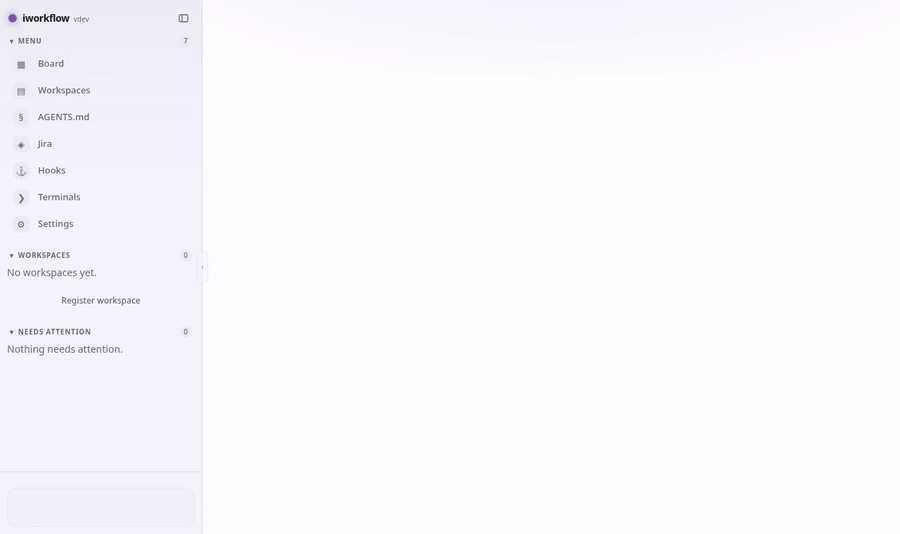

# Espacio de trabajo, tablero y ciclo de vida de la tarea

> 🇬🇧 [English version](../workspace.md) · [← README](../../README.es.md)

La interfaz es un espacio de trabajo estilo IDE: cada pantalla (tablero, tarea, diff, terminal, ajustes, ficheros…) se abre como **pestaña** dentro de grupos que puedes dividir arrastrando. Las pestañas se reordenan arrastrándolas dentro de su barra, se mueven a otro grupo o se sueltan en una división nueva.

- **Explorador de ficheros y editor** (con resaltado de sintaxis) sobre un workspace o sobre el worktree de una tarea. En el panel de la tarea: **Revisión → Explorar ficheros**.
- Los ficheros y carpetas modificados, añadidos, sin seguimiento, borrados o en conflicto se colorean según `git status`.
- Mientras editas, el margen izquierdo marca las líneas añadidas, modificadas y borradas respecto a `HEAD` (como en VS Code).
- Al **editar una tarea**, los límites de CPU y memoria están en *Opciones avanzadas*.
- **Proyectos relacionados:** las pantallas de crear y editar tarea listan los demás workspaces en *Proyectos relacionados*. La tarea conserva los que marques; al arrancar, su agente recibe sus rutas y la indicación de no modificarlas, puede leer sus ficheros y, si existen, consultar el codegraph de cada proyecto (`.codegraph/`) y su memoria engram (solo si `engram` está instalado). Claude además recibe las carpetas con `--add-dir`, y sus herramientas de edición (`Edit`, `Write`, `NotebookEdit`) tienen denegado escribir en ellas. Los comandos de shell no están aislados, así que no es una garantía absoluta. Al escribir `@` en el prompt se completan ficheros del proyecto actual y de los marcados, escritos como `@<proyecto>:<ruta>` (los espacios del nombre del proyecto pasan a guiones).

## Tablero por workspace

Cada workspace tiene su propio **tablero**: un lienzo de nodos de tarea unidos por flechas (`/board/<workspace>`; `/` abre el primer workspace por nombre). Al pulsar un workspace en la barra lateral se abre su tablero, y los chips de workspace de la parte superior del tablero permiten cambiar de uno a otro. El menú del elemento de la barra lateral conserva **Ver ficheros** (el árbol del proyecto), **Abrir terminal** y **Gestionar workspaces**.

- **Grafo de dependencias:** arrastra desde el puerto derecho de un nodo hasta otra tarea para que esta espere a la primera. Selecciona una flecha para borrarla. Las autorreferencias, los duplicados, los ciclos, las flechas entre workspaces y las flechas hacia una tarea que ya no está en *Por hacer* se rechazan con un mensaje.
- **Disparador al integrar:** una tarea con predecesoras arranca sola, sobre su rama base configurada, cuando **todas** están `merged`. Una tarea en *Por hacer* sin predecesoras se inicia a mano con **Iniciar**. Las flechas se dibujan atenuadas mientras la predecesora está pendiente, con una línea discontinua en movimiento mientras trabaja y en verde continuo cuando está integrada. (Las condiciones de arista todavía no están implementadas; el modelo deja sitio para ellas.)
- **Tareas anidadas y en paralelo:** *Añadir tarea siguiente* crea una tarea que depende de la seleccionada; *Añadir tarea en paralelo* crea una con las mismas predecesoras. Ambas se crean en *Por hacer*.
- **Lienzo:** arrastra el fondo para desplazarte, usa la rueda para hacer zoom y **Ajustar vista** para encuadrar todo. Las posiciones de los nodos se guardan; las tareas sin posición guardada se colocan automáticamente por capas.
- **Panel de tareas sueltas:** a la izquierda se listan las tareas sin flechas ni posición guardada (todas las creadas con *Nueva tarea* empiezan aquí) con sus acciones habituales (Iniciar, Editar, Borrar, Abrir, Integrar…), de modo que pueden ejecutarse por separado sin ninguna cadena. Arrastra una tarjeta al lienzo, o pulsa **Añadir al grafo**, para convertirla en nodo; las tareas creadas con *Añadir siguiente / en paralelo* van directamente al grafo. **Quitar del grafo** en un nodo borra todas sus flechas y su posición guardada (de forma atómica) y la devuelve a este panel; las sucesoras que se quedan sin predecesoras pasan a ser tareas sueltas normales. El panel se pliega y muestra su contador; en pantallas de menos de 768 px pasa a ser un selector **Sueltas (N) / Grafo**.

## Ciclo de vida de una tarea

<p align="center">
  
  <br />
  <sub>Una tarea de principio a fin: lanzar, seguir al agente en vivo, revisar el diff e integrar.</sub>
</p>

```text
starting → running ⇄ idle → finishing → awaiting_review → merged
                                              │               ↘ discarded
                                              ↓
              conflict · failed · interrupted ── Reanudar (gentle-shell --continue)
              rate_limited ── se reanuda sola cuando se renueva el límite de uso
```

| Situación | Qué hace la app |
|---|---|
| Conflicto al integrar | `merge --abort`; la tarea pasa a `conflict` y conserva el worktree. Reanuda el agente para resolverlo. |
| Rama base con cambios sin commitear | Rechaza el merge sin tocar nada. |
| Rama base sin checkout | Integra en un worktree temporal. |
| Reinicio del servidor | Las tareas activas pasan a `interrupted`; se pueden reanudar. |
| Límite de uso del proveedor alcanzado | La tarea pasa a `rate_limited` y se reanuda automáticamente cuando el límite se renueva (también puede reanudarse a mano). Consulta [Límites de uso](#límites-de-uso). |

## Límites de uso

<p align="center"></p>

La app muestra cuánto has consumido de tus límites de suscripción, para que sepas si un agente está a punto de verse limitado antes de lanzar más tareas.

- Una **barra de uso** muestra, por proveedor, la ventana móvil de cinco horas y la ventana semanal (siete días) con su porcentaje consumido y la hora de renovación. El color pasa a *aviso* desde el 70 % y a *crítico* desde el 90 %.
- **Claude** se lee de las credenciales OAuth que Claude Code guarda en tu máquina y del endpoint de uso de Anthropic; **Codex** (ChatGPT), de los límites de tasa que Codex escribe en sus ficheros de sesión, sin red. Cuando un proveedor falla, se muestra la última lectura correcta marcada como *desactualizada*; si no existe ninguna, indica que no está disponible.
- Cuando un agente alcanza el límite, la tarea pasa a `rate_limited` y iworkflow la reanuda sola cuando la ventana se renueva.
- Leer el uso de Claude es opcional y usa [`IWF_CLAUDE_CREDENTIALS`, `IWF_CLAUDE_USAGE_URL` e `IWF_CODEX_SESSIONS_DIR`](configuration.md#variables-de-entorno).

## Hooks de tareas

<p align="center"></p>

La pestaña **Hooks** (⚓) contiene una biblioteca de acciones que se ejecutan **antes o después de que una tarea arranque o termine**. Crea un hook una vez y asígnalo a los proyectos a los que se aplique.

- **Tipo:** un *script* (un programa o una línea de comandos completa, con argumentos, variables de entorno y directorio de trabajo opcionales) o un *agente* (un prompt que ejecuta una sesión de agente).
- **Eventos y momentos:** `task start` y `task finish`, cada uno *antes* (pre) o *después* (post). Cada asignación es un proyecto, un evento y un momento; los hooks de una misma asignación se ejecutan en el orden que fijas arrastrándolos.
- **En caso de fallo:** por asignación, *block* (aborta la acción), *warn* (informa y continúa) o *ignore*.
- **Plantillas:** los argumentos y los prompts de agente pueden usar campos de la ejecución, como `{{.Branch}}`, `{{.TaskTitle}}`, `{{.WorktreePath}}` o `{{.WorkspacePath}}`; un campo desconocido es un error, nunca un valor vacío.
- **Prueba e historial:** *Probar* ejecuta un hook una vez en el directorio del proyecto sin registrar nada; la pestaña de historial lista cada ejecución con su resultado. Cada hook tiene un tiempo máximo para que uno bloqueado no retenga una tarea para siempre.
- El detalle de la tarea muestra los hooks que se ejecutaron para esa tarea.
