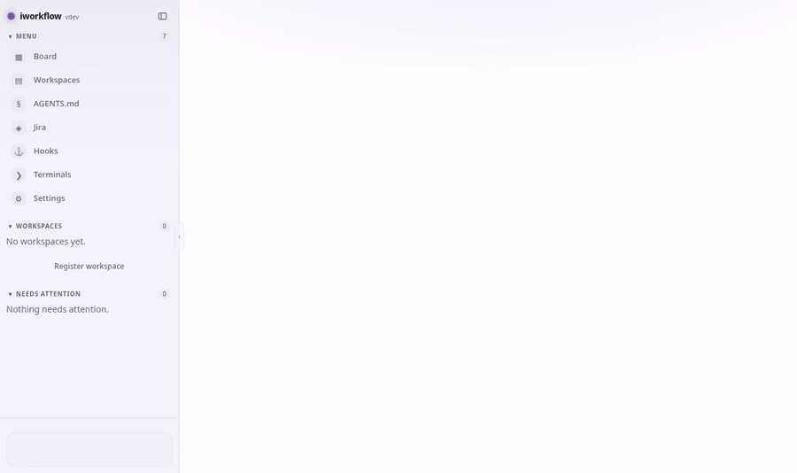

# Workspace, board and task lifecycle

> 🇪🇸 [Versión en castellano](es/workspace.md) · [← README](../README.md)

The interface is an IDE-like workspace: every screen (board, task, diff, terminal, settings, files…) opens as a **tab** inside groups you can split by dragging. Tabs can be reordered by dragging them within their bar, moved to another group or dropped into a new split.

- **File explorer and editor** (with syntax highlighting) over a workspace or over a task's worktree. In the task panel: **Review → Explore files**.
- Modified, added, untracked, deleted or conflicted files and folders are colored according to `git status`.
- While you edit, the left gutter marks added, modified and deleted lines against `HEAD` (as in VS Code).
- When **editing a task**, the CPU and memory limits live under *Advanced options*.
- **Related projects:** the create and edit task screens list the other workspaces under *Related projects*. A task keeps the ones you tick; when its agent starts it is told their paths and not to modify them, may read their files, and, when present, query each project's codegraph (`.codegraph/`) and its engram memory (only if `engram` is installed). Claude also gets the folders through `--add-dir`, and its edit tools (`Edit`, `Write`, `NotebookEdit`) are denied inside them. Shell commands are not sandboxed, so this is not a hard guarantee. Typing `@` in the prompt completes files of the current project and of the ticked ones, written as `@<project>:<path>` (spaces in the project name become dashes).

## Workspace board

Each workspace has its own **board**: a canvas of task nodes joined by arrows (`/board/<workspace>`; `/` opens the first workspace by name). Clicking a workspace in the sidebar opens its board, and the workspace chips at the top of the board switch between workspaces. The sidebar item menu keeps **View files** (the project tree), **Open terminal** and **Manage workspaces**.

- **Dependency graph:** drag from a node's right port onto another task to make it wait for the first one. Select an arrow to delete it. Self-references, duplicates, cycles, arrows across workspaces and arrows into a task that is no longer in *To do* are rejected with a message.
- **Merge trigger:** a task with predecessors starts on its own, on its configured base branch, once **all** of them are `merged`. A *To do* task without predecessors is started manually with **Start**. Arrows are drawn muted while the predecessor is pending, with a flowing dashed line while it works, and solid green once it is merged. (Edge conditions are not implemented yet; the model leaves room for them.)
- **Nested and parallel tasks:** *Add next task* creates a task that depends on the selected one; *Add parallel task* creates one with the same predecessors. Both are created in *To do*.
- **Canvas:** drag the background to pan, use the wheel to zoom and **Fit view** to frame everything. Node positions are saved; tasks without a saved position are laid out automatically in layers.
- **Loose tasks panel:** on the left, tasks with no arrows and no saved position (every task made with *New task* starts here) are listed with their usual actions (Start, Edit, Delete, Open, Merge…), so they can run standalone without any chain. Drag a card onto the canvas, or press **Add to graph**, to make it a node; *Add next / parallel task* tasks go straight into the graph. **Remove from graph** on a node deletes all its arrows and saved position (atomically) and sends it back to this panel; successors left without predecessors become ordinary standalone tasks. The panel is collapsible and counts its tasks; on screens under 768 px it becomes a **Loose (N) / Graph** tab switch.

## Task lifecycle

<p align="center">
  
  <br />
  <sub>One task end to end: launch, follow the agent live, review the diff, merge.</sub>
</p>

```text
starting → running ⇄ idle → finishing → awaiting_review → merged
                                              │               ↘ discarded
                                              ↓
              conflict · failed · interrupted ── Resume (gentle-shell --continue)
              rate_limited ── resumes by itself when the usage limit renews
```

| Situation | What the app does |
|---|---|
| Conflict while integrating | `merge --abort`; the task moves to `conflict` and keeps its worktree. Resume the agent to resolve it. |
| Base branch with uncommitted changes | Rejects the merge without touching anything. |
| Base branch not checked out | Integrates in a temporary worktree. |
| Server restart | Active tasks move to `interrupted`; they can be resumed. |
| Provider usage limit reached | The task moves to `rate_limited` and is resumed automatically once the limit renews (it can also be resumed by hand). See [Usage limits](#usage-limits). |

## Usage limits

<p align="center">
  
</p>

The app shows how much of your subscription limits you have consumed, so you know whether an agent is about to be throttled before launching more tasks.

- A **usage bar** shows, per provider, the rolling five-hour window and the weekly (seven-day) window with their consumed percentage and renewal time. The color changes to *warn* from 70 % and *critical* from 90 %.
- **Claude** is read from the OAuth credentials Claude Code stores on your machine and the Anthropic usage endpoint; **Codex** (ChatGPT) from the rate limits Codex writes into its session files, with no network. When a provider fails, the last good reading is shown marked as *stale*; when none exists it says it is unavailable.
- When an agent hits the limit the task becomes `rate_limited` and iworkflow resumes it by itself when the window renews.
- Reading Claude usage is optional and uses [`IWF_CLAUDE_CREDENTIALS`, `IWF_CLAUDE_USAGE_URL` and `IWF_CODEX_SESSIONS_DIR`](configuration.md#environment-variables).

## Task hooks

<p align="center">
  
</p>

The **Hooks** tab (⚓) holds a library of actions that run **before or after a task starts or finishes**. Create a hook once and assign it to the projects it applies to.

- **Kind:** a *script* (a program or a full command line, with optional arguments, environment variables and working directory) or an *agent* (a prompt run by an agent session).
- **Events and moments:** `task start` and `task finish`, each *before* (pre) or *after* (post). Every assignment is a project, an event and a moment, and the hooks of one of them run in the order you set by dragging.
- **On failure:** per assignment, *block* (abort the action), *warn* (report and continue) or *ignore*.
- **Templates:** arguments and agent prompts can use fields of the run such as `{{.Branch}}`, `{{.TaskTitle}}`, `{{.WorktreePath}}` or `{{.WorkspacePath}}`; an unknown field is an error, never an empty value.
- **Test and history:** *Test* runs a hook once in the project directory without recording anything; the history tab lists every run with its result. Each hook has a timeout so a stuck one cannot hold a task forever.
- The task detail shows the hooks that ran for that task.
